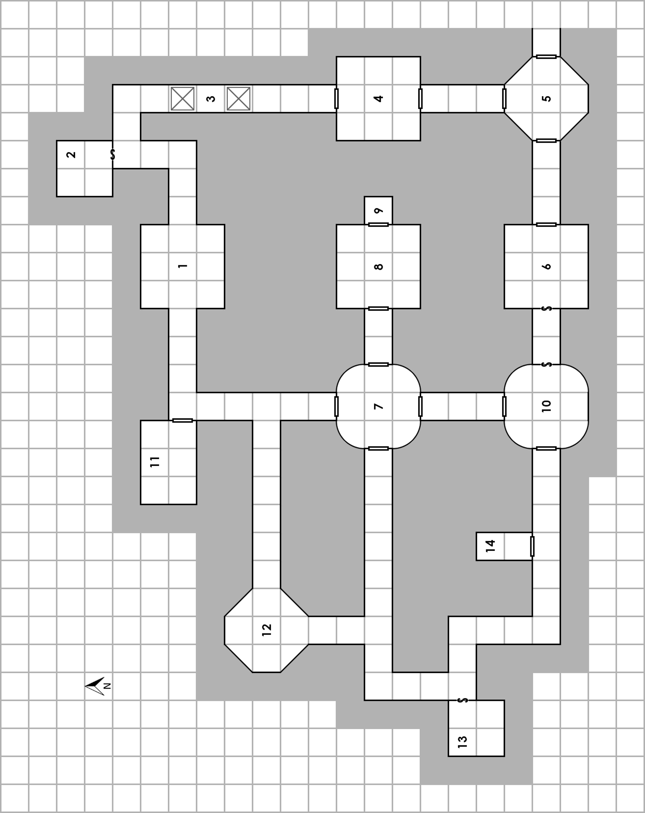

# Beneath Brymassen

**A Collaborative Dungeon**  
An adventure for 3 to 6 beginning player characters

::: {.callout-note title="For the Game Master"}
This chapter contains adventure secrets. Choose the dungeon crawl or rescue mission version before play; use the corresponding opening and version of room 14. Blockquoted passages can be read aloud or paraphrased. Room numbers match the [dungeon map](#dungeon-map).
:::

## Background

This dungeon can be used in two different ways: As a “standard” dungeon, to be cleared and looted at the party's leisure, or as a rescue mission. Room 14 of this dungeon is presented in two ways, one identified as “storyline” representing the rescue mission, and the other marked “non-storyline” for the traditional dungeon crawl version.

### Dungeon Crawl Background

If you wish to run the traditional dungeon crawl version of this adventure, you should read (or paraphrase) the following to the party:

> You found your way to the only tavern in the little rural town of Brymassen, and settled in for an evening of washing away the dust of the road with cheap beer. As you all sat at a table drinking your first mug of beer, a man came rushing in; he stood in the doorway for a moment, peering into the gloomy tavern, before he caught sight of you.

> He came straight to your table, walking boldly as if he owned the place; two other men come into the tavern behind him, and follow him to your table. “You are the adventurers, recently come to town? Greetings! I am Forsythe, Mayor of Brymassen, and I have a business proposition for you. It seems some humanoid monsters, goblins perhaps, have dug a hole into the basement beneath the local mill, and the little monsters have been raiding the mill and surrounding houses, stealing everything not nailed down. If you would be willing to enter their lair and slay them, we would be able to pay you five gold pieces for each goblin or similar smaller monster, and ten for each larger creature. Of course, you'd have to bring back proof; we're willing to accept the right ear of each slain creature for this purpose. What say you?”

The mission is exactly as described. The GM may wish to place a church or temple with a mid-level Cleric in the town, willing to provide a few cure light wounds spells per day in return for a small donation, perhaps 20 gp per spell.

### Rescue Mission Background

If you wish to run the rescue mission version of this adventure, you should read (or paraphrase) the following to the party:

> You found your way to the only tavern in the little rural town of Brymassen, and settled in for an evening of washing away the dust of the road with cheap beer. As you all sat at a table drinking your first mug of beer, a man came rushing in; he stood in the doorway for a moment, peering into the gloomy tavern, before he caught sight of you.

> He came straight to your table, almost running. “You are the adventurers, recently come to town? Please, sirs, you must help me. My children have been taken, dragged away into a hole in the wall of my cellar by hideous monsters, goblins perhaps. Please, please, come and see!”

Assuming they choose to come with him, the man leads them to his leather-working shop; his family lives in a small apartment in the back of the building, but he will lead the adventurers to the cellar entrance behind the shop. His wife will meet the party there, and she will also beg them to rescue her children. They don't have much money, but they'll give all they have (a total of 45 gp) in return for the party's help.

The cellar is a circular room perhaps 10' in diameter; a 3' wide hole, looking rather like a large mouse hole, is visible in the back of the cellar, and small humanoid footprints (from some creature having feet with blunt claws) are visible in the dirt floor of the cellar.

## Dungeon Key

### 1. Entrance Room {#room-1}

> The tunnel you have been crawling through opens into a room about four feet from the floor. The room is 30' by 30' with openings to the east and west near the center of the walls.

If the PC's check for traps or otherwise exercise caution before exiting the tunnel they will notice a differently colored stone set into the floor near the tunnel exit. If this is not detected, each character exiting the tunnel has a chance equal to 1-2 on 1d6 of triggering a spear trap in the ceiling (which fires straight down). If triggered, the character who set it off must make a save vs. Death Ray or be hit for 1d6 points of damage.

### 2. Hidden Shrine {#room-2}

The secret door to this room has a cleverly designed lock, hidden behind a swiveling nub of rock. The key is on the corpse in the southernmost pit in area 3, below; otherwise, it could be picked normally.

> The secret door opens to a brightly lit room that was turned into a makeshift shrine. The cold stone walls are decorated with chalk symbols and a makeshift altar made from a large wooden crate covered in a moldering white cloth holds a simple golden chalice. On the far side of the room, there is a figure mostly obscured by the altar.

The room was blessed as a sanctuary by a long-dead adventuring Cleric. The Cleric's body is behind the crate in a kneeling position, facing the altar, still clutching her holy symbol. She is nothing more than barely held together skin and bones. Her gear is long gone, except for her holy symbol (a silver starburst worth 20 gp) and the tattered remains of her robes.

The room itself will detect as magical and is under the effect of a permanent protection from evil spell (as a 6th level caster). The golden chalice (worth 100 gp) radiates a soft golden light that fills the room. If holy water is poured into it and then consumed, it will provide the imbiber with a cure light wounds spell; this effect works at most twice a day. The chalice will not function outside of the room.

### 3. The Pits {#room-3}

> As you round the corner, you smell the strong odor of death. Ahead you see an open pit. A very narrow ledge leads around it on both sides.

There are two pits in this section of hallway. The one to the north is the open pit described above. It is 10' deep, and thus does 1d6 damage to anyone falling into it. Any character attempting to cross on a ledge must roll a Dexterity ability roll to avoid falling in.

The southern pit is covered by a very well hidden trap door that will open if 100 or more pounds of weight are placed on it (such as a character walking on it). It will spring closed in a single round after opening. Anyone falling into this 10' spiked pit takes 1d6 points of damage for the fall plus 1d4 points of damage from the spikes; a saving throw vs. Death Ray may be rolled to avoid the spikes. In the bottom of the pit is the corpse of an adventurer, dead about three weeks. On his body is 3 gp, a short sword, a key (to area 2), and a Potion of Healing.

### 4. Centipede Room {#room-4}

As the party approaches this room, read the following:

> You smell a terrible stench, like a midden or a rotting garbage heap.

Both doors into this room are stuck, and both are rotted through at the bottom. If opened, read the following:

> This room is about knee-deep in sludge and rotting debris, but otherwise apparently empty.

The room can be crossed in perfect safety by simply wading through. However, a character poking around with a 10 ft pole, spear or whatever has a 1 in 6 chance per round of disturbing a nest of immature giant centipedes. If this happens, 1d20+20 immature giant centipedes will emerge. Owing to their blinding speed, they can move up to 10 ft before the player characters can react, and will climb up poles or spear-shafts onto the probing character if at all possible.

Any centipede that survives the first round of combat may crawl beneath the player character's armor, if the character is wearing any. If this is done, the centipede gains the character's armor class, and may not be attacked without harming the character until his or her armor is removed. Meanwhile the wearing character becomes AC 11 to the invading centipede, ignoring any Dexterity bonus.

Optional Rule: Any elven character with a baby giant centipede crawling beneath his or her armor must make a save vs. Death Ray with Wisdom bonus applied or start to panic. If the character panics, he or she may take no action except standing still, shouting, screaming, sobbing, or begging comrades for help.

| Statistic | Immature Giant Centipede |
|---|---|
| AC | 11 |
| HD | 1 HP |
| #At | 1 bite |
| Dam | Poison (save at +5) |
| Mv | 40' |
| Sv | NM |
| Ml | 7 |
| XP | 10 ea. |
| Number encountered | 1d20+20 |
| HP | 1 each |

### 5. Octagonal Room {#room-5}

> The oddly shaped room has doors in the north, west and east walls. The floors are littered with the dung and detritus of various creatures passing through this room. There is a slight breeze coming from the east door; the air seems slightly fresher here.

If the party opens the east door they will find a hallway heading east that narrows down into a roughly-hewn natural passageway. If the passageway is followed it will eventually lead into a well hidden small cavern open to the outside world.

### 6. Battle Axe Trap {#room-6}

The door to this room is not locked. When it is opened, a large axe will swing down from over the door, striking as a monster with a +3 AB and doing 1d8 damage if a hit is scored. The door opens into the room, forcing the character who opens the door to walk into the axe's path. Of course, a very careful character might be able to discover a way to avoid the axe.

The room is laid out like a bedroom, with a bed, side table, four chairs and a table with a deck of cards on it, spread out as if four players had just laid their cards down and walked away. The back wall is covered with tapestries. Also on the card table are a pair of bowls made of a rust-colored metal; 20 gold pieces are in one of the bowls, and each bowl is worth 2 sp each.

### 7. Empty {#room-7}

> This room appears to be empty. The floor is broken and cracked, with chunks missing, although none of the holes are more than a finger length deep. What appears to be the faint outline of a door is on the wall between the north and west door. The east door has a sign on it hanging askew that reads in neat common letters "STORAGE" under which is scrawled "Not any moor" (in Common, crudely in yellow paint and misspelled). Scrawled on the north door is "My wife is a cow, but her melk

> is clabberd." On the west door in the same yellow hand writing is "Push butten to opin." and a small yellow dot under it. The south door is tagged with "Hear be trolls and gnolls."

This room is indeed empty and has no other features. A close inspection reveals that the outline of the door between the north and west wall was scratched there by someone with a knife or other instrument – there is no "secret door". Pushing the small yellow dot on the west door does nothing.

### 8. Kobolds on the Run {#room-8}

Listening to this door will reveal a lot of quick, whining speech coming from multiple voices.

> Upon opening the door, you see six dog-faced reptilian humanoids sitting around a small fire in a circle discussing something.

Anyone who understands kobold can determine they are hiding from the big boss of their tribe after stealing the tribal treasure, and are arguing over where to go next.

When the party has a chance to look around the room, they see the following:

> The room itself features well-crafted busts on pedestals (four against the north wall and four against the south) of old and venerable visages, a few of which can be recognized as more famous members of local clergy or government. There are ragged tapestries on each wall, but they are quiet ancient and rotten.

The tapestries show some of the past history of the local region.

The kobolds are not wearing armor but five have clubs and one has a dagger; and three have slings with a pouch of stones. They are hiding out after having stolen what they believe was the tribal treasure but is only part of it. On the floor behind them are two bags, each tied to a four foot long pole for carrying between two people: one holds 1,000 sp (in one) and 400 cp (in the other). Each has and additional 3d8 cp and 3d6 sp on their person.

The busts are plaster with thick layers of paint, which itself is darkened and old. Their value is roughly 5 gold pieces each. They are just one of hundreds that were molded and painted cheaply to celebrate a founding father's day – any long time resident of the area will likely identify them instantly.

| Statistic | 6 Kobolds |
|---|---|
| AC | 11 |
| HD | 1d4 HP |
| #At | 1 weapon |
| Dam | 1d4 or by weapon |
| Mv | 30' |
| Sv | NM |
| Ml | 6 |
| XP | 10 ea. |
| HP | 4, 2, 3, 1, 3, 2 |

### 9. Storeroom {#room-9}

The lock on the heavy wooden door leading to this room is visibly broken; only a few twisted, rusting pieces of iron remain. The door swings open easily. The place was once a storeroom but most of its contents have long since been looted. Now it contains a small patch of Green Slime on the ceiling.

> Peering through the doorway, you see an unlit room, about 10' square, that is mostly empty. The remains of some broken barrels and crates lie scattered along the walls and in the corners.

Read if the PCs are using a torch, lantern, or other light source:

> You see a faint glinting, a reflection of the light you're carrying, apparently from some small objects lying in the middle of the room.

Upon closer inspection these prove to be the badly corroded buttons and buckles from the clothing and gear of the last victim of the Green Slime that clings to the ceiling. It has been a while since the Green Slime has eaten. It occupies a 5' x 5' area in the center of the ceiling and is easily visible to anyone who looks upward with a good light source or Darkvision. The creature will detect and attack the first character venturing into the center of the room (for instance, to examine or retrieve the metal objects on the floor). It will also attack any pole or similar object that is used to test the floor.

| Statistic | Green Slime |
|---|---|
| AC | can always be hit |
| HD | 2\*\* |
| #At | 1 |
| Dam | turns victim to slime in 6+1d4 rounds |
| Mv | 1' |
| Sv | F2 |
| Ml | 12 |
| XP | 125 |
| HP | 5 |

### 10. Catacomb {#room-10}

> The walls of this room are lined with small shelves. Each shelf is piled high with bones, and with shards and splinters and fragments of bone-as far as you can tell, mostly human. The ceiling is decorated with a stucco mural that appears to be of a religious nature. Judging by the steatopygous muliebrity of the deity depicted, perhaps she is some long-forgotten goddess of fertility and death.

There are literally thousands of bones on the shelves. A thorough search has a 1% chance per round of dislodging something from among the bones, determined randomly on the following table (roll 1d6):

1. Tucked into a hollowed-out femur, a Scepter of Healing. This scepter resembles a wand with a thickened end, and may be used only by a Cleric. When the Cleric touches someone with the wand, he or she will be healed for 1d12-1 HP. If a natural "1" is rolled (i.e. the roll totals "0") then the enchantment of the scepter has been exhausted and it will permanently cease to function.

2. Glued to the inside of a skull, a garnet worth 200 gp.

3. Wrapped around a child's ulna, a Scroll of Magic-User Spells with a single spell: invisibility.

4. The searcher dislodges a tiny but extremely poisonous spider from a bone fragment, which will bite. The searcher must roll an immediate saving throw vs. Poison or die.

5. The searcher cuts him- or herself on a fragment of bone. He or she must roll a saving throw vs. Poison (adjusted for Constitution) or contract a blood-borne wasting disease; while diseased, the character loses 1d4 points each of Strength, Dexterity, Constitution, Charisma and Hit Points. Provided the character does not die from this, he or she will recover naturally in 2d6 days, regaining the ability scores and hit points lost.

6. The searcher disturbs a bone formerly belonging to the high priest of the death-goddess. He or she is immediately cursed. Until the curse is removed, that character will be unable to refuse any request made of them (no matter how foolish or unreasonable) in a language they can understand. Note that orders and instructions are not requests; the benchmark word for something to be a request is "please." The cursed character may not delay or procrastinate in fulfilling the request. A remove curse spell is the only way to lift this curse.

### 11. Hobgoblin's Room {#room-11}

> This 20'x30' room is carved from greenish stone and layered with carpets and tapestries, and all manner of decorated pillows lay strewn about. A large, grizzled and apparently ancient Hobgoblin is seating among the pillows reading a large tome.

| Statistic | Grizzled Hobgoblin |
|---|---|
| AC | 16 |
| HD | 2\* |
| #At | 1 pillow filled with gravel |
| Dam | 1d6+2 |
| Mv | 4' |
| Sv | F2 |
| Ml | 9 |
| XP | 100 |
| HP | 13 |

The hobgoblin wears a Medallion of ESP and has put it to good use over the years. The denizens of the dungeon routinely seek him out for information, and in return they provide him with food and luxuries. He will attempt to barter with the PCs, offering information that they may seek by using his medallion. Since he genuinely knows little about the PCs or much else beyond these halls, he will usually lie but offer enough hints at treasure and magic to be interesting. He knows some information about this dungeon, and will trade it for gold coins (GM's discretion).

He will not be hostile unless outright attacked. The large tome is a cookbook (value 2 gp). The tapestries, carpets and pillows are worth 75 gp but are very bulky, dirty, and difficult to move. A purse containing 20 gp lies in a pouch under a pillow the hobgoblin is laying on.

### 12. Room of Glowing Skulls {#room-12}

> As you enter this octagonal room you are struck by an odd sight. Each wall has a small niche in it, and in each of them is a glowing skull. Over by the north wall there are five humanoid creatures doing their best to pry out one of the skulls.

The five humanoids are orcs; if the player characters are familiar with them, the GM may choose to call them by name. They are busy trying to get the skull out of the wall and won't hear the party entering unless they make significant noise within 30' of the room. If the party is reasonably quiet, the orcs are surprised on a roll of 1-4 on a d6; otherwise, roll surprise as usual.

The skulls are cemented into the walls. If a player character tries to remove any of the skulls by brute force, there is 90% chance the skull will be destroyed. If a Thief attempts it, the usual chance to Pick Locks is applied; failure results in a 50% chance of the skull being destroyed. Each skull generates illumination as if affected by a light spell. This effect is permanent.

| Statistic | 5 Orcs |
|---|---|
| AC | 14 |
| HD | 1 |
| #At | 1 weapon |
| Dam | 1d8 or by weapon |
| Mv | 40' |
| Sv | F1 |
| Ml | 8 |
| XP | 25 ea. |
| HP | 8, 8, 5, 5, 6 |

### 13. Sarcophagus Room {#room-13}

> The secret door opens to reveal a twenty foot square room. A large stone sarcophagus rests in the center of the room. A skeleton stands in each corner of the room, each one gripping an ancient spear, but all remain motionless.

The skeletons only move and attack if they themselves are attacked or the sarcophagus is touched.

The outside of the sarcophagus is covered with carved images a man in robes casting spells at an array of foes. A search of the sarcophagus reveals no traps, and the lid slides easily off. Once opened a magic mouth spell activates and says:

> Many baubles did I plunder from the dead, now it is my turn to give up my baubles to the living, may they serve you as they have served me.

A single skeleton lies in the sarcophagus, dressed in the tattered remains of a once fine robe. It wears a jeweled ring on its right hand, and a plain silver ring on its left hand. If tested, both rings detect as magical; the jeweled ring is a Ring of Protection +1 and the silver band is a Ring of Fire Resistance.

| Statistic | 4 Skeletons |
|---|---|
| AC | 13 |
| HD | 1 |
| #At | 1 |
| Dam | 1d6 or by weapon |
| Mv | 40' |
| Sv | F1 |
| Ml | 12 |
| XP | 25 ea. |
| HP | 4, 5, 4, 7 |

### 14. The Jail Cell — Rescue Mission {#room-14-rescue}

::: {.callout-note title="Alternative version of room 14"}
Use this version for the rescue mission; use the [other version](#room-14-crawl) instead for the other adventure mode. This selection note is an addition to the web edition.
:::

> A huge wooden cage hangs suspended from the ceiling in this smoky room. Four small children can be seen huddled together inside of it; five dog-faced reptilian humanoids stand around poking at them with various weapons and laughing. A larger creature of the same species is seated next to a cooking fire near the north wall.

The children in the cages are the ones stolen from the town, and the kobolds in this room, and their compatriots in Room 8 are the kidnappers. The large kobold in the back is the kobold chieftain, who is rather grumpy about the loss of some items recently stolen from him by members of his own tribe.

If the party has members that speak kobold and can hear the conversation in the room before entering, they will hear talk from the kobolds trying to decide whether to ransom the children back to the town or sell them to orc slavers who are due to be stopping by soon (the orcs in Room 12 are the ones they are speaking of).

Since the theft of some of their treasure the kobolds will be less than enthusiastic about surrendering the children, especially while the chieftain is still alive.

The cage is suspended by a rope that is tied off to a ring on the east wall. It will probably take two characters to successfully lower it to the ground to free the children.

If the chieftain is searched the party will find a large leather pouch containing 220 sp and 30 gp hanging from his belt.

| Statistic | 5 Kobolds |
|---|---|
| AC | 13 |
| HD | 1d4 HP |
| #At | 1 weapon |
| Dam | 1d6 (shortsword) |
| Mv | 20' |
| Sv | NM |
| Ml | 8 |
| XP | 10 ea. |
| HP | 3, 2, 3, 2, 1 |

| Statistic | Kobold Chieftain |
|---|---|
| AC | 14 |
| HD | 2 |
| #At | 1 shortsword |
| Dam | 1d6+1 |
| Mv | 20' |
| Sv | F2 |
| Ml | 8 |
| XP | 75 |
| HP | 8 |

### 14. The Bird Cage — Dungeon Crawl {#room-14-crawl}

::: {.callout-note title="Alternative version of room 14"}
Use this version for the dungeon crawl; use the [other version](#room-14-rescue) instead for the other adventure mode. This selection note is an addition to the web edition.
:::

> A huge iron cage lies on its side in this room, the door knocked open. Underneath it lies the obviously dead body of a goblin, crushed by the cage. A chain can be seen hanging freely and the flapping of wings can be heard coming from the ceiling.

The cage at one time held the stirges now flying around the room. The poor dead goblin somehow managed to be under the cage when it was freed from the chain and died as a result. If the goblin is searched the party will find a pouch containing 220 sp and 30 gp.

| Statistic | 7 Stirges |
|---|---|
| AC | 13 |
| HD | 1\* |
| #At | 1 bite |
| Dam | 1d4 + 1d4/round blood drain |
| Mv | 10'; Fly 60' |
| Sv | F1 |
| Ml | 9 |
| XP | 37 ea. |
| HP | 2, 4, 8, 2, 5, 5, 8 |

## Dungeon Map

<figure class="figure">

<figcaption class="figure-caption">Original dungeon map, displayed north-up. The room dimensions in the text imply a grid of 10 feet per square (3 meters in the Hebrew edition).</figcaption>
</figure>

## Source and License

*Beneath Brymassen*, a collaborative dungeon, in *Adventure Anthology One*, first edition, release 21, printed pages 18–24 (PDF pages 20–26).

Copyright © 2008–2012 Eldrad Wolfsbane, Mak, The Expert, skisko, Thomas Kolter, Maliki, Jim Bobb, Stuart Marshall, hjmartin70, J. D. Neal, David Gerard, and Chris Gonnerman.

This web edition preserves both adventure modes and room numbering, organizes statistics into tables, replaces printed hit-point boxes with numeric lists, and adds clearly labeled mode-selection notes. The hobgoblin's unusual movement rate of 4 feet is retained as printed. The Hebrew translation converts distances at 10 feet = 3 meters, rounds the 100-pound trap threshold to approximately 45 kg, and adapts the deliberately misspelled graffiti in room 7 into Hebrew. The map is displayed north-up using page layout; the source image is unchanged.

The adventure text and its Hebrew translation are identified as Open Game Content under OGL v1.0a, separately from the site's CC-BY-SA license. The map is reproduced from the source; the source excludes artwork from Open Game Content and retains its copyright holders' rights. The anthology's general map credits name J. D. Neal, Dennis Bamberger, and the authors; it does not give a separate credit for this map.

::: {.callout-note collapse="true" title="Original source notice and complete license"}

:::
