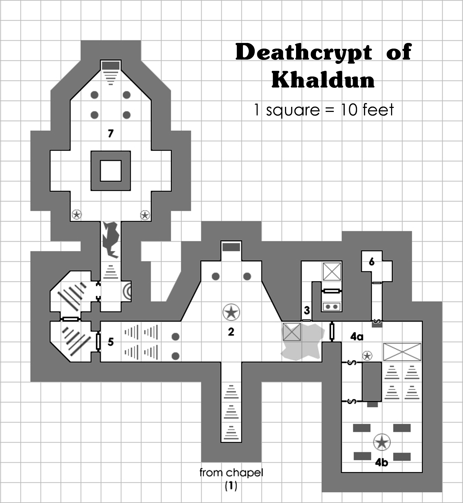

# Deathcrypt of Khaldun

By **Scott A. Murray**  
An adventure for 4 to 6 characters of about 6th level

::: {.callout-note title="For the Game Master"}
This chapter contains adventure secrets. Blockquoted passages can be read aloud or paraphrased. Area numbers match the [crypt map](#crypt-map). The final encounter has three stages: Khaldun and his skeletons, an armored minotaur skeleton when Khaldun weakens, and an armored dragon skeleton upon his death.

Review monster descriptions for energy drain, mummy rot, weapon defenses, and incorporeal creatures before play. The anthology also refers to the Basic Fantasy Field Guide for monsters not in the core rules; the statistics and abilities supplied in the adventure itself are preserved here. This preparation note is an addition to the web edition.
:::

## Background

A century ago, adventurers working for a sorcerer known as Khaldun unearthed a strange tome bound in the flesh of a medusa. Only one member of the troupe survived the return trip, the rest falling ill with an inexplicable disease that twisted the mind. Upon receiving the book, Khaldun sequestered himself in his underground study and dismissed his guards and hirelings, not emerging for five weeks.

When he finally surfaced, Khaldun ravaged the region with pestilent magic. Hundreds fell to disease during the first night, and those that were not burned rose again as undead horrors at the bidding of Khaldun. Resolved to put an end to the terror, the bravest warriors of the territory drove Khaldun into the wilderness, where he died in the bitter cold of winter.

However, it was not to be his end. Before his passing, he instructed his followers to not only build him a crypt, but to also seal themselves in the tomb as well, where they would die of starvation and rise again as maddened undead guardians. At his death, Khaldun swore to take his revenge on the descendants of those who exiled him. Now, on the eve of the 100th anniversary of his banishment, you, the descendants of those mighty defenders, stand ready to put an end to Khaldun's curse as he stirs from his slumber…

## Adapting the Module

While this module is intended to be run as a standalone adventure, it can easily be integrated into an existing Basic Fantasy RPG campaign. Perhaps the deathcrypt is hidden within a larger dungeon complex, rather than beneath a chapel. The background provided for the module might also be discarded, with the GM casting Khaldun as “merely” a powerful lich or mummy.

## Dungeon Key

### 1. The Chapel {#room-1}

> Patches of loose snow and ice cover the broken stone floor of this small chapel. The dull orange flames of burning braziers cast deep shadows along the frost-bitten walls. A frozen fountain sits against the west wall, and a spiral stairwell descends into gloom. An icy wind howls through the evergreens outside and whips through the opening of the chapel.

The chapel is the characters’ last chance to make preparations before descending into the crypt. The stairwell descends to area 2.

### 2. False Crypt {#room-2}

When the characters reach the bottom of the stairs, read:

> Dusty bones litter the floor of this wide, cobweb-choked tomb. A crumbling sarcophagus lies beyond an imposing demonic fountain that regurgitates black liquid. The whisper of the fetid water breaks the eerie stillness of the chamber. A pair of ornate pillars to the west supports a high vaulted ceiling above, while another pair of pillars lies broken to the east.

This chamber is in fact a false crypt designed to lure adventurers to their death. A throng of zombies and skeletons rise from the floor when any adventurer moves within 15 feet of the sarcophagus, each attacking the nearest target until destroyed.

| Statistic | 6 Skeletons |
|---|---|
| AC | 13 |
| HD | 1 |
| #At | 1 sickle |
| Dam | 1d6 or by weapon |
| Mv | 40' |
| Sv | F1 |
| Ml | 12 |
| XP | 25 ea. |
| HP | 1, 3, 3, 4, 4, 6 |

| Statistic | 5 Zombies |
|---|---|
| AC | 12 |
| HD | 2 |
| #At | 1 |
| Dam | 1d8 or by weapon |
| Mv | 20' |
| Sv | F2 |
| Ml | 12 |
| XP | 75 ea. |
| HP | 3, 5, 5, 6, 9 |

The collapsed pillars to the east have formed a pile of rubble 20 feet in diameter (movement rates halved while crossing). If any creature moves into the 10’x10’ trapped area shown on the map, a portion of the ceiling collapses. Characters in the affected zone must make a save vs. Death Ray or take 2d6 points of damage and be knocked down. Monsters in the trapped area are instantly destroyed. This trap only activates once per adventure.

A character may choose search the debris. The GM should secretly roll a 1d6, adding 1 to the result if any of the searching characters’ Intelligence scores is greater than 15:

| Roll | Result |
|:---:|---|
| 1 | Collapsing ceiling trap (as above, may activate even if already triggered) |
| 2–3 | Nothing |
| 4–5 | Equipment (a flask of holy water and a lantern) |
| 6–7 | Sack containing 1,600 cp, 800 ep, and 2 greenstones (value 75 gp each) |

Characters moving toward the pillars to the west notice the stairs are partially blocked by enormous spider webs. While the webs can be passed through with a few minutes of effort, disturbing them awakens a mated pair of giant black widow spiders. They attack any creature that tries to pass through the web, but will not pursue retreating enemies.

| Statistic | 2 Giant Black Widow Spiders |
|---|---|
| AC | 14 |
| HD | 3\* |
| #At | 1 bite |
| Dam | 2d6 + poison |
| Mv | 20'; Web 40' |
| Sv | F3 |
| Ml | 8 |
| XP | 175 ea. |
| HP | 13, 15 |

The water in the fountain is murky and tastes foul, but is not harmful. A character searching in the fountain will find a cracked ceramic bowl that holds about a quart of water.

The sarcophagus is empty.

### 3. Shrine {#room-3}

A narrow flight of cracked stone steps descends into darkness.

The stairs lead to a small corridor that contains a hidden pit trap (see map). Any character that steps onto the pit must make a save vs. Death Ray or fall 60 feet, taking 6d6 points of damage. Once the pit trap is triggered, or if it is found, a character may leap across with a successful Dexterity check.

The door beyond the pit is carved from polished bone. When it is opened, read:

> A bloodied altar sits amid a gloomy, cramped charnel house. Beetles scuttle across the stone floor, and a chilly draft filters in from some unseen corner. Racks of bleached bones line the walls. A wax idol carved into the shape of a black dragon stands perched atop the altar. The idol seems to radiate strange whispers, whose melodies suggest a hymn.

The black dragon idol is cursed. When a character manipulates the idol in any way, the GM should secretly roll 1d6, adding 1 if the character has a 15 or higher Wisdom:

| Roll | Effect |
|:---:|---|
| 1–3 | Curse (couplet of ruin, save vs. Magic Wands or take 4d8 points of damage and lose 1 held or worn magic item, if any) |
| 4–7 | Nothing |

Casting a detect evil spell will show the idol as emanating evil but nothing more. A Cleric of 4th level or greater can identify the idol as being cursed with a successful ability roll check at a -4 penalty (adding Wisdom bonus to roll). Casting remove curse on the idol negates the couplet of ruin curse and no roll is needed before manipulating it.

If the idol is searched, an iron skeleton key and a small scarab amulet (a Scarab of Protection, with 5 charges) are hidden inside.

If the couplet of ruin is triggered, a pair of wraiths emerges from thin cracks in the walls after 1d6 rounds, pursuing the characters until destroyed.

| Statistic | 2 Wraiths |
|---|---|
| AC | 15 ‡ |
| HD | 4\*\* |
| #At | 1 touch |
| Dam | 1d6 + energy drain (1 level) |
| Mv | Fly 80' |
| Sv | F4 |
| Ml | 12 |
| XP | 320 ea. |
| HP | 16, 20 |

### 4a. Antechamber {#room-4a}

> The odor of dried parchment and embalming fluid hangs heavy on the stale air. A rusted suit of ceremonial plate mail stands against the south wall, and a stone sarcophagus, bearing the imprint of a hand, leans against the north. Around the corner, a wide flight of broad stone steps ascends into darkness. A cruel skull painted in dried blood is visible on the stairs.

The suit of armor is in fact an iron living statue, and will attack when the sliding stairs trap is triggered.

| Statistic | Iron Living Statue |
|---|---|
| AC | 18 |
| HD | 4\* |
| #At | 2 fists |
| Dam | 1d8/1d8 + special |
| Mv | 10' |
| Sv | F4 |
| Ml | 12 |
| XP | 280 |
| HP | 17 |
| Special | non-magical weapons can stick inside |

A character detecting the secret door to the south (see map) notices that many of the masonry blocks in the wall are decrepit. These blocks can be pulled down or burst through with a successful Strength check. The secret door reveals a steeply sloping corridor that ends at a similar secret door.

If the characters inspect the sarcophagus more closely, they will find that it does not lean, but in fact is set into the north wall and cannot be moved. The lid is very heavy and requires a successful “open doors” check to remove. Opening the sarcophagus reveals that it has no back – instead, a secret corridor leads from this chamber to a banded iron door coated in ashen dust. This corridor can be sensed while the sarcophagus is closed with a successful “detect secret doors” check made on a 1d10.

If a character climbs the stairs to the south and reaches the last 5 feet of the steps, it triggers the sliding stairs trap. The steps shift position, becoming a steep chute, and at the base of the flight a 20 foot-deep pool of acid opens (see map). The triggering character and all characters on the stairs must succeed on a save vs. Death or be cast into the pool, taking 8d6 points of acid damage initially and 2d6 points of acid damage for each subsequent round spent in the liquid. A character suffers 1d3 points of acid damage each turn for 1d6 turns after escaping. If the trap is detected ahead of time, it can be jammed (with a successful Remove Traps roll) such that it will not activate.

A character may leap over the pit with a successful Dexterity check, however, that character must also make an immediate Strength check to climb the chute or fall into the acid.

### 4b. Sepulcher of Vetula {#room-4b}

When the characters ascend the stairs in area 4a (or, alternatively, when they pass through the secret corridor), read:

> This wide sepulcher is bathed in the ominous red glow of a brazier, which sits in the clawed hands of a domineering necromancer statue ahead. A brass gong hangs in the far southeast corner, glistening in the firelight. A skeletal armored figure is silhouetted by the light, and it turns to face you as you approach. Its broken armor is midnight black, and a red skull is painted onto his heavy shield.

> ‘I am Vetula,’ it says in a raspy whisper, ‘guardian of the tomb of Khaldun. You shall pay for your intrusion with your soul.’

Vetula moves toward the gong when the encounter begins, attempting to ring it with the hilt of its axe. If the gong is rung, a demonic gargoyle emerges from the brazier and rolls initiative. A pair of shadow hounds emerge from two of the sarcophagi 1 round after initiative is rolled.

| Statistic | Vetula the Battle Wight |
|---|---|
| AC | 20 † |
| HD | 5\* |
| #At | 1 serrated axe/1 touch |
| Dam | 1d8+1/energy drain (1 level) |
| Mv | 15' |
| Sv | F5 |
| Ml | 13 |
| XP | 405 |
| HP | 26 |

| Statistic | 2 Shadow Hounds |
|---|---|
| AC | 14 plus incorporeal |
| HD | 3\*\* |
| #At | 1 bite or 1 breath |
| Dam | 1d6 or 3d6 |
| Mv | 40' |
| Sv | F3 |
| Ml | 10 |
| XP | 205 ea. |
| HP | 7, 11 |

| Statistic | Demonic Gargoyle |
|---|---|
| AC | 19 ‡ |
| HD | 4\*\* |
| #At | 2 claws/1 bite/1 horn |
| Dam | 1d4 fire/1d4 fire/1d6 fire/1d4 |
| Mv | 30'; fly 50' |
| Sv | F4 |
| Ml | 11 |
| XP | 320 |
| HP | 19 |
| Note | takes half damage from fire |

The large necromancer statue in the center of the crypt is imbued with strange magic. When any character casts a spell of 3rd level or greater, the GM should secretly roll a 1d6:

| Roll | Effect |
|:---:|---|
| 1 | The statue comes to life! |
| 2 | All numeric effects of the cast spell (range, damage, etc) are halved |
| 3–5 | Nothing |
| 6 | All numeric effects of the spell are doubled |

| Statistic | Stone Living Statue |
|---|---|
| AC | 16 |
| HD | 5\* |
| #At | 2 lava sprays |
| Dam | 2d6/2d6 |
| Mv | 20' |
| Sv | F5 |
| Ml | 12 |
| XP | 405 |
| HP | 30 |

A brass skeleton key is hidden amid the coals of the brazier. The statue sets the brazier down in an open spot nearby when it animates. The water from the fountain in area 2 can be used to douse the flames, making it safe to search; otherwise searching the coals deals 1d6 points of fire damage per attempt.

A character examining the brazier notices that the rim is made of scorched brass.

### 5. Final Approach {#room-5}

When the characters come to the first door, read:

> This stone door is reinforced with rusted iron bands and set into an ornate archway. A large brass keyhole is visible above the door’s pull rings. An inscription above the keyhole reads: YOU SHALL FIND YOUR KEY IN THE HEART OF THE FIRE.

This door requires the brass skeleton key to open. A Thief can attempt an “open locks” check on the door, but he or she makes the check as if they were five levels lower, and may only attempt the check once.

When the characters open the first door, read:

> Down a crooked flight of steps looms an iron door reinforced with blood red bands. An iron keyhole seals the portal, and on its surface is an inscription: ‘YOU SHALL FIND YOUR KEY IN THE HEART OF THE DRAGON.’

This door requires the iron skeleton key to open. A Thief can attempt an “open locks” check on the door, but he or she makes the check as if they were five levels lower, and may only attempt the check once.

When the characters open the second door, read:

> Part of an ancient stone door has collapsed here, granting passage into a black marble corridor beyond. A fell wind blows through the opening, sending dust and cobwebs drifting through the air.

When the characters pass through the rubble, or if any of them glance through the archway, read:

> Candles illuminate a demonic fountain that spits clear water into a shallow pool. Along the rim of the fountain are magic runes that glow with a faint purple radiance. Obsidian stairs descend to the north, but they appear to have fallen away, leaving a yawning crevice.

The water is safe to drink and bestows healing upon those who consume it. Once per day, a character may drink from the fountain, regaining 2d6+6 hit points.

The runes are a slay living trap that activates if any character attempts to read them (save vs. Spells or die, 2d6 points of damage on a successful save). The runes fade once the trap is triggered.

The crevice is 20 feet long, 10 feet wide, and 40 feet deep. A character may attempt to balance along the edge of the crevice to cross; doing so requires a successful Dexterity check at a -4 penalty.

### 6. Vault {#room-6}

When the characters pass through the sarcophagus into the corridor leading to area 6, read:

> A narrow, crooked passageway leads towards a reinforced iron door caked in ochre dust.

Attempting to open the door while it is locked triggers a charnel dust trap. All characters in the hallway are blasted with noxious bone dust that sprays from hidden holes in the ceiling. Affected characters must make a save vs. Poison or lose 1d3 points of Constitution. This trap automatically resets after one minute.

Opening the lock on the door disables the trap. If a Thief fails his or her “open locks” check by 25% or more, the trap triggers (unless it has not yet reset from a previous triggering).

Beyond the door is a small chamber covered in murals. The murals depict a cloaked necromancer raising skeletons from an abyss. Two wrought iron chests contain:

1. 1,400 sp, 2,700 gp, set of obsidian skull earrings (value 1,200 gp), scroll of protection from undead, cursed dagger -1

2. 1,600 cp, 4,000 sp, 1,200 ep, 2,200 gp, 2 greenstones (value 100 gp each), Energy-Draining Mace +1 (on a natural 20 attack roll, this item drains one life energy level from any living creature struck, in addition to normal damage done)

### 7. True Crypt {#room-7}

> As you pass through the obsidian archway, you emerge in a vast crypt. Bones are scattered across the black marble floor, and a great square wall rises in the center of the chamber, upon which the visage of a sneering helmeted skull is engraved. Alcoves filled with bones are set into the east and west walls, which seem to rattle in anticipation. The flicker of green torches cast skeletal shadows dancing along the vine-choked walls.

When the players round the wall and spot the sarcophagus, read:

> From an open sarcophagus ahead, a frail mummified humanoid rises. Its red eyes shine through the gloom, and it speaks to you in a low, disembodied gurgle.

> ‘I have waited many seasons to take my revenge on the living. I am pleased to see that the mortal kingdoms have already sent unto me an offering…’

Khaldun attacks immediately, as do the skeletons that emerge from the alcoves.

| Statistic | 6 Skeletons |
|---|---|
| AC | 13 |
| HD | 1 |
| #At | 1 sickle |
| Dam | 1d6 or by weapon |
| Mv | 40' |
| Sv | F1 |
| Ml | 12 |
| XP | 25 ea. |
| HP | 1, 3, 3, 4, 4, 6 |

| Statistic | Khaldun, Mummy Cleric |
|---|---|
| AC | 17 ‡ |
| HD | 6\*\* |
| #At | 1 touch |
| Dam | 1d12 plus mummy rot |
| Mv | 20' |
| Sv | F6 |
| Ml | 9 |
| XP | 675 |
| HP | 30 |

In addition to its normal abilities, Khaldun may cast the follows spells as a 6th-level Cleric:

- [ ] cause fear
- [ ] inflict light wounds
- [ ] bane
- [ ] spiritual sickle

#### At 15 Hit Points or Fewer {#phase-minotaur}

When Khaldun is reduced to 15 hit points or fewer, read:

> Red eyes burning with rage, Khaldun raises his skeletal hands, wisps of purple energy trailing from his fingertips. He utters a phrase of blasphemy, and the sound of clattering iron and bones resonates from the alcoves.

An armored minotaur skeleton rises from a collection of bones, acting on Khaldun’s initiative. It fights until destroyed.

| Statistic | Armored Minotaur Skeleton |
|---|---|
| AC | 16 |
| HD | 5 |
| #At | 1 gore or greataxe |
| Dam | 1d6 or 1d12+2 |
| Mv | 20' |
| Sv | F6 |
| Ml | 11 |
| XP | 500 |
| HP | 23 |

#### At 0 Hit Points {#phase-dragon}

When Khaldun is reduced to 0 hit points, read:

> Khaldun falls to his skeletal knees, his red eyes fading like the last embers of a campfire. A curse escapes his fleshless throat, and he reaches towards the ceiling with arms engulfed in magical black flame. As his body is disintegrated by the arcane energies, the square wall begins to slowly lower into the floor, filling the crypt with a terrible grinding. From a hidden chamber within, the armored skeleton of a black dragon shudders, casting off a wave of dust and cobwebs. Slowly, it rises and unfurls its sinewy wings, while acid begins to drip from its broken fangs.

> A hoarse cackle escapes Khaldun’s throat as he disintegrates to ash.

| Statistic | Armored Black Dragon Skeleton |
|---|---|
| AC | 20 |
| HD | 7\*\* |
| #At | 2 claws/1 bite or 1 breath/1 tail |
| Dam | 1d6/1d6/2d10 or 7d6 acid/1d6 |
| Mv | 20' |
| Sv | F7 |
| Ml | 8 |
| XP | 1,200 |
| HP | 65 |

When the dragon is defeated, read in an appropriately resounding voice:

> The bones of the undead black dragon tumble to the floor in an avalanche, kicking up great plumes of ashen dust that sting at your eyes. The bones in the alcoves rattle and scatter across the ground… The cataclysmic noise slowly fades, and soon the only sound breaking the deathly silence is the cracking of the torches, which still burn with a dull emerald flame.

With Khaldun defeated, the characters are free to search the crypt and any other unexplored areas of the dungeon. If a character looks into the sarcophagus, they find:

5,100 cp, 1,000 sp, 14,500 gp, 3,600 pp, bloodstone (200 gp), a skull medallion of flawless obsidian with ruby eyes (value 2,100 gp), potion of invulnerability, scroll of protection from elementals, ring of protection +2, Book of Khaldun

## Concluding the Adventure

Grateful for their bravery, the magistrate of the territory honors the characters in a public ceremony and rewards them with 10,000 gp. If this module was adapted to be part of a larger dungeon adventure, add this 10,000 gp to the hoard in Khaldun’s sarcophagus instead.

The Book of Khaldun has no official abilities, and is written in a language unfamiliar to the characters. Depending on how this module was used, the Book might serve as merely a token of success, a hook for a future adventure, or even an artifact around which an entire campaign is based.

## Crypt Map

{#fig-khaldun-map fig-alt="Original map of Khaldun's crypt; the entrance from the chapel in area 1 is marked along the bottom edge."}

Each square represents 10 feet (3 meters in the Hebrew edition). The entrance from the chapel in area 1 is marked along the bottom edge.

## Source and License

*Deathcrypt of Khaldun*, by Scott A. Murray, in *Adventure Anthology One*, first edition, release 21, printed pages 38–43 (PDF pages 40–45). The contents page also lists the title as *Deathcrypt of Khaldhun*. Copyright © 2009 Scott A. Murray.

This web edition preserves the encounter statistics, including the dragon's 65 HP, Vetula's morale of 13, and the † and ‡ symbols printed alongside some armor classes. Statistics are reorganized into tables, numeric lists replace printed HP boxes, and headings identify the final encounter's phase triggers. The Hebrew edition converts distances at 10 feet = 3 meters, rounds the bowl's quart capacity to approximately one liter, and aligns cleric spell names with the site's terminology while retaining the original names. The original idol-identification check does not specify which ability is tested; its penalty and Wisdom bonus are preserved as written.

The adventure text and its Hebrew translation are identified as Open Game Content under OGL v1.0a, separately from the site's CC-BY-SA license. The map is reproduced from the source; the source excludes artwork from Open Game Content and retains its copyright holders' rights. The anthology's general map credits name J. D. Neal, Dennis Bamberger, and the authors; it does not give a separate credit for this map.

::: {.callout-note collapse="true" title="Original source notice and complete license"}

:::
