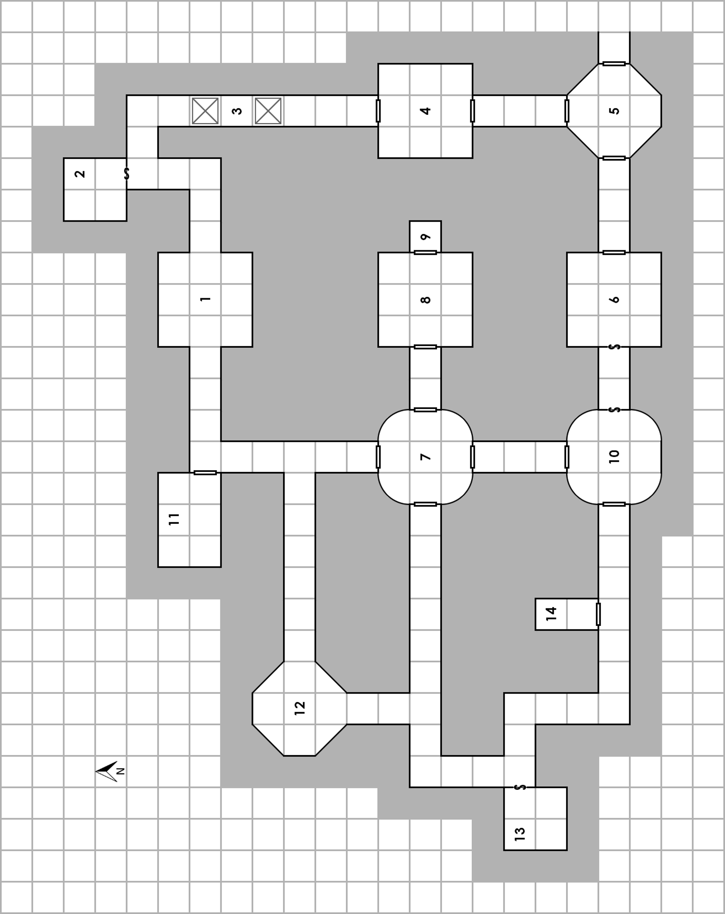

# מתחת לברימאסן

**מבוך שנכתב בשיתוף**  
הרפתקה ל־3–6 דמויות שחקן מתחילות

::: {.callout-note title="למנחת המשחק"}
הפרק כולל את סודות ההרפתקה. בחרי מראש בין גרסת **סיור המבוך** לגרסת **משימת ההצלה**; לכל גרסה פתיחה משלה ותיאור חלופי לחדר 14. הקטעים המוזחים מיועדים להקראה או לתיאור במילים שלך. מספרי החדרים תואמים ל[מפת המבוך](#מפת-המבוך).
:::

## רקע

אפשר להשתמש במבוך בשתי דרכים: כמבוך "רגיל", שהקבוצה יכולה לפנות ממפלצות ולבזוז בקצב שלה, או כמשימת הצלה. חדר 14 מתואר בשתי גרסאות: [תא הכלא](#room-14-rescue), המסומן במקור כגרסה העלילתית ומתאים למשימת ההצלה, ו[כלוב הציפורים](#room-14-crawl), המסומן כגרסה ללא עלילה ומתאים לסיור המבוך המסורתי.

### פתיחה לסיור המבוך

אם בחרת בגרסת סיור המבוך, הקריאי לקבוצה את הקטע הבא או תארי אותו במילים שלך:

> הגעתם לבית המרזח היחיד בעיירה הכפרית הקטנה ברימאסן, והתיישבתם לערב של שטיפת אבק הדרכים בבירה זולה. בעודכם יושבים סביב שולחן ושותים את כוס הבירה הראשונה, אדם ממהר פנימה. לרגע הוא עומד בפתח וסוקר את בית המרזח האפלולי, ואז מבחין בכם.
>
> הוא ניגש היישר לשולחנכם, בצעד בטוח כאילו המקום שייך לו. שני גברים נוספים נכנסים אחריו ועוקבים אחריו אל השולחן. "אתם ההרפתקנים שהגיעו לאחרונה לעיירה? ברוכים הבאים! אני פורסיית', ראש עיירת ברימאסן, ויש לי הצעה עסקית בשבילכם. נראה שמפלצות הומנואידיות, אולי גובלינים, חפרו חור אל המרתף שמתחת לטחנה המקומית. המפלצות הקטנות פושטות על הטחנה ועל הבתים הסמוכים וגונבות כל מה שאינו ממוסמר למקומו. אם תהיו מוכנים להיכנס למאורה שלהן ולהרוג אותן, נוכל לשלם לכם חמישה מטבעות זהב על כל גובלין או מפלצת קטנה דומה, ועשרה על כל יצור גדול יותר. כמובן, תצטרכו להביא הוכחות. האוזן הימנית של כל יצור שנהרג תספיק לנו. מה דעתכם?"

המשימה היא בדיוק כפי שתוארה. תוכלי להציב בעיירה כנסייה או מקדש ובהם כוהן בדרגה בינונית, המוכן להטיל כמה לחשי **ריפוי פצעים קלים** ביום תמורת תרומה קטנה, אולי 20 מטבעות זהב לכל לחש.

### פתיחה למשימת ההצלה

אם בחרת בגרסת משימת ההצלה, הקריאי לקבוצה את הקטע הבא או תארי אותו במילים שלך:

> הגעתם לבית המרזח היחיד בעיירה הכפרית הקטנה ברימאסן, והתיישבתם לערב של שטיפת אבק הדרכים בבירה זולה. בעודכם יושבים סביב שולחן ושותים את כוס הבירה הראשונה, אדם ממהר פנימה. לרגע הוא עומד בפתח וסוקר את בית המרזח האפלולי, ואז מבחין בכם.
>
> הוא ניגש היישר לשולחנכם, כמעט בריצה. "אתם ההרפתקנים שהגיעו לאחרונה לעיירה? בבקשה, רבותיי, אתם חייבים לעזור לי. לקחו את הילדים שלי! מפלצות נוראות, אולי גובלינים, גררו אותם לתוך חור בקיר המרתף שלי. בבקשה, בבקשה, בואו לראות!"

אם ההרפתקנים מסכימים להתלוות אליו, האיש מוביל אותם לבית המלאכה שלו לעיבוד עורות. משפחתו מתגוררת בדירה קטנה בחלקו האחורי של המבנה, אך הוא מוביל את ההרפתקנים אל הכניסה למרתף שמאחורי בית המלאכה. אשתו פוגשת אותם שם וגם היא מתחננת שיצילו את ילדיה. אין להם כסף רב, אך הם יתנו את כל מה שיש להם — 45 מטבעות זהב בסך הכול — תמורת עזרת הקבוצה.

המרתף הוא חדר עגול שקוטרו כשלושה מטרים. בחלקו האחורי נראה חור ברוחב כ־0.9 מטרים, המזכיר חור עכבר גדול. ברצפת העפר נראות עקבות קטנות של יצורים הומנואידיים, שכפות רגליהם מצוידות בטפרים קהים.

## תיאורי החדרים

### 1. חדר הכניסה {#room-1}

> המנהרה שזחלתם בה נפתחת אל חדר, בגובה של כ־1.2 מטרים מעל הרצפה. מידות החדר הן תשעה על תשעה מטרים, ובמרכז הקיר המזרחי ובמרכז הקיר המערבי יש פתחים.

אם הדמויות מחפשות מלכודות או נזהרות בדרך אחרת לפני שהן יוצאות מהמנהרה, הן מבחינות באבן שצבעה שונה, המשובצת ברצפה ליד פתח המנהרה. אם לא גילו אותה, לכל דמות שיוצאת מהמנהרה יש סיכוי של 1–2 בגלגול 1d6 להפעיל מלכודת חניתות בתקרה, היורה היישר למטה. הדמות שהפעילה אותה חייבת להצליח בגלגול הצלה נגד קרן מוות, או לספוג 1d6 נקודות נזק.

### 2. המקדש הנסתר {#room-2}

לדלת הסודית המובילה לחדר יש מנעול מתוחכם, המוסתר מאחורי בליטת סלע מסתובבת. המפתח נמצא על הגופה בבור הדרומי ביותר ב[אזור 3](#room-3). אפשר גם לפרוץ את המנעול כרגיל.

> הדלת הסודית נפתחת אל חדר מואר היטב שהוסב למקדש מאולתר. סמלי גיר מעטרים את קירות האבן הקרים. על מזבח מאולתר, העשוי מארגז עץ גדול המכוסה בבד לבן מתפורר, מונח גביע זהב פשוט. בצדו הרחוק של החדר נראית דמות, שרובה מוסתרת מאחורי המזבח.

כוהנת הרפתקנית שמתה לפני זמן רב בירכה את החדר והפכה אותו למקום מקלט קדוש. גופתה כורעת מאחורי הארגז, פניה למזבח, והיא עדיין אוחזת בסמל הקודש שלה. נותרו ממנה רק עור ועצמות שבקושי מחזיקים יחד. ציודה נעלם מזמן, מלבד סמל הקודש — כוכב כסף שקצותיו קורנים, בשווי 20 מטבעות זהב — ושרידיה הבלויים של גלימתה.

החדר מזוהה כקסום, ונמצא תחת אפקט קבוע של הלחש **הגנה מרוע**, כאילו הוטל בידי מטיל בדרגה 6. הגביע, ששוויו 100 מטבעות זהב, מפיץ אור זהוב ורך הממלא את החדר. אם מוזגים לתוכו מים קדושים ושותים אותם, השותה זוכה לאפקט של לחש **ריפוי פצעים קלים**. הדבר פועל לכל היותר פעמיים ביום. הגביע אינו פועל מחוץ לחדר.

### 3. הבורות {#room-3}

> כשאתם פונים מעבר לפינה, ריח מוות חריף עולה באפכם. לפניכם נפער בור פתוח. משני צדדיו עובר מדף צר מאוד.

בקטע המסדרון הזה יש שני בורות. הצפוני הוא הבור הפתוח שתואר לעיל. עומקו שלושה מטרים, וכל הנופל לתוכו סופג 1d6 נקודות נזק. כל דמות המנסה לחצות על אחד המדפים חייבת להצליח בבדיקת זריזות כדי לא ליפול.

הבור הדרומי מכוסה בדלת נסתרת היטב, הנפתחת אם מונח עליה משקל של כ־45 ק"ג או יותר, למשל כשדמות דורכת עליה. הדלת נסגרת בקפיצה בתוך סיבוב אחד מרגע שנפתחה. עומק הבור שלושה מטרים ובתחתיתו דוקרנים. הנופל סופג 1d6 נקודות נזק מהנפילה ועוד 1d4 נקודות נזק מהדוקרנים; גלגול הצלה מוצלח נגד קרן מוות מונע את הפגיעה מהדוקרנים. בתחתית הבור מוטלת גופת הרפתקן שמת לפני כשלושה שבועות. על גופו יש שלושה מטבעות זהב, חרב קצרה, מפתח ל[אזור 2](#room-2) ושיקוי ריפוי.

### 4. חדר הנדלים {#room-4}

כשהקבוצה מתקרבת לחדר, הקריאי:

> צחנה נוראה עולה באפכם, כמו זו של ערמת זבל או אשפה נרקבת.

שתי הדלתות לחדר תקועות, ותחתיתן של שתיהן נרקבה לגמרי. אם פותחים אחת מהן, הקריאי:

> החדר מכוסה בוצה ופסולת נרקבת עד לגובה הברכיים, אך מלבד זאת נראה ריק.

אפשר לחצות את החדר בבטחה גמורה פשוט בשכשוך בבוצה. עם זאת, דמות המחטטת בה באמצעות מוט באורך שלושה מטרים, חנית או חפץ אחר, עלולה להפריע לקן של נדלים ענקיים צעירים: הסיכוי לכך הוא 1 מתוך 6 בכל סיבוב. אם זה קורה, מגיחים 1d20+20 נדלים. בשל מהירותם המסחררת, הם יכולים לנוע עד שלושה מטרים לפני שהדמויות מספיקות להגיב. הם יטפסו במעלה המוט או קת החנית אל הדמות המחטטת, אם הדבר אפשרי.

כל נדל ששורד את סיבוב הקרב הראשון עשוי לזחול מתחת לשריון של דמות, אם היא לובשת שריון. במקרה כזה הנדל זוכה לדירוג השריון של הדמות, ואי אפשר לתקוף אותו בלי לפגוע גם בה עד להסרת השריון. בינתיים, דירוג השריון של הדמות מול הנדל הפולש הוא 11, ללא כל תוסף זריזות.

**כלל לבחירה:** דמות אלף שנדל ענק צעיר זוחל מתחת לשריונה חייבת להצליח בגלגול הצלה נגד קרן מוות, עם תוסף החוכמה, או להיכנס לבהלה. דמות שנכנסה לבהלה אינה יכולה לפעול, מלבד לעמוד במקומה, לצעוק, לצרוח, להתייפח או להתחנן שחבריה יעזרו לה.

| נתון | נדל ענק צעיר |
|---|---|
| דירוג שריון | 11 |
| קוביות פגיעה | נקודת פגיעה אחת |
| מספר התקפות | 1 נשיכה |
| נזק | רעל; תוסף +5 לגלגול ההצלה |
| תנועה | 12 מ' |
| גלגול הצלה | אדם רגיל |
| מורל | 7 |
| נק"נ | 10 לכל אחד |
| מספר מופיעים | 1d20+20 |
| נקודות פגיעה | 1 לכל נדל |

במקור מופיעות 40 משבצות למעקב אחר היצורים, אך בפועל פוגשים רק את המספר שהתקבל בגלגול 1d20+20. כל משבצת מייצגת נדל אחד, ולא 40 נקודות פגיעה של יצור יחיד.

### 5. החדר המתומן {#room-5}

> בחדר שצורתו משונה יש דלתות בקיר הצפוני, המערבי והמזרחי. הרצפה זרועה גללים ושאריות שהותירו יצורים שונים שעברו כאן. משב קל מגיע מהדלת המזרחית, והאוויר כאן נראה מעט רענן יותר.

אם הקבוצה פותחת את הדלת המזרחית, מתגלה מסדרון המוביל מזרחה ומצטמצם למעבר טבעי שנחצב בגסות. הליכה לאורכו מובילה לבסוף למערה קטנה ומוסתרת היטב, הפתוחה אל העולם שבחוץ.

### 6. מלכודת גרזן הקרב {#room-6}

הדלת לחדר אינה נעולה. כשפותחים אותה, גרזן גדול מתנופף מטה מעל הפתח ותוקף כמו מפלצת עם תוסף התקפה של +3. בפגיעה הוא גורם 1d8 נקודות נזק. הדלת נפתחת פנימה, כך שהפותח חייב לצעוד אל מסלולו של הגרזן. כמובן, דמות זהירה מאוד עשויה לגלות דרך להימנע ממנו.

החדר מסודר כחדר שינה, ובו מיטה, שולחן צד, ארבעה כיסאות ושולחן שעליו חפיסת קלפים. הקלפים פרושים כאילו ארבעה שחקנים הניחו אותם זה עתה והסתלקו. הקיר האחורי מכוסה שטיחי קיר. על שולחן הקלפים יש גם שתי קערות ממתכת בגון חלודה. באחת מהן 20 מטבעות זהב, וכל קערה שווה שני מטבעות כסף.

### 7. חדר ריק {#room-7}

> החדר נראה ריק. הרצפה שבורה וסדוקה, וחלקים ממנה חסרים, אך אין בה חור שעומקו עולה על אורך אצבע. בין הדלת הצפונית למערבית נראה מתאר חלש של דלת. על הדלת המזרחית תלוי שלט עקום, ועליו כתוב באותיות מסודרות במדוברת "מחסן". מתחתיו שורבט בצבע צהוב ובכתיב משובש: "כבר לו". על הדלת הצפונית נכתב: "אישתי פרה, אבל החלב שלה מחמיט". על הדלת המערבית מופיעה באותו כתב צהוב הכתובת "ללחוצ על הכפתור כדי ליפתוח", ומתחתיה נקודה צהובה קטנה. על הדלת הדרומית כתוב: "קאן יש טרולים וגנולים".

החדר אכן ריק ואין בו דבר נוסף. בחינה מקרוב מגלה שמתאר הדלת שבין הקיר הצפוני למערבי נחרט בידי מישהו בסכין או בכלי אחר; אין שם דלת סודית. לחיצה על הנקודה הצהובה בדלת המערבית אינה עושה דבר.

### 8. קובולדים במנוסה {#room-8}

בהאזנה ליד הדלת נשמעים קולות רבים של דיבור מהיר ויבבני.

> כשאתם פותחים את הדלת, אתם רואים שישה הומנואידים זוחליים בעלי פני כלב, יושבים במעגל סביב מדורה קטנה ומשוחחים על משהו.

מי שמבין קובולדית יכול להבין שהם מסתתרים מפני המנהיג הגדול של שבטם לאחר שגנבו את אוצר השבט, וכעת מתווכחים לאן ללכת.

כשהקבוצה מספיקה להביט סביב, תארי:

> בחדר ניצבים פסלי ראש וחזה עשויים היטב על כנים: ארבעה לצד הקיר הצפוני וארבעה לצד הדרומי. פניהם זקנים ומכובדים. אפשר לזהות כמה מהם ככוהנים או כאנשי ממשל מקומיים מפורסמים. על כל קיר תלויים שטיחי קיר בלויים, עתיקים מאוד ורקובים.

שטיחי הקיר מציגים אירועים מתולדות האזור.

הקובולדים אינם לובשים שריון. חמישה מהם חמושים באלות ואחד בפגיון; לשלושה יש גם קלעים ושקיקי אבנים. הם מסתתרים לאחר שגנבו את מה שלדעתם היה אוצר השבט, אך למעשה היה רק חלק ממנו. על הרצפה מאחוריהם מונחים שני שקים, שכל אחד קשור למוט באורך כ־1.2 מטרים, כדי ששניים יוכלו לשאת אותו יחד. בשק אחד יש 1,000 מטבעות כסף ובאחר 400 מטבעות נחושת. נוסף על כך, כל קובולד נושא עליו 3d8 מטבעות נחושת ו־3d6 מטבעות כסף.

הפסלים עשויים גבס ומכוסים שכבות עבות של צבע ישן וכהה. כל אחד מהם שווה כחמישה מטבעות זהב. אלה רק כמה מתוך מאות פסלים שיוצרו ביציקה ונצבעו בזול לציון יום חג לכבוד אחד מאבות היישוב; כל תושב ותיק באזור צפוי לזהות אותם מיד.

| נתון | 6 קובולדים |
|---|---|
| דירוג שריון | 11 |
| קוביות פגיעה | 1d4 נקודות פגיעה |
| מספר התקפות | 1 נשק |
| נזק | 1d4 או לפי נשק |
| תנועה | 9 מ' |
| גלגול הצלה | אדם רגיל |
| מורל | 6 |
| נק"נ | 10 לכל אחד |
| נקודות פגיעה | 4, 2, 3, 1, 3, 2 |

### 9. המחסן {#room-9}

המנעול שעל דלת העץ הכבדה המובילה לחדר שבור לעין כול: נותרו ממנו רק כמה פיסות ברזל מעוקמות ומחלידות. הדלת נפתחת בקלות. המקום שימש פעם מחסן, אך רוב תכולתו נבזזה מזמן. כיום יש בתקרה כתם קטן של רפש ירוק.

> כשאתם מציצים דרך הפתח, אתם רואים חדר חשוך, שמידותיו כשלושה על שלושה מטרים, והוא ריק ברובו. שרידי חביות וארגזים שבורים פזורים לאורך הקירות ובפינות.

אם הדמויות משתמשות בלפיד, בעששית או במקור אור אחר, הקריאי:

> אתם מבחינים בנצנוץ חלש, השתקפות של האור שאתם נושאים, כנראה מחפצים קטנים המונחים במרכז החדר.

בדיקה מקרוב מגלה שאלה כפתורים ואבזמים שאוכלו קשות, מבגדיו ומציודו של הקורבן האחרון של הרפש הירוק הנצמד לתקרה. הרפש לא אכל כבר זמן־מה. הוא מכסה שטח של 1.5 על 1.5 מטרים במרכז התקרה, וקל להבחין בו אם מביטים למעלה עם מקור אור טוב או באמצעות זיוונות. היצור מזהה ותוקף את הדמות הראשונה שנכנסת למרכז החדר, למשל כדי לבדוק את חפצי המתכת שעל הרצפה או לאסוף אותם. הוא יתקוף גם מוט או חפץ דומה המשמש לבדיקת הרצפה.

| נתון | רפש ירוק |
|---|---|
| דירוג שריון | תמיד אפשר לפגוע בו |
| קוביות פגיעה | 2** |
| מספר התקפות | 1 |
| נזק | הופך את הקורבן לרפש בתוך 6+1d4 סיבובים |
| תנועה | 0.3 מ' |
| גלגול הצלה | לוחם: 2 |
| מורל | 12 |
| נק"נ | 125 |
| נקודות פגיעה | 5 |

### 10. חדר הקבורה {#room-10}

> קירות החדר מכוסים מדפים קטנים. על כל מדף נערמו עצמות, שברים, שבבים ורסיסי עצם — ככל שתוכלו להבחין, רובם של בני אדם. על התקרה תבליט טיח בעל אופי דתי. לפי דמותה הנשית של האלה המתוארת בו וישבנה השופע, ייתכן שזו אלת פריון ומוות שנשכחה מזמן.

על המדפים יש אלפי עצמות, פשוטו כמשמעו. בחיפוש יסודי יש סיכוי של 1% בכל סיבוב להזיז או לחשוף משהו מבין העצמות. גלגלי 1d6 כדי לקבוע מה מתגלה:

1. **שרביט ריפוי**, המוחבא בתוך עצם ירך חלולה. הוא דומה לשרביט שקצהו מעובה, ורק כוהן יכול להשתמש בו. כשכוהן נוגע במישהו באמצעותו, הנפגע משיב 1d12-1 נקודות פגיעה. אם מתקבלת תוצאה טבעית של 1, כלומר סך הכול 0 נקודות ריפוי, קסמו של השרביט אוזל והוא חדל לפעול לצמיתות.
2. **אבן גארנט** בשווי 200 מטבעות זהב, המודבקת לצדה הפנימי של גולגולת.
3. **מגילת לחשי קוסם** הכרוכה סביב עצם גומד של ילד. היא מכילה לחש אחד: **היעלמות מעין**.
4. המחפש מטריד **עכביש זעיר וארסי ביותר** המסתתר בשבר עצם, והוא נושך אותו. על המחפש להצליח מיד בגלגול הצלה נגד רעל, או למות.
5. המחפש נחתך משבר עצם. עליו להצליח בגלגול הצלה נגד רעל, עם מתאם החוסן, או להידבק **במחלה מתישה העוברת בדם**. בזמן המחלה הדמות מאבדת 1d4 נקודות מכל אחד מהערכים הבאים: כוח, זריזות, חוסן, כריזמה ונקודות פגיעה. אם אינה מתה מכך, היא מחלימה באופן טבעי בתוך 2d6 ימים ומשיבה את ערכי התכונות ואת נקודות הפגיעה שאבדו.
6. המחפש מזיז עצם שהייתה שייכת לכוהן הגדול של אלת המוות, ו**מקולל** מיד. עד להסרת הקללה, הדמות אינה יכולה לסרב לשום בקשה המופנית אליה בשפה שהיא מבינה, טיפשית או בלתי סבירה ככל שתהיה. פקודות והוראות אינן בקשות; מילת המבחן היא "בבקשה". הדמות המקוללת אינה רשאית להתעכב או לדחות את מילוי הבקשה. רק לחש **הסרת קללה** יכול להסיר את הקללה הזאת.

### 11. חדר ההובגובלין {#room-11}

> מידות החדר הן שישה על תשעה מטרים. הוא חצוב באבן ירקרקה ומרופד בשטיחים ובשטיחי קיר. כריות מעוטרות מכל הסוגים פזורות בו. בין הכריות יושב הובגובלין גדול, מאפיר ונראה זקן מופלג, וקורא בכרך גדול.

| נתון | הובגובלין מאפיר |
|---|---|
| דירוג שריון | 16 |
| קוביות פגיעה | 2* |
| מספר התקפות | 1 כרית מלאה חצץ |
| נזק | 1d6+2 |
| תנועה | 1.2 מ' |
| גלגול הצלה | לוחם: 2 |
| מורל | 9 |
| נק"נ | 100 |
| נקודות פגיעה | 13 |

ההובגובלין עונד **תליון תע"ח**, ועשה בו שימוש מועיל לאורך השנים. שוכני המבוך פונים אליו בקביעות לקבלת מידע, ובתמורה מספקים לו מזון ומותרות. הוא ינסה לסחור עם הדמויות, ויציע מידע שהן מחפשות בעזרת התליון שלו. כיוון שלמעשה הוא יודע מעט על הדמויות ועל העולם שמחוץ למסדרונות האלה, הוא בדרך כלל משקר, אך משלב בדבריו די רמזים על אוצרות וקסם כדי לעורר עניין. הוא מכיר מעט מידע על המבוך הזה, וימסור אותו תמורת מטבעות זהב, לפי שיקול דעתך.

הוא אינו עוין אלא אם תוקפים אותו ממש. הכרך הגדול הוא ספר בישול, ששוויו שני מטבעות זהב. השטיחים, שטיחי הקיר והכריות שווים יחד 75 מטבעות זהב, אך הם מסורבלים מאוד, מלוכלכים וקשים להובלה. ארנק ובו 20 מטבעות זהב נמצא בכיס מתחת לכרית שעליה ההובגובלין נשען.

### 12. חדר הגולגולות הזוהרות {#room-12}

> כשאתם נכנסים לחדר המתומן, מראה מוזר מקבל את פניכם. בכל קיר יש גומחה קטנה, ובכל גומחה גולגולת זוהרת. ליד הקיר הצפוני חמישה יצורים הומנואידיים מתאמצים לעקור אחת מהגולגולות ממקומה.

חמשת היצורים הם אורקים. אם הדמויות מכירות אורקים, תוכלי לנקוב בשמם בתיאור. הם עסוקים בניסיון לעקור את הגולגולת מהקיר, ולא ישמעו את כניסת הקבוצה אלא אם היא מקימה רעש ניכר בטווח של תשעה מטרים מהחדר. אם הקבוצה שקטה למדי, האורקים מופתעים בתוצאה של 1–4 בגלגול 1d6; אחרת, גלגלי הפתעה כרגיל.

הגולגולות מקובעות לקירות במלט. אם דמות מנסה לעקור אחת מהן בכוח, יש סיכוי של 90% שהיא תיהרס. אם גנב מנסה להסיר אותה, השתמשי בסיכוי הרגיל שלו לפריצת מנעולים; במקרה של כישלון יש סיכוי של 50% שהגולגולת תיהרס. כל גולגולת מאירה כאילו הוטל עליה לחש **אור**. האפקט קבוע.

| נתון | 5 אורקים |
|---|---|
| דירוג שריון | 14 |
| קוביות פגיעה | 1 |
| מספר התקפות | 1 נשק |
| נזק | 1d8 או לפי נשק |
| תנועה | 12 מ' |
| גלגול הצלה | לוחם: 1 |
| מורל | 8 |
| נק"נ | 25 לכל אחד |
| נקודות פגיעה | 8, 8, 5, 5, 6 |

### 13. חדר הסרקופג {#room-13}

> הדלת הסודית נפתחת וחושפת חדר שמידותיו שישה על שישה מטרים. במרכזו מונח סרקופג אבן גדול. בכל פינה עומד שלד האוחז בחנית עתיקה, אך כולם נותרים ללא תנועה.

השלדים זזים ותוקפים רק אם תוקפים אותם או נוגעים בסרקופג.

צדו החיצוני של הסרקופג מכוסה בתבליטים של גבר בגלימות המטיל לחשים על אויבים שונים. בחיפוש לא מתגלות מלכודות, והמכסה מחליק הצדה בקלות. כשפותחים אותו, מופעל לחש **פה קסום** ואומר:

> "תכשיטים רבים בזזתי מן המתים. כעת הגיע תורי למסור את תכשיטיי לחיים. מי ייתן וישרתו אתכם כשם ששירתו אותי."

בתוך הסרקופג שוכב שלד יחיד, לבוש בשרידיה הבלויים של גלימה שפעם הייתה מפוארת. על ידו הימנית טבעת משובצת אבני חן, ועל השמאלית טבעת כסף פשוטה. בבדיקה מתגלות שתיהן כקסומות: הטבעת המשובצת היא **טבעת הגנה +1**, וטבעת הכסף היא **טבעת חסינות לאש**.

| נתון | 4 שלדים |
|---|---|
| דירוג שריון | 13 |
| קוביות פגיעה | 1 |
| מספר התקפות | 1 |
| נזק | 1d6 או לפי נשק |
| תנועה | 12 מ' |
| גלגול הצלה | לוחם: 1 |
| מורל | 12 |
| נק"נ | 25 לכל אחד |
| נקודות פגיעה | 4, 5, 4, 7 |

### 14. תא הכלא — גרסת משימת ההצלה {#room-14-rescue}

::: {.callout-note title="גרסה חלופית לחדר 14"}
השתמשי בתיאור הזה למשימת ההצלה. בגרסת סיור המבוך השתמשי ב[כלוב הציפורים](#room-14-crawl) במקומו.
:::

> כלוב עץ ענק תלוי מן התקרה בחדר האפוף עשן. ארבעה ילדים קטנים מצטופפים בתוכו. חמישה הומנואידים זוחליים בעלי פני כלב עומדים סביב הכלוב, דוקרים לעבר הילדים בכלי נשק שונים וצוחקים. יצור גדול יותר מאותו המין יושב לצד מדורת בישול ליד הקיר הצפוני.

אלה הילדים שנחטפו מהעיירה. הקובולדים שבחדר וחבריהם שב[חדר 8](#room-8) הם החוטפים. הקובולד הגדול שבחלקו האחורי של החדר הוא ראש השבט. הוא זועף למדי בשל חפצים שבני שבטו גנבו ממנו לאחרונה.

אם בקבוצה יש דוברי קובולדית המסוגלים לשמוע את השיחה לפני הכניסה לחדר, הם שומעים את הקובולדים מתלבטים אם לדרוש כופר מהעיירה תמורת הילדים או למכור אותם לסוחרי עבדים אורקים שאמורים להגיע בקרוב. אלה האורקים שב[חדר 12](#room-12).

מאז גנבת חלק מאוצרם, הקובולדים אינם נלהבים לוותר על הילדים, במיוחד כל עוד ראש השבט חי. הכלוב תלוי בחבל הקשור לטבעת בקיר המזרחי. כנראה יידרשו שתי דמויות כדי להוריד אותו לקרקע בבטחה ולשחרר את הילדים.

בחיפוש על גופו של ראש השבט מתגלה שקיק עור גדול התלוי בחגורתו, ובו 220 מטבעות כסף ו־30 מטבעות זהב.

| נתון | 5 קובולדים | ראש שבט קובולדים |
|---|---|---|
| דירוג שריון | 13 | 14 |
| קוביות פגיעה | 1d4 נקודות פגיעה | 2 |
| מספר התקפות | 1 נשק | 1 חרב קצרה |
| נזק | 1d6, חרב קצרה | 1d6+1 |
| תנועה | 6 מ' | 6 מ' |
| גלגול הצלה | אדם רגיל | לוחם: 2 |
| מורל | 8 | 8 |
| נק"נ | 10 לכל אחד | 75 |
| נקודות פגיעה | 3, 2, 3, 2, 1 | 8 |

### 14. כלוב הציפורים — גרסת סיור המבוך {#room-14-crawl}

::: {.callout-note title="גרסה חלופית לחדר 14"}
השתמשי בתיאור הזה לסיור המבוך. במשימת ההצלה השתמשי ב[תא הכלא](#room-14-rescue) במקומו.
:::

> כלוב ברזל ענק מוטל על צדו בחדר, ודלתו פתוחה לרווחה. מתחתיו מוטלת גופת גובלין שנמחץ למוות. שרשרת תלויה בחופשיות מהתקרה, ומשם גם נשמע משק כנפיים.

הכלוב הכיל פעם את הסטריג'ים שכעת מתעופפים בחדר. הגובלין האומלל הצליח איכשהו להימצא מתחת לכלוב כשזה השתחרר מהשרשרת, וכך נהרג. בחיפוש על גופו מתגלה שקיק ובו 220 מטבעות כסף ו־30 מטבעות זהב.

| נתון | 7 סטריג'ים |
|---|---|
| דירוג שריון | 13 |
| קוביות פגיעה | 1* |
| מספר התקפות | 1 נשיכה |
| נזק | 1d4 ועוד ניקוז דם של 1d4 נקודות פגיעה בכל סיבוב |
| תנועה | 3 מ'; מעוף 18 מ' |
| גלגול הצלה | לוחם: 1 |
| מורל | 9 |
| נק"נ | 37 לכל אחד |
| נקודות פגיעה | 2, 4, 8, 2, 5, 5, 8 |

## מפת המבוך

<figure class="figure">

<figcaption class="figure-caption">מפת המבוך מן המקור, מוצגת כשהצפון למעלה. לפי מידות החדרים בתיאור, כל משבצת מייצגת כשלושה מטרים (10 רגל במקור).</figcaption>
</figure>

## מקור, תרגום ורישיון

המקור: *Beneath Brymassen*, מבוך שנכתב בשיתוף, בתוך *Adventure Anthology One*, מהדורה ראשונה, שחרור 21, עמ' 18–24 (עמ' 20–26 בקובץ PDF).

מחברים ובעלי זכויות היוצרים: Eldrad Wolfsbane, Mak, The Expert, skisko, Thomas Kolter, Maliki, Jim Bobb, Stuart Marshall, hjmartin70, J. D. Neal, David Gerard ו־Chris Gonnerman. זכויות יוצרים © 2008–2012.

התרגום שומר על שני מסלולי ההרפתקה ועל מספרי החדרים. המרחקים הומרו לפי 10 רגל = 3 מטרים; סף המשקל בבור שבחדר 3 עוגל מ־100 ליברות לכ־45 ק"ג. הכתובות המשובשות בחדר 7 עובדו לשיבושי כתיב בעברית. תנועת ההובגובלין בחדר 11 רשומה במקור כ־4 רגל, והערך החריג נשמר בתרגום כ־1.2 מ'. הנתונים אורגנו בטבלאות, ורשימות מספריות מחליפות את משבצות נקודות הפגיעה שבדפוס. הנחיות הבחירה בין גרסאות חדר 14 נוספו להצגה באתר.

טקסט ההרפתקה ותרגומו מזוהים כאן כתוכן משחק פתוח לפי OGL v1.0a, בנפרד מרישיון CC-BY-SA של יתר האתר. המפה מובאת מהמקור; לפי הודעת המקור, איורים אינם תוכן משחק פתוח וזכויותיהם נשארות בידי בעלי הזכויות. קרדיט המפות הכללי באנתולוגיה: J. D. Neal, Dennis Bamberger ומחברי ההרפתקאות; למפה זו לא ניתן קרדיט נפרד.

::: {.callout-note collapse="true" title="הודעת המקור ונוסח הרישיון המלא (באנגלית)"}
::: {dir="ltr" lang="en" style="text-align:left;"}

:::
:::
