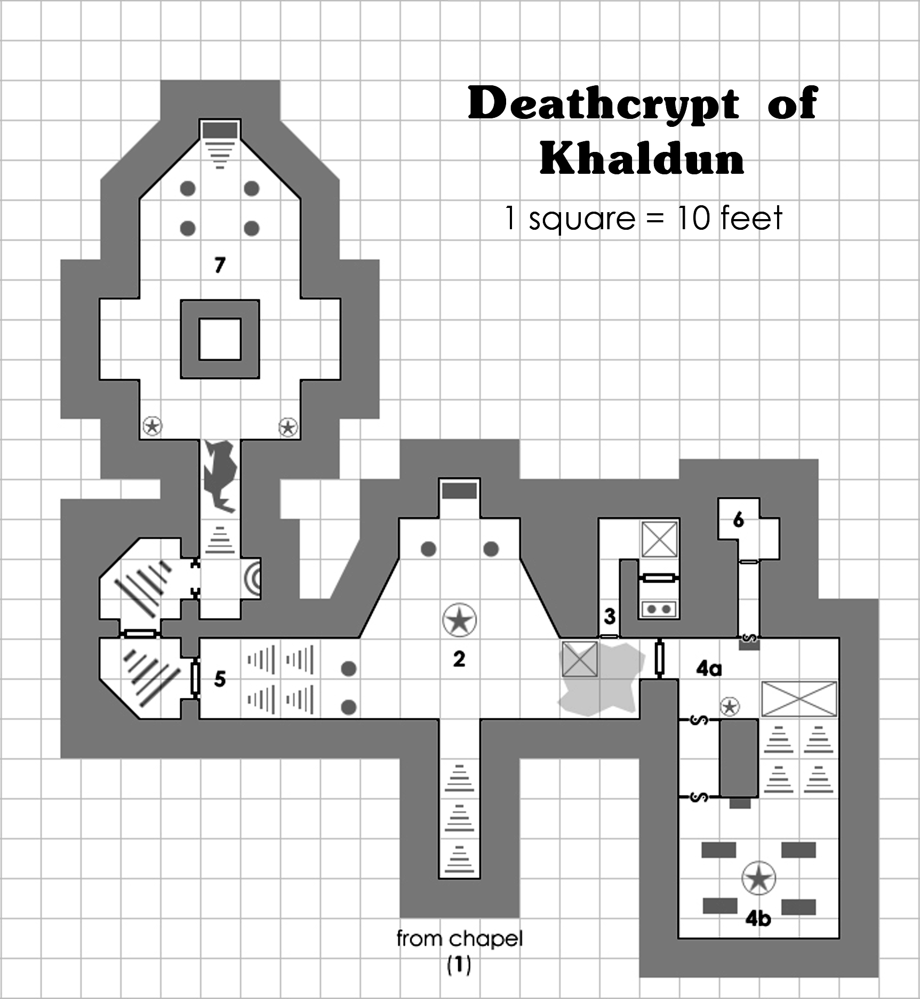

# קבר המוות של ח'אלדון

מאת **סקוט א' מארי (Scott A. Murray)**  
הרפתקה ל־4–6 דמויות בדרגה 6 בערך

::: {.callout-note title="למנחת המשחק"}
הפרק כולל את סודות ההרפתקה. הקטעים המוזחים מיועדים להקראה או לתיאור במילים שלך. מספרי האזורים תואמים ל[מפת הקבר](#מפת-הקבר). בקרב האחרון יש שלושה שלבים: ח'אלדון ושלדיו, שלד מינוטאור שמצטרף כשח'אלדון נחלש, ולבסוף שלד דרקון שמתעורר עם מותו.

להכנת המשחק, עייני בתיאורי המפלצות לכללי ניקוז אנרגיה, רקב מומיות, הגנות מנשק ויצורים חסרי גוף. האנתולוגיה מפנה גם למדריך השדה למפלצות שאינן בספר הבסיס; כאן נשמרים הנתונים והיכולות שנמסרו בהרפתקה עצמה.
:::

## רקע

לפני מאה שנה חשפה חבורת הרפתקנים שעבדה עבור מכשף בשם ח'אלדון ספר מוזר, הכרוך בעורה של מדוזה. רק אחד מבני החבורה שרד את הדרך חזרה. כל האחרים לקו במחלה בלתי מוסברת שעיוותה את דעתם. לאחר שקיבל את הספר, ח'אלדון הסתגר בחדר העבודה התת־קרקעי שלו, שילח את שומריו ושכיריו, ולא יצא במשך חמישה שבועות.

כשעלה לבסוף אל פני השטח, ח'אלדון החריב את האזור בקסם מפיץ מגפות. מאות מתו ממחלות כבר בלילה הראשון, ואלה שגופותיהם לא נשרפו קמו מחדש כאימי אל־מתים בשירותו. נחושים לשים קץ לאימה, הלוחמים האמיצים ביותר באזור הבריחו את ח'אלדון אל שטחי הפרא, ושם מת בקורו המר של החורף.

אך לא היה זה סופו. לפני מותו הורה לחסידיו לא רק לבנות לו קבר, אלא גם לאטום את עצמם בתוכו. שם ימותו ברעב ויקומו מחדש כשומרים אל־מתים מטורפים. בשעת מותו נשבע ח'אלדון לנקום בצאצאיהם של אלה שהגלו אותו. כעת, ערב מלאת מאה שנה לגירושו, אתם, צאצאיהם של אותם מגינים אדירים, עומדים מוכנים לשים קץ לקללתו, בעודו מתעורר משנתו...

## התאמת ההרפתקה

אף שההרפתקה נועדה למשחק עצמאי, קל לשלב אותה במערכה קיימת של בייסיק פנטזי. אולי קבר המוות חבוי בתוך מתחם מבוכים גדול יותר, במקום מתחת לבית תפילה. אפשר גם לוותר על הרקע המוצע ולהציג את ח'אלדון כ"לא יותר" מליץ' רב־עוצמה או ממומיה.

## תיאורי האזורים

### 1. בית התפילה {#room-1}

> כתמי שלג תחוח וקרח מכסים את רצפת האבן השבורה של בית התפילה הקטן. הלהבות הכתומות והעמומות של כלי הגחלים הבוערים מטילות צללים עמוקים על הקירות מוכי הכפור. מזרקה קפואה ניצבת לצד הקיר המערבי, וגרם מדרגות לולייני יורד אל האפלולית. רוח קפואה מייללת בין העצים ירוקי־העד שבחוץ ומצליפה מבעד לפתח בית התפילה.

זהו המקום האחרון שבו הדמויות יכולות להתכונן לפני הירידה אל הקבר. גרם המדרגות יורד ל[אזור 2](#room-2).

### 2. הקבר המדומה {#room-2}

כשהדמויות מגיעות לתחתית המדרגות, הקריאי:

> עצמות מאובקות זרועות על רצפתו של חדר הקבורה הרחב, החנוק בקורי עכביש. מעבר למזרקה שדית מאיימת, הפולטת נוזל שחור, מונח סרקופג מתפורר. רחש המים המצחינים מפר את הדממה המצמררת. זוג עמודים מעוטרים במערב תומך בתקרה מקומרת וגבוהה, ובמזרח מוטל זוג נוסף, שבור.

זהו למעשה קבר מדומה שנועד לפתות הרפתקנים אל מותם. ברגע שהרפתקן כלשהו מתקרב לטווח של 4.5 מטרים מהסרקופג, חבורת זומבים ושלדים מתרוממת מהרצפה. כל אחד תוקף את המטרה הקרובה ביותר אליו עד שהוא מושמד.

| נתון | 6 שלדים | 5 זומבים |
|---|---|---|
| דירוג שריון | 13 | 12 |
| קוביות פגיעה | 1 | 2 |
| מספר התקפות | 1 מגל | 1 |
| נזק | 1d6 או לפי נשק | 1d8 או לפי נשק |
| תנועה | 12 מ' | 6 מ' |
| גלגול הצלה | לוחם: 1 | לוחם: 2 |
| מורל | 12 | 12 |
| נק"נ | 25 לכל אחד | 75 לכל אחד |
| נקודות פגיעה | 1, 3, 3, 4, 4, 6 | 3, 5, 5, 6, 9 |

העמודים שקרסו במזרח יצרו ערמת שברים שקוטרה שישה מטרים. קצב התנועה פוחת למחצית בזמן שחוצים אותה. אם יצור כלשהו נכנס לשטח הממולכד שמידותיו שלושה על שלושה מטרים, המסומן במפה, חלק מהתקרה מתמוטט. דמויות באזור הפגיעה חייבות להצליח בגלגול הצלה נגד קרן מוות, או לספוג 2d6 נקודות נזק וליפול ארצה. מפלצות באזור הממולכד מושמדות מיד. המלכודת מופעלת כך פעם אחת בלבד במהלך ההרפתקה.

דמות יכולה לחפש בין השברים. גלגלי בסתר 1d6, והוסיפי 1 לתוצאה אם ערך התבונה של אחת הדמויות המחפשות גבוה מ־15:

| תוצאה | ממצא |
|:---:|---|
| 1 | מלכודת התקרה המתמוטטת שתוארה לעיל; בחיפוש היא עשויה לפעול גם אם כבר הופעלה |
| 2–3 | אין דבר |
| 4–5 | ציוד: בקבוק מים קדושים ועששית |
| 6–7 | שק ובו 1,600 מטבעות נחושת, 800 מטבעות אלקטרום ושתי אבני חן ירוקות, בשווי 75 מטבעות זהב כל אחת |

דמויות המתקרבות לעמודים שבמערב מבחינות שקורי עכביש עצומים חוסמים חלקית את המדרגות. אפשר לפלס בהם דרך במאמץ של כמה דקות, אך ההפרעה מעירה זוג עכבישי אלמנה שחורה ענקיים. הם תוקפים כל יצור שמנסה לעבור בקורים, אך אינם רודפים אחר אויבים נסוגים.

| נתון | 2 עכבישי אלמנה שחורה ענקיים |
|---|---|
| דירוג שריון | 14 |
| קוביות פגיעה | 3* |
| מספר התקפות | 1 נשיכה |
| נזק | 2d6 ורעל |
| תנועה | 6 מ'; בקורים 12 מ' |
| גלגול הצלה | לוחם: 3 |
| מורל | 8 |
| נק"נ | 175 לכל אחד |
| נקודות פגיעה | 13, 15 |

המים במזרקה עכורים וטעמם רע, אך אינם מזיקים. דמות המחפשת בתוכה מוצאת קערת חרס סדוקה שקיבולתה בערך ליטר מים.

הסרקופג ריק.

### 3. המקדש {#room-3}

גרם מדרגות צר מאבן סדוקה יורד אל החשכה.

המדרגות מובילות למסדרון קטן ובו בור נסתר, המסומן במפה. כל דמות שדורכת עליו חייבת להצליח בגלגול הצלה נגד קרן מוות, או ליפול מגובה של 18 מטרים ולספוג 6d6 נקודות נזק. לאחר שהמלכודת הופעלה, או אם התגלתה, אפשר לדלג מעל הבור בבדיקת זריזות מוצלחת.

הדלת שמעבר לבור עשויה עצם מלוטשת. כשפותחים אותה, הקריאי:

> מזבח מוכתם בדם ניצב בבית עצמות צפוף ואפלולי. חיפושיות מתרוצצות על רצפת האבן, ומשב קריר חודר מפינה נסתרת. לאורך הקירות ניצבים מדפים מלאים עצמות מולבנות. צלם שעווה בצורת דרקון שחור עומד על המזבח. נדמה שהצלם מפיץ לחישות מוזרות, שמנגינתן מזכירה מזמור תפילה.

צלם הדרקון השחור מקולל. בכל פעם שדמות מתעסקת בו בדרך כלשהי, גלגלי בסתר 1d6 והוסיפי 1 אם ערך החוכמה שלה הוא 15 ומעלה:

| תוצאה | אפקט |
|:---:|---|
| 1–3 | קללת "צמד פסוקי החורבן": גלגול הצלה נגד שרביטי קסם. בכישלון הדמות סופגת 4d8 נקודות נזק ומאבדת חפץ קסם אחד שהיא מחזיקה או עונדת, אם יש לה כזה |
| 4–7 | אין דבר |

לחש **גילוי רוע** מגלה שהצלם מקרין רוע, אך לא מעבר לכך. כוהן בדרגה 4 ומעלה יכול לזהות שהוא מקולל בבדיקת תכונה מוצלחת עם מחסר של -4, כשמוסיפים לגלגול את תוסף החוכמה. הטלת **הסרת קללה** על הצלם מבטלת את קללת צמד פסוקי החורבן, ומאותו רגע אין צורך בגלגול לפני שנוגעים בו או משתמשים בו.

בחיפוש בצלם מתגלים בתוכו מפתח מאסטר מברזל וקמע קטן בצורת חרפושית: **חרפושית הגנה** בעלת חמישה מטענים.

אם קללת צמד פסוקי החורבן מופעלת, שתי רוחות צל יוצאות מסדקים דקים בקירות כעבור 1d6 סיבובים ורודפות אחר הדמויות עד שהן מושמדות.

| נתון | 2 רוחות צל |
|---|---|
| דירוג שריון | 15 ‡ |
| קוביות פגיעה | 4** |
| מספר התקפות | 1 מגע |
| נזק | 1d6 וניקוז אנרגיה של דרגה אחת |
| תנועה | מעוף 24 מ' |
| גלגול הצלה | לוחם: 4 |
| מורל | 12 |
| נק"נ | 320 לכל אחת |
| נקודות פגיעה | 16, 20 |

### 4a. חדר ההמתנה {#room-4a}

> ריח קלף יבש ונוזלי חניטה מכביד על האוויר העומד. חליפת שריון לוחות טקסית וחלודה ניצבת לצד הקיר הדרומי, וסרקופג אבן שעליו טביעת כף יד נשען על הקיר הצפוני. מעבר לפינה, גרם רחב של מדרגות אבן עולה אל החשכה. על המדרגות נראית גולגולת אכזרית, שצוירה בדם יבש.

חליפת השריון היא למעשה פסל ברזל חי. הוא תוקף כשמלכודת המדרגות המחליקות מופעלת.

| נתון | פסל ברזל חי |
|---|---|
| דירוג שריון | 18 |
| קוביות פגיעה | 4* |
| מספר התקפות | 2 אגרופים |
| נזק | 1d8 לכל אגרוף, ועוד מיוחד |
| תנועה | 3 מ' |
| גלגול הצלה | לוחם: 4 |
| מורל | 12 |
| נק"נ | 280 |
| נקודות פגיעה | 17 |
| מיוחד | נשקים לא־קסומים עלולים להיתקע בתוכו |

דמות המגלה את הדלת הסודית מדרום, המסומנת במפה, מבחינה שרבות מאבני הבנייה בקיר רעועות. אפשר לפרק אותן או לפרוץ דרכן בבדיקת כוח מוצלחת. מעבר לדלת יש מסדרון תלול ומשופע, שבקצהו דלת סודית דומה.

בבחינה מקרוב של הסרקופג מתברר שאינו נשען על הקיר, אלא משוקע בקיר הצפוני ואי אפשר להזיזו. המכסה כבד מאוד, ויש להצליח בבדיקת פתיחת דלתות כדי להסירו. כשפותחים את הסרקופג, מגלים שאין לו דופן אחורית: מעבר סודי מוביל ממנו אל דלת ברזל מחוזקת בחבקים, המכוסה אבק אפרפר. אפשר לחוש במעבר גם כשהסרקופג סגור, בבדיקת גילוי דלתות סודיות מוצלחת המתבצעת ב־1d10.

אם דמות עולה במדרגות שמדרום ומגיעה ל־1.5 המטרים האחרונים שלהן, היא מפעילה את מלכודת המדרגות המחליקות. המדרגות משנות את מצבן והופכות למגלשה תלולה, ובתחתיתן נפתחת בריכת חומצה שעומקה שישה מטרים, כמסומן במפה. הדמות שהפעילה את המלכודת וכל הדמויות שעל המדרגות חייבות להצליח בגלגול הצלה נגד קרן מוות, או להיזרק אל הבריכה. הנפילה לתוכה גורמת מיד 8d6 נקודות נזק מחומצה, וכל סיבוב נוסף בנוזל גורם עוד 2d6 נקודות נזק מחומצה. לאחר היציאה מהחומצה, הדמות ממשיכה לספוג 1d3 נקודות נזק מחומצה בכל תור, למשך 1d6 תורות. אם מגלים את המלכודת מראש, אפשר לתקוע את מנגנונה בבדיקת נטרול מלכודות מוצלחת, כך שלא תופעל.

אפשר לדלג מעל הבור בבדיקת זריזות מוצלחת, אך לאחר מכן יש להצליח מיד גם בבדיקת כוח כדי לטפס במגלשה; בכישלון נופלים לחומצה.

### 4b. קברו של וטולה {#room-4b}

כשהדמויות עולות במדרגות שב[אזור 4a](#room-4a), או מגיעות דרך המעבר הסודי, הקריאי:

> חדר הקבורה הרחב שטוף זוהר אדום ומבשר רעות, הבוקע מכלי גחלים המוחזק בידיו המטופרות של פסל מטיל־אוב מאיים. גונג פליז תלוי בפינה הדרום־מזרחית הרחוקה, מבהיק באור האש. דמות שלדית ומשוריינת נראית כצללית באור, ומסתובבת לעברכם כשאתם מתקרבים. שריונה השבור שחור כלילה, ועל מגינה הכבד מצוירת גולגולת אדומה.
>
> "אני וטולה," היא אומרת בלחישה צרודה, "שומר קברו של ח'אלדון. על פלישתכם תשלמו בנשמתכם."

בתחילת המפגש וטולה נע לעבר הגונג ומנסה להכות בו בקת גרזנו. אם הגונג מצלצל, גרגויל שדי יוצא מכלי הגחלים ומגלגל יוזמה. שני כלבי צל יוצאים משניים מהסרקופגים סיבוב אחד לאחר גלגול היוזמה.

| נתון | וטולה, רפא הקרב |
|---|---|
| דירוג שריון | 20 † |
| קוביות פגיעה | 5* |
| מספר התקפות | 1 גרזן משונן / 1 מגע |
| נזק | 1d8+1 בגרזן / ניקוז אנרגיה של דרגה אחת במגע |
| תנועה | 4.5 מ' |
| גלגול הצלה | לוחם: 5 |
| מורל | 13 |
| נק"נ | 405 |
| נקודות פגיעה | 26 |

| נתון | 2 כלבי צל |
|---|---|
| דירוג שריון | 14, נוסף על היותם חסרי גוף |
| קוביות פגיעה | 3** |
| מספר התקפות | 1 נשיכה או 1 נשיפה |
| נזק | 1d6 או 3d6 |
| תנועה | 12 מ' |
| גלגול הצלה | לוחם: 3 |
| מורל | 10 |
| נק"נ | 205 לכל אחד |
| נקודות פגיעה | 7, 11 |

| נתון | גרגויל שדי |
|---|---|
| דירוג שריון | 19 ‡ |
| קוביות פגיעה | 4** |
| מספר התקפות | 2 טפרים / 1 נשיכה / 1 קרן |
| נזק | 1d4 אש לכל טופר; 1d6 אש בנשיכה; 1d4 בקרן |
| תנועה | 9 מ'; מעוף 15 מ' |
| גלגול הצלה | לוחם: 4 |
| מורל | 11 |
| נק"נ | 320 |
| נקודות פגיעה | 19 |
| מיוחד | סופג חצי נזק מאש |

פסל מטיל־האוב הגדול שבמרכז חדר הקבורה חדור קסם מוזר. בכל פעם שדמות מטילה לחש מעוצמה 3 ומעלה, גלגלי בסתר 1d6:

| תוצאה | אפקט |
|:---:|---|
| 1 | הפסל מתעורר לחיים! |
| 2 | כל האפקטים המספריים של הלחש שהוטל — טווח, נזק וכן הלאה — מופחתים למחצית |
| 3–5 | אין דבר |
| 6 | כל האפקטים המספריים של הלחש מוכפלים |

| נתון | פסל אבן חי |
|---|---|
| דירוג שריון | 16 |
| קוביות פגיעה | 5* |
| מספר התקפות | 2 סילוני לבה |
| נזק | 2d6 לכל סילון |
| תנועה | 6 מ' |
| גלגול הצלה | לוחם: 5 |
| מורל | 12 |
| נק"נ | 405 |
| נקודות פגיעה | 30 |

מפתח מאסטר מפליז חבוי בין הגחלים. כשהפסל מתעורר, הוא מניח את כלי הגחלים בשטח פנוי סמוך אליו. אפשר לכבות את האש בעזרת המים מהמזרקה שב[אזור 2](#room-2), ואז לחפש בבטחה. אחרת, כל ניסיון לחפש בין הגחלים גורם 1d6 נקודות נזק מאש.

דמות הבודקת את כלי הגחלים מבחינה ששפתו עשויה פליז מפויח.

### 5. הדרך האחרונה {#room-5}

כשהדמויות מגיעות לדלת הראשונה, הקריאי:

> דלת האבן מחוזקת בחבקי ברזל חלודים וקבועה בקשת מעוטרת. מעל טבעות המשיכה שלה נראה חור מנעול גדול מפליז. כתובת מעליו אומרת: "את המפתח תמצאו בלב האש."

כדי לפתוח את הדלת נדרש מפתח המאסטר מפליז. גנב יכול לנסות לפרוץ את המנעול, אך מבצע את הבדיקה כאילו היה נמוך בחמש דרגות מדרגתו, ורשאי לנסות פעם אחת בלבד.

כשפותחים את הדלת הראשונה, הקריאי:

> בתחתית גרם מדרגות עקום ניצבת דלת ברזל המחוזקת בחבקים אדומים כדם. חור מנעול מברזל חותם את הפתח, ועל הדלת כתוב: "את המפתח תמצאו בלב הדרקון."

כדי לפתוח את הדלת נדרש מפתח המאסטר מברזל. גם כאן גנב יכול לנסות לפרוץ את המנעול כאילו היה נמוך בחמש דרגות מדרגתו, ורשאי לנסות פעם אחת בלבד.

כשפותחים את הדלת השנייה, הקריאי:

> חלק מדלת אבן עתיקה קרס, ודרכו אפשר להיכנס למסדרון שיש שחור שמעבר לה. רוח מבשרת רעות נושבת דרך הפתח ומעיפה אבק וקורי עכביש באוויר.

כשהדמויות עוברות בין השברים, או אם אחת מהן מציצה דרך הקשת, הקריאי:

> נרות מאירים מזרקה שדית היורקת מים צלולים לתוך בריכה רדודה. לאורך שפתה רונות קסם הזוהרות באור סגול חלש. מדרגות אובסידיאן יורדות צפונה, אך נראה שקרסו והותירו סדק פעור.

המים בטוחים לשתייה ומרפאים את השותים. כל דמות יכולה לשתות מהמזרקה פעם ביום ולהשיב 2d6+6 נקודות פגיעה.

הרונות הן מלכודת **המתת חיים**, המופעלת אם דמות כלשהי מנסה לקרוא אותן: יש להצליח בגלגול הצלה נגד לחשים או למות. גם בהצלה מוצלחת סופגים 2d6 נקודות נזק. לאחר הפעלת המלכודת הרונות דוהות.

אורך הסדק שישה מטרים, רוחבו שלושה מטרים ועומקו 12 מטרים. דמות יכולה לנסות לחצות לאורך שוליו, תוך שמירה על שיווי משקל, בבדיקת זריזות מוצלחת עם מחסר של -4.

### 6. חדר האוצר {#room-6}

כשהדמויות עוברות דרך הסרקופג אל המסדרון המוביל לאזור הזה, הקריאי:

> מעבר צר ועקום מוביל אל דלת ברזל מחוזקת, המכוסה שכבה של אבק אוכרה.

ניסיון לפתוח את הדלת כשהיא נעולה מפעיל מלכודת אבק קבורה. אבקת עצמות רעילה ניתזת מחורים נסתרים בתקרה על כל הדמויות שבמסדרון. הנפגעות חייבות להצליח בגלגול הצלה נגד רעל, או לאבד 1d3 נקודות חוסן. המלכודת נדרכת מחדש אוטומטית לאחר דקה אחת.

פתיחת המנעול משביתה את המלכודת. אם גנב נכשל בבדיקת פריצת המנעולים בהפרש של 25% ומעלה, המלכודת מופעלת, אלא אם טרם נדרכה מחדש מההפעלה הקודמת.

מעבר לדלת יש חדר קטן המכוסה ציורי קיר. בציורים נראה מטיל־אוב עטוי גלימה המקים שלדים מתהום. שתי תיבות מברזל מחושל מכילות:

1. **תיבה ראשונה:** 1,400 מטבעות כסף, 2,700 מטבעות זהב, זוג עגילי גולגולת מאובסידיאן בשווי 1,200 מטבעות זהב, מגילת הגנה מפני אל־מתים ופגיון מקולל -1.
2. **תיבה שנייה:** 1,600 מטבעות נחושת, 4,000 מטבעות כסף, 1,200 מטבעות אלקטרום, 2,200 מטבעות זהב, שתי אבני חן ירוקות בשווי 100 מטבעות זהב כל אחת, ואלה מנקזת אנרגיה +1. בתוצאה טבעית של 20 בגלגול התקפה, האלה מנקזת דרגת אנרגיית חיים אחת מיצור חי שנפגע, נוסף על הנזק הרגיל.

### 7. הקבר האמיתי {#room-7}

> כשאתם עוברים בקשת האובסידיאן, אתם יוצאים אל אולם קבורה עצום. עצמות מפוזרות על רצפת השיש השחורה. במרכז האולם מתנשא קיר מרובע גדול, שעליו חקוקים פניה של גולגולת עטוית קסדה, המגחכת בבוז. בקירות המזרחי והמערבי קבועות גומחות מלאות עצמות, שנדמה כי הן מקשקשות בציפייה. הבהוב הלפידים הירוקים מטיל צללים שלדיים המרקדים על הקירות החנוקים בצמחים מטפסים.

כשהדמויות מקיפות את הקיר ומבחינות בסרקופג, הקריאי:

> מתוך סרקופג פתוח מזדקר הומנואיד חנוט וצנום. עיניו האדומות זוהרות באפלולית, והוא מדבר אליכם בגרגור נמוך, שנדמה כי אינו בוקע מגופו.
>
> "עונות רבות חיכיתי לנקום בחיים. משמח לראות שממלכות בני התמותה כבר שלחו אליי מנחה..."

ח'אלדון תוקף מיד, וכמוהו השלדים היוצאים מהגומחות.

| נתון | 6 שלדים |
|---|---|
| דירוג שריון | 13 |
| קוביות פגיעה | 1 |
| מספר התקפות | 1 מגל |
| נזק | 1d6 או לפי נשק |
| תנועה | 12 מ' |
| גלגול הצלה | לוחם: 1 |
| מורל | 12 |
| נק"נ | 25 לכל אחד |
| נקודות פגיעה | 1, 3, 3, 4, 4, 6 |

| נתון | ח'אלדון, כוהן מומיה |
|---|---|
| דירוג שריון | 17 ‡ |
| קוביות פגיעה | 6** |
| מספר התקפות | 1 מגע |
| נזק | 1d12 ורקב מומיות |
| תנועה | 6 מ' |
| גלגול הצלה | לוחם: 6 |
| מורל | 9 |
| נק"נ | 675 |
| נקודות פגיעה | 30 |

נוסף על יכולותיו הרגילות, ח'אלדון מסוגל להטיל את הלחשים הבאים ככוהן בדרגה 6:

- [ ] **[גרימת פחד](allSpells.qmd#סילוק-פחד)** — cause fear.
- [ ] **[גרימת פצעים קלים](allSpells.qmd#ריפוי-פצעים-קלים)** — inflict light wounds.
- [ ] **[קללה](allSpells.qmd#ברכה)** — bane.
- [ ] **מגל רוחני** — spiritual sickle, כפי שנקרא במקור; הלחש המקביל בספר הבסיס הוא [פטיש רוחני](allSpells.qmd#פטיש-רוחני).

#### כשח'אלדון יורד ל־15 נקודות פגיעה או פחות {#phase-minotaur}

הקריאי:

> עיניו האדומות בוערות מזעם. ח'אלדון מרים את ידיו השלדיות, וקנוקנות של אנרגיה סגולה נמשכות מקצות אצבעותיו. הוא משמיע פסוק חילול קודש, וקול ברזל ועצמות מקשקשים מהדהד מהגומחות.

שלד מינוטאור משוריין מתרומם מערמת עצמות ופועל ביוזמה של ח'אלדון. הוא נלחם עד שיושמד.

| נתון | שלד מינוטאור משוריין |
|---|---|
| דירוג שריון | 16 |
| קוביות פגיעה | 5 |
| מספר התקפות | 1 נגיחה או גרזן אדיר |
| נזק | 1d6 או 1d12+2 |
| תנועה | 6 מ' |
| גלגול הצלה | לוחם: 6 |
| מורל | 11 |
| נק"נ | 500 |
| נקודות פגיעה | 23 |

#### כשח'אלדון יורד ל־0 נקודות פגיעה {#phase-dragon}

הקריאי:

> ח'אלדון קורס על ברכיו השלדיות, ועיניו האדומות דועכות כגחליה האחרונים של מדורה. קללה נפלטת מגרונו נטול הבשר, והוא מושיט אל התקרה זרועות עטופות להבה שחורה וקסומה. בעוד גופו מתפורר באנרגיות המאגיות, הקיר המרובע מתחיל לשקוע באטיות ברצפה, וקול חריקה נורא ממלא את הקבר. מתוך חדר נסתר שבתוכו רועד שלד משוריין של דרקון שחור, ומנער מעליו גל של אבק וקורי עכביש. לאט הוא מזדקף ופורש את כנפיו הגידיות, בעוד חומצה מתחילה לטפטף מניביו השבורים.
>
> צחקוק צרוד נפלט מגרונו של ח'אלדון כשהוא מתפורר לאפר.

| נתון | שלד דרקון שחור משוריין |
|---|---|
| דירוג שריון | 20 |
| קוביות פגיעה | 7** |
| מספר התקפות | 2 טפרים / 1 נשיכה, או 1 נשיפה / 1 זנב |
| נזק | 1d6 לכל טופר; 2d10 בנשיכה; 7d6 חומצה בנשיפה; 1d6 בזנב |
| תנועה | 6 מ' |
| גלגול הצלה | לוחם: 7 |
| מורל | 8 |
| נק"נ | 1,200 |
| נקודות פגיעה | 65 |

כשהדרקון מובס, הקריאי בקול מהדהד כראוי:

> עצמות הדרקון השחור האל־מת מתמוטטות אל הרצפה כמפולת ומעלות ענני אבק אפרפר גדולים הצורבים את עיניכם. העצמות שבגומחות מקשקשות ומתפזרות על הקרקע... הרעש האדיר דועך באטיות, ועד מהרה הקול היחיד המפר את דממת המוות הוא פצפוץ הלפידים, שעדיין בוערים בלהבת אזמרגד עמומה.

לאחר תבוסת ח'אלדון, הדמויות יכולות לחפש בקבר ובשאר חלקי המבוך שטרם חקרו. בסרקופג נמצאים:

- 5,100 מטבעות נחושת, 1,000 מטבעות כסף, 14,500 מטבעות זהב ו־3,600 מטבעות פלטינה.
- אבן דם בשווי 200 מטבעות זהב.
- תליון גולגולת מאובסידיאן ללא רבב, בעל עיני אודם, בשווי 2,100 מטבעות זהב.
- שיקוי אי־פגיעות, מגילת הגנה מפני יסודנים וטבעת הגנה +2.
- **ספר ח'אלדון**.

## סיום ההרפתקה

בהוקרה על אומץ לבן, הממונה על המחוז מכבד את הדמויות בטקס פומבי ומעניק להן 10,000 מטבעות זהב. אם שילבת את ההרפתקה במבוך גדול יותר, הוסיפי במקום זאת את 10,000 מטבעות הזהב לאוצר שבסרקופג של ח'אלדון.

לספר ח'אלדון אין יכולות רשמיות, והוא כתוב בשפה שהדמויות אינן מכירות. בהתאם לאופן שבו השתמשת בהרפתקה, הספר יכול לשמש רק כסמל להצלחה, כקרס להרפתקה עתידית או אפילו כעתק שסביבו נבנית מערכה שלמה.

## מפת הקבר

{#fig-khaldun-map fig-alt="מפת קבר ח'אלדון המקורית, עם אזורים 2 עד 7, אזורי המשנה 4a ו־4b, מלכודות ומעברים סודיים."}

המפה המקורית משתמשת במספור האזורים ובכותרת באנגלית. כל משבצת מייצגת שלושה מטרים (10 רגל במקור). הכניסה מבית התפילה שבאזור 1 מסומנת בשוליה התחתונים.

## מקור, תרגום ורישיון

המקור: *Deathcrypt of Khaldun*, מאת Scott A. Murray, בתוך *Adventure Anthology One*, מהדורה ראשונה, שחרור 21, עמ' 38–43 (עמ' 40–45 בקובץ PDF). בתוכן העניינים מופיע גם האיות *Deathcrypt of Khaldhun*. זכויות יוצרים © 2009 Scott A. Murray.

המרחקים הומרו לפי 10 רגל = 3 מטרים, ונפח הקערה שבאזור 2 עוגל מקוורט אחד לכ־1 ליטר. נתוני הקרב נשמרו, לרבות 65 נקודות הפגיעה של הדרקון, המורל 13 של וטולה וסימני † ו־‡ המופיעים במקור ליד דירוגי שריון מסוימים. רשימות מספריות מחליפות את משבצות נקודות הפגיעה שבדפוס. נוספו כותרות לשלבי הקרב והפניות פנימיות. שמות לחשי הכוהן הותאמו למינוח באתר, לצד שמותיהם במקור. בבדיקת זיהוי הקללה באזור 3 לא צוין במקור איזו תכונה נבדקת; המחסר ותוסף החוכמה נשמרו כפי שנמסרו.

טקסט ההרפתקה ותרגומו מזוהים כאן כתוכן משחק פתוח לפי OGL v1.0a, בנפרד מרישיון CC-BY-SA של יתר האתר. המפה מובאת מהמקור; לפי הודעת המקור, איורים אינם תוכן משחק פתוח וזכויותיהם נשארות בידי בעלי הזכויות. קרדיט המפות הכללי באנתולוגיה: J. D. Neal, Dennis Bamberger ומחברי ההרפתקאות; למפה זו לא ניתן קרדיט נפרד.

::: {.callout-note collapse="true" title="הודעת המקור ונוסח הרישיון המלא (באנגלית)"}
::: {dir="ltr" lang="en" style="text-align:left;"}

:::
:::
