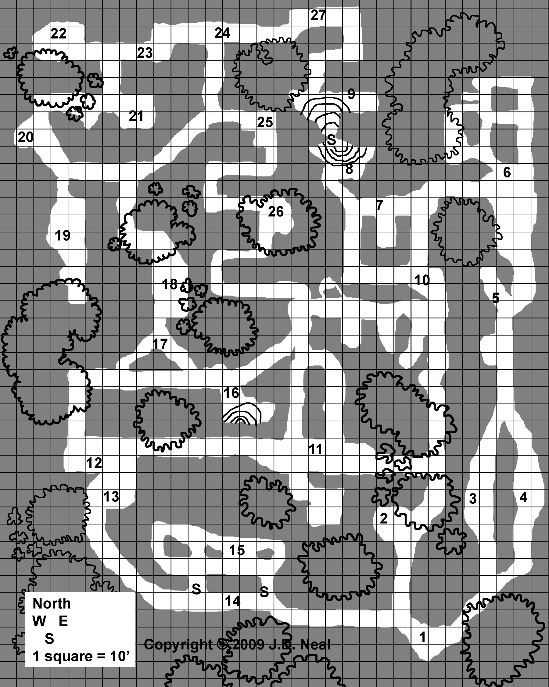

# ולהאלה של החרקים

מאת **ג'יי די ניל (J. D. Neal)**  
הרפתקה ל־4–8 דמויות בדרגות 3–6

::: {.callout-note title="למנחת המשחק"}
הפרק כולל את סודות ההרפתקה. הקטעים המוזחים מיועדים להקראה או לתיאור במילים שלך. מספרי האזורים תואמים ל[מפת המבוך](#מפת-המבוך).

המקור מפנה ל־*Basic Fantasy Field Guide, Volume 1* עבור גמלי שלמה ענקיים, יתושים ענקיים, שרכים שומרים ועכבישי מחילות ענקיים. נתוני הקרב המופיעים בהרפתקה מובאים כאן; להכנת המשחק יש לעיין גם בתיאורי היצורים, ובפרט בכללי הרעל, ניקוז הדם וההתקפות המיוחדות.
:::

## הסביבה

רשת המערות הזאת משלבת מכרות שנחצבו בגסות עם תעלות ומעברים טבעיים שהמים שחקו בסלע. מעולם לא התגורר בה שבט הומנואידי, אם כי כורים הגיעו לכאן מפעם לפעם. רוב הסלע הוא אבן גיר רכה, לבנה או צהבהבה, ולצדה מעט גרניט, אדמה מהודקת, שורשים ואבנים.

לרוב המנהרות אין "תקרה": הן פתוחות ומאפשרות כניסת אור ומים. צמחים ויצורים קטנים משגשגים באדמה הפורייה שנשפכה או נשטפה בגשם מפני השטח שמעל. הצמחייה העשירה שמסביב צומחת מטה אל המנהרות ומפזרת זרעים על רצפתן.

שוכני המבוך הם אוסף של חרקי ענק, עכבישניים, תולעים ויצורים דומים, המנהלים ביניהם מעין "מלחמה". איש לא הפריע להם זה זמן רב, והם התבססו בשגרה משלהם. רבים כמעט שאינם עוזבים את השטח שתפסו, וניזונים זה מזה ומכל מה שחולף במקום.

אין כאן דלתות, ורבים מהאזורים פתוחים דיים לכניסת אור. לכן, אם השחקנים אינם בוחרים לחקור בלילה, הצורך בתאורה מוגבל יותר, אם כי הצללים העמוקים עדיין מצדיקים נשיאת מקור אור. במציאות הסדקים היו מפותלים ועקומים, אך במפה הם הושארו ישרים למדי כדי להקל על התיאור ועל המיפוי.

אפשר לחקור את המנהרות גם בהליכה על פני השטח שמסביבן, אך רבות מהמפלצות יכולות לזחול או לעוף החוצה בעקבות בשר טרי. נוסף על כך, בעונת הצמיחה שולי הסדקים מכוסים צמחים ומטפסים, המקשים להביט פנימה. אם הקבוצה מנסה לעקוף את המבוך לאורך שפתו, הגדילי את הסיכוי שתופתע. חרקים רבים מזהים טרף ופולשים באמצעות חושים כימיים או תנודות יותר מאשר בעזרת הראייה. התרוצצות בין השיחים והעצים שמחוץ למנהרות היא הזמנה גלויה למארב.

## מפלצות נודדות

בכל שלושה תורות, כלומר 30 דקות, גלגלי 1d6. בתוצאה 1 יש מפגש; גלגלי 1d6 לקביעת היצורים:

| תוצאה | מפגש | נתונים |
|:---:|---|---|
| 1 | 1d6 נמלים ענקיות | [אזור 6](#room-6) |
| 2 | 1d3 עכבישי סרטן ענקיים | [אזור 3](#room-3) |
| 3 | 1d6 חדפי ענק | [אזור 11](#room-11) |
| 4 | 1d6 דבורים ענקיות | [אזור 21](#room-21) |
| 5 | 1d6 חגבי מערה | [אזור 23](#room-23) |
| 6 | 2d6 נדלים ענקיים | [אזור 10](#room-10) |

## תיאורי האזורים

### 1. בית הקברות לחרקים {#room-1}

> החדר הגס והחצוב ברישול מלא שלדי חרקים ופיסות של חלקי גוף — רגליים, כנפיים ועוד.

אלה גופות יבשות וריקות של חיפושיות, עכבישים ונמלים, הפזורות בערמות משונות. רובן ישנות ושבירות. כמה מהן טריות יותר, ואחת או שתיים אף לחות למגע. כשחרקים מאזורים אחרים מתים, לפעמים גוררים אותם לכאן כדי לאכול אותם או להיפטר מהם.

### 2. עץ היגון {#room-2}

> עץ גדול שלח את שורשיו העצומים מטה, אל תוך הפתח הרחב שבמקום.

זוג זדוני של אלמנות שחורות ענקיות תפס את הפינה הזאת כתחומו. האלמנות מסתתרות בחשכת סבך השורשים שמעל, ללא תנועה וכמעט בלתי נראות, וצדות בעיקר באמצעות זיהוי תנועה. למי שנכנס לפינה יש סיכוי גבוה להסתבך בקורים הכמעט בלתי נראים שטוו לרוחב הכניסה. כשהן מזהות טרף, הן ממהרות לרדת. גופן חוסם את אור היום המגיע מלמעלה ועלול לבלבל את הטרף.

לצד השורשים התחתונים שמוטה גופת אדם חנוטה ושלדית, המוחזקת יחד בקורים וברקמות יבשות. היא עונדת סמל קודש מכסף. אלה קסומה +1 קשורה ברצועה סביב אחד מפרקי ידיה, ועליה תרמיל מלא ציוד רגיל, כולל מזון רקוב. בשקיק קטן יש שלוש אבני חן בשווי 100 מטבעות זהב כל אחת ומטבעות בשווי כולל של 15 מטבעות זהב.

| נתון | 2 אלמנות שחורות ענקיות |
|---|---|
| דירוג שריון | 14 |
| קוביות פגיעה | 3* |
| מספר התקפות | 1 נשיכה |
| נזק | 2d6 ורעל |
| תנועה | 6 מ'; בקורים 12 מ' |
| גלגול הצלה | לוחם: 3 |
| מורל | 8 |
| נק"נ | 175 לכל אחת |
| נקודות פגיעה | 16, 17 |

### 3. עכבישים בשפע {#room-3}

> הצמחייה כאן צפופה. שיחים ומטפסים עמוסי עלים צומחים מטה אל תוך הסדק. קליפות גופותיהם של חרקים מתים פזורות על הרצפה.

המסדרון הגס הוא מאורתם של כמה עכבישים, הנלחמים במלחמה לא מתוכננת נגד החרקים האחרים. הם מגינים על שטחם, לוכדים, הורגים ואוכלים נמלים וחיפושיות המשוטטות בסביבה. הפגרים שעל הרצפה מבהירים מי שוכן כאן. מי שמקדיש זמן לבדיקה לפני הכניסה עשוי להבחין מדי פעם בתנועה עמומה, אך העכבישים מוסווים היטב ונוהגים לתקוף ממארב. מי שסבלני דיו עשוי אפילו לצפות בציד מוצלח.

| נתון | 6 עכבישי סרטן ענקיים |
|---|---|
| דירוג שריון | 13 |
| קוביות פגיעה | 2* |
| מספר התקפות | 1 נשיכה |
| נזק | 1d8 ורעל |
| תנועה | 12 מ' |
| גלגול הצלה | לוחם: 2 |
| מורל | 7 |
| נק"נ | 100 לכל אחד |
| נקודות פגיעה | 13, 8, 5, 8, 4, 7 |

### 4. חיפושיות אוכלות עץ {#room-4}

> רצפת האזור מכוסה שכבה עבה של עלים ישנים ואדמה פורייה. ריח של אדמה שזה עתה נהפכה עולה באפכם, ולצדו ריח עץ טרי.

חיפושיות מפציצות ענקיות משגשגות בתערובת העלים והעץ המתפורר שעל הרצפה. אם תוקפים אותן, או מתקרבים אליהן יותר מדי, הן תוקפות.

| נתון | 8 חיפושיות מפציצות ענקיות |
|---|---|
| דירוג שריון | 16 |
| קוביות פגיעה | 2* |
| מספר התקפות | 1 נשיכה ועוד מיוחד |
| נזק | 1d6 ועוד מיוחד |
| תנועה | 12 מ' |
| גלגול הצלה | לוחם: 2 |
| מורל | 8 |
| נק"נ | 100 לכל אחת |
| נקודות פגיעה | 15, 12, 12, 8, 5, 8, 4, 6 |

### 5. חיפושיות נמריות בציד {#room-5}

> הצמחייה כאן שופעת, במיוחד לאורך השפה העליונה. פתח ארוך בתקרה מציף את האזור באור במשך היום, ובמיוחד בצהריים.

בקצהו האחר של המעבר אורבות שלוש חיפושיות נמריות, זהירות ושקטות. הן מזנקות לעבר כל תנועה בניסיון לתפוס טרף, ויש להן סיכוי טוב להפתיע, אלא אם לדמויות יש דרך להאיר את המקום מרחוק ולחשוף אותן.

בין הפסולת שבקן מונחות כמה עצמות הומנואידיות, שאריות שריון וקרעי בגדים. שקיק ובו 300 מטבעות זהב נשפך על הקרקע, לצד חרב קצרה ופגיון חלודים. מידת החלודה נתונה לשיקול דעתך.

| נתון | 3 חיפושיות נמריות ענקיות |
|---|---|
| דירוג שריון | 17 |
| קוביות פגיעה | 3+1 |
| מספר התקפות | 1 נשיכה |
| נזק | 2d6 |
| תנועה | 18 מ' (3 מ') |
| גלגול הצלה | לוחם: 3 |
| מורל | 9 |
| נק"נ | 145 לכל אחת |
| נקודות פגיעה | 21, 15, 14 |

### 6. נמלים {#room-6}

> לפניכם שני פתחים בצדו הצפוני של הסדק. הפתחים מעוגלים ונקיים משורשים ומשיחים, שחלקם נגזמו סמוך לבסיסם. אין בהם אבנים גדולות, ומשהו יישר את הקירות ואת הרצפה.

נמלים ענקיות מתרוצצות בלי הפסקה במנהרות האלה. הן עסוקות כל כך בניקוי המעברים, שבדרך כלל רואים אותן מיד.

| נתון | 5 נמלים ענקיות |
|---|---|
| דירוג שריון | 17 |
| קוביות פגיעה | 4 |
| מספר התקפות | 1 |
| נזק | 2d6 |
| תנועה | 18 מ' (3 מ') |
| גלגול הצלה | לוחם: 4 |
| מורל | 7 במפגש ראשון, 12 לאחר תחילת הקרב |
| נק"נ | 240 לכל אחת |
| נקודות פגיעה | 27, 23, 22, 22, 19 |

### 7. מוות בעשב {#room-7}

> עצים צעירים ודקים פזורים בשטח הפתוח למדי, שבו צומחים עשב גבוה וקנים.

כאן חיים שני גמלי שלמה ענקיים, העוקבים אחר טרפם כשהם נטמעים בצמחייה. הסיכוי שלהם להפתיע דמויות שאינן נזהרות גבוה: 1–4 בגלגול 1d6. הסיכוי נמוך יותר מול מי שמחפש יצור כזה.

| נתון | 2 גמלי שלמה ענקיים |
|---|---|
| דירוג שריון | 16 |
| קוביות פגיעה | 5 |
| מספר התקפות | 1 נשיכה |
| נזק | 1d12 בנשיכה |
| תנועה | 12 מ'; מעוף 36 מ' |
| גלגול הצלה | לוחם: 5 |
| מורל | 8 |
| נק"נ | 360 לכל אחד |
| נקודות פגיעה | 28, 22 |

מידע מפורט יותר על גמלי שלמה ענקיים (*Giant Praying Mantises*) מופיע ב־*Basic Fantasy Field Guide, Volume 1*.

### 8. הבריכה {#room-8}

> בצדה הצפוני של הגומחה יש בריכת מים צלולים, נקיים וקרירים. המים שקטים, ואולי מקורם בנגר גשמים או בחלחול עדין ממעיין תת־קרקעי. קנים פזורים מסביב, אך מדפי סלע בולטים מחשיכים את המקום רוב הזמן.

מדי פעם עשוי להיות כאן חרק ששותה, אך מעטים מתגוררים באזור. הבריכה ממשיכה מתחת למדף סלע ונפתחת אל החדר ה"סודי" שמצפון. העניקי לקבוצה מענק נק"נ קטן, למשל 50–100 נקודות ניסיון, על גילוי המעבר ושחייה אל צדו האחר.

### 9. יתושים {#room-9}

> בריכת מים צלולים, נקיים וקרירים ממלאת חלק גדול מהחדר. פניה שקטים. אולי זו בריכת אגירה של מי גשמים, ואולי היא ניזונה מחלחול עדין מתחת לאדמה. הגומחה פתוחה לשמים, ולאורך שוליה מתנשאים קנים דקים לגובה תשעה מטרים. זמזום טורדני נשמע ומתחזק מרגע לרגע.

כאן שוכנים יתושים ענקיים, הפושטים בלילה על בעלי החיים שבסביבה. הם מגיעים בזמזום כדי לתקוף טרף בעל דם חם בכל שעות היום. מספרם הכולל הוא 20+2d6, אך רק לעיתים רחוקות יגלו יותר מ־1d6+1 יתושים כל הרפתקן ברגע נתון.

| נתון | 22–32 יתושים ענקיים |
|---|---|
| דירוג שריון | 11 |
| קוביות פגיעה | 1d4 נקודות פגיעה * |
| מספר התקפות | 1 נשיכה |
| נזק | 1d3 בנשיכה, ועוד ניקוז דם של 1d3 נקודות פגיעה בכל סיבוב |
| תנועה | 15 מ' |
| גלגול הצלה | לוחם: 1 |
| מורל | 9 |
| נק"נ | 13 לכל אחד |
| נקודות פגיעה | 3, 1, 3, 3, 2, 3, 1, 3, 2, 4, 1, 1, 2, 3, 2, 1, 3, 4, 2, 1, 3, 1, 4, 2, 4, 4, 2, 3, 3, 2, 3, 2 |

הרשימה כוללת 32 ערכי נקודות פגיעה, כמספר המרבי במקור; השתמשי רק במספר היתושים שהתקבל בגלגול.

מידע מפורט יותר על יתושים ענקיים (*Giant Mosquitoes*) מופיע ב־*Basic Fantasy Field Guide, Volume 1*.

### 10. נדלים {#room-10}

> מדי פעם משהו מתרוצץ בין העלים היבשים המכסים את האזור העשבוני והמגודל.

שכבת העלים והרפש שורצת נדלים ענקיים. בכל דקת חיפוש גלגלי 1d6 כדי לקבוע בכמה נתקלים: בתוצאה 1–3 מופיע נדל אחד, בתוצאה 4–5 מופיעים שניים ובתוצאה 6 מופיעים שלושה. המספר הכולל המרבי באזור הוא 1d6+6, כלומר 7–12 נדלים.

| נתון | 7–12 נדלים ענקיים |
|---|---|
| דירוג שריון | 11 |
| קוביות פגיעה | 1d4 נקודות פגיעה * |
| מספר התקפות | 1 נשיכה |
| נזק | רעל |
| תנועה | 12 מ' |
| גלגול הצלה | אדם רגיל |
| מורל | 7 |
| נק"נ | 13 לכל אחד |
| נקודות פגיעה | 2, 4, 2, 3, 4, 1, 2, 2, 3, 3, 1, 1 |

### 11. חדפי ענק {#room-11}

> המנהרה פתוחה למדי, אך שוליה מגודלים. שרכים גדולים ושיחים צומחים בצפיפות לאורך הרצפה. מתוך העשבים נשמעות צווחות קדחתניות, המזכירות עכברים גדולים מדי.

חדפי הענק נמשכו לכאן בעקבות התולעים והחרקים. הם רעבתניים ותוקפים כל דבר אכיל שהם מזהים. בין הפסולת שעל הקרקע מונחים שני גרזני יד בעלי ראשים מכסף.

| נתון | 12 חדפי ענק |
|---|---|
| דירוג שריון | 16 |
| קוביות פגיעה | 1* |
| מספר התקפות | 2 נשיכות |
| נזק | 1d6 לכל נשיכה |
| תנועה | 18 מ' |
| גלגול הצלה | לוחם: 2 |
| מורל | 10 |
| נק"נ | 37 לכל אחד |
| נקודות פגיעה | 8, 7, 1, 4, 6, 3, 4, 6, 3, 5, 6, 4 |

### 12. שרך שומר {#room-12}

> שרכים גדולים ושיחים צומחים בצפיפות על הרצפה.

שרך שומר מגן על האזור.

| נתון | שרך שומר |
|---|---|
| דירוג שריון | 14 |
| קוביות פגיעה | 6* |
| מספר התקפות | 3 — קוץ, חומצה ועלים |
| נזק | 1d4 מקוץ; 3d8 מחומצה; 1d8 מעלים |
| תנועה | 0 מ' (נייח) |
| גלגול הצלה | לוחם: 6 |
| מורל | 12 |
| נק"נ | 555 |
| נקודות פגיעה | 27 |

מידע מפורט יותר על שרכים שומרים (*Guard Ferns*) מופיע ב־*Basic Fantasy Field Guide, Volume 1*.

### 13. שלדים {#room-13}

> אפשר להבחין שהתעלה הייתה פעם צרה בהרבה, אך קרסה לפני זמן־מה לערמת סלעים ועפר. בין השברים צומחים עשבים ושיחים, ולצדם מקלות לבנים דמויי עצם ואבנים מעוגלות.

המקלות הם עצמות, והאבנים הן גולגולות. אלה שרידיה של קבוצת כורים אנושית שנהרגה במפולת ונחשפה מחדש בשל בליית הסלע ופעילות החרקים. יש כאן כשישה שלדים, ששלושה או ארבעה מהם מתאימים להנפשה. בין העצמות נמצאים 180 מטבעות נחושת, 13 מטבעות כסף, 13 מטבעות זהב וחמישה מטבעות פלטינה.

### 14. מחילות העכבישים {#room-14}

> לפניכם מנהרה ארוכה הפתוחה לשמים, עם עשב על הרצפה ומטפסים ארוכים לאורך הקירות.

בקיר הצפוני מסתתרים שני עכבישי מחילות. הם התקינו מכסים מעולים למחילותיהם, ומסתמכים בעיקר על קולות ותנודות לזיהוי טרף. התייחסי למכסים כדלתות סודיות עשויות היטב. חיפוש פיזי נמרץ מגלה אותם: המכסים רכים, ואילו הקירות והרצפה קשים. חיפוש בחיטוט גורם גם לעכביש שבתוך המחילה לתקוף. אם לא גילו אותם מראש, גלגלי 1d6 לכל אדם החולף ליד פתח. בתוצאה 5 או 6, עכביש הבחין בו ומחליט לתקוף.

| נתון | 2 עכבישי מחילות ענקיים |
|---|---|
| דירוג שריון | 15 |
| קוביות פגיעה | 4* |
| מספר התקפות | 1 נשיכה |
| נזק | 1d8 בנשיכה ורעל, או היאבקות |
| תנועה | 15 מ' |
| גלגול הצלה | לוחם: 4 |
| מורל | 8 |
| נק"נ | 280 לכל אחד |
| נקודות פגיעה | 18, 15 |

מידע מפורט יותר על עכבישי מחילות ענקיים (*Giant Trapdoor Spiders*) מופיע ב־*Basic Fantasy Field Guide, Volume 1*.

### 15. פינת הפסולת {#room-15}

> גופות של חרקים מסוגים שונים נאספו כאן. הן מנוקבות, והנוזלים והאיברים שבתוכן נוקזו.

מתחת לגופות חבויים גושי זהב קטנים במשקל של כ־4.5 ק"ג, שהם 10 ליברות במקור. לפי הערכת המקור, 10 מטבעות זהב לליברה, שוויים 100 מטבעות זהב בסך הכול. לצדם שתי אבני חן גולמיות, בשווי 200 מטבעות זהב כל אחת ללא ליטוש; לאחר ליטוש שוויה של כל אחת יתקרב ל־500 מטבעות זהב.

### 16. המפל {#room-16}

> התזת מים בלתי פוסקת מבשרת על הבריכה. זרם פורץ מחור קטן למעלה ונשפך אל המים שמתחתיו.

הבריכה רדודה ומימיה מתוקים. הפתח שלמעלה קטן מכדי שמישהו יוכל להיכנס אליו. המים מתנקזים באטיות דרך הסלע הנקבובי שמתחת.

### 17. ערוגות התולעים {#room-17}

> שני ענפיו של הצומת דמוי האות Y מכוסים שכבות של אדמה פורייה ועפר. מדי פעם משהו נע בין העלים בתנועה נחשית.

באזורים האלה חיים שלשולים גדולים למדי ובלתי מזיקים לחלוטין: אורכם 30–60 סנטימטרים, ולעיתים אף 90–120 סנטימטרים. הם חיים את חייהם העיוורים, מעשירים את הקרקע ומשמשים מזון לחפרפרות, לחרקים וליצורים דומים. אם הדמויות מסתקרנות, גלגלי 5d6 והכפילי את התוצאה ב־2.25 כדי לקבוע בקירוב את משקל התולעים בקילוגרמים בכל אחד מהמקומות האלה.

### 18. התקפת הנחש {#room-18}

> עצים גבוהים וצרים ומטפסים מכסים את הקירות. נחש גדול משתלשל בפיתולים מלמעלה!

לאחר שמטפלים בתושב הרעב, חיפוש יסודי מגלה בין השיחים והעלים שתי גופות עתיקות של גמדים, מעוכות ומעוכלות ברובן. מתחת לאחת מהן יש תיבת עץ קטנה ובה שיקוי ריפוי ושיקוי צורה גזית. שק עור שעוכל ברובו מכיל שלוש אבני חן בשווי 100 מטבעות זהב כל אחת, 12 מטבעות פלטינה ו־230 מטבעות זהב.

| נתון | נחש פיתון |
|---|---|
| דירוג שריון | 14 |
| קוביות פגיעה | 5* |
| מספר התקפות | 1 נשיכה וחניקה |
| נזק | 1d4 ועוד 2d4 |
| תנועה | 9 מ' |
| גלגול הצלה | לוחם: 5 |
| מורל | 8 |
| נק"נ | 590 |
| נקודות פגיעה | 22 |

### 19. מרבץ אבני החן {#room-19}

> המעבר הצר מוביל למנהרה רטובה, שקצהּ נראה כאילו נחצב בידי הומנואידים. מכוש ברזל שבור וחלוד ונעל עור ישנה ורקובה, דמוית גרב, נראים בין אבנים ועפר שנשפכו. הקירות מצטמצמים בחדות למעלה וכמעט מסתירים את האור. מדי פעם מטפטפת רטיבות, והרצפה בוצית ורכה. לפעמים אתם שוקעים עד הקרסול בבור בוץ אקראי.

זו הסיבה שכורים הגיעו לכאן מדי פעם: אבני חן משובצות בחומר הרך שבקירות. בכמה שעות עבודה הדמויות יכולות להוציא את האבנים הלא־מלוטשות הבאות. המחירים הם לכל אבן:

| מספר | שווי ללא ליטוש | שווי לאחר ליטוש |
|:---:|---|---|
| 3d8 | 10 מטבעות זהב | 25 מטבעות זהב |
| 2d8 | 100 מטבעות זהב | 200 מטבעות זהב |
| 1d8 | 250 מטבעות זהב | 500 מטבעות זהב |

### 20. המתקפה הצורבת {#room-20}

> עצים ושיחים צפופים מעליכם יוצרים סבך אפל של צללים, שורשים, מטפסים ושרכים.

שלוש חיפושיות מפציצות ענקיות אורבות בצללים וצדות כל מה שחולף. בין שרידי קורבנותיהן מונחת מחרוזת עור קרועה, שאליה קשורות 10 אבני חן קטנות, בשווי 50 מטבעות זהב כל אחת.

| נתון | 3 חיפושיות מפציצות ענקיות |
|---|---|
| דירוג שריון | 16 |
| קוביות פגיעה | 2* |
| מספר התקפות | 1 נשיכה ועוד מיוחד |
| נזק | 1d6 ועוד מיוחד |
| תנועה | 12 מ' |
| גלגול הצלה | לוחם: 2 |
| מורל | 8 |
| נק"נ | 100 לכל אחת |
| נקודות פגיעה | 13, 11, 5 |

### 21. קן דבורים ענקיות {#room-21}

> הכניסה לחלל הקטן פתוחה למדי. עצים ושיחים פזורים מספקים מעט צל. בין שורשי העצים לצד הקיר הדרומי מונח גוש משונה וגדול מאוד של מה שנראה כעץ אפור.

דבורים ענקיות הקימו כאן כוורת עצומה משעווה ומחומר דמוי נייר. בדרך כלל הקבוצה פוגשת אותן בגלים של 1d6 או 1d8, אלא אם הדמויות עושות דבר־מה שמרגיז את הקן כולו. לרוב נמצאות בתוך הקן עצמו 1d6 או 1d8 דבורים בכל רגע נתון. משום כך הן מוגנות מלחשים שונים הפוגעים בשטח, או לפחות זוכות לתוסף לגלגולי ההצלה נגדם.

כדי לקבוע את כמות הדבש בכוורת בליטרים, גלגלי 2d6 והכפילי ב־38, בקירוב. אפשר לתמחר כ־3.8 ליטרים ב־20–40 מטבעות זהב. המקור מציין גם מחיר של כ־5–10 מטבעות זהב לכ־0.45 ק"ג דבש.

| נתון | 15 דבורים ענקיות |
|---|---|
| דירוג שריון | 13 |
| קוביות פגיעה | 1d4 נקודות פגיעה * |
| מספר התקפות | 1 עקיצה |
| נזק | 1d4 ורעל |
| תנועה | 3 מ'; מעוף 15 מ' |
| גלגול הצלה | לוחם: 1 |
| מורל | 9 |
| נק"נ | 13 לכל אחת |
| נקודות פגיעה | 2, 3, 3, 1, 2, 4, 1, 1, 1, 4, 2, 4, 2, 2, 4 |

### 22. מטרד הנמלים {#room-22}

> רצפת המעבר מכוסה עלים ושרידים של עצים ישנים.

אם הקבוצה נכנסת לגומחה הזאת, נמלים גדולות בהרבה מנמלים רגילות מציפות אותה, אך אלה אינן נמלי ענק. הן יוצרות שני נחילי חרקים התוקפים בקרב פנים אל פנים.

| נתון | 2 נחילי חרקים |
|---|---|
| דירוג שריון | 13 |
| קוביות פגיעה | 4* |
| מספר התקפות | 1 נחיל |
| נזק | 1d3; נזק כפול נגד מי שאינו לובש שריון |
| תנועה | 3 מ' |
| גלגול הצלה | לא חל |
| מורל | 11 |
| נק"נ | 280 לכל אחד |
| נקודות פגיעה | 14, 13 |

לאחר שמסלקים אותן אפשר לחפש באזור ולגלות חמש אבני חן לא־מלוטשות, בשווי 50 מטבעות זהב כל אחת, או 100 מטבעות זהב לאחר ליטוש ראוי.

### 23. שדה המוקשים של חגבי המערה {#room-23}

> מטפסים, שיחים ושרכים פזורים לאורך המעבר. עלים ועץ רקוב מכסים את הרצפה. מדי פעם נשמע קול כרסום ופקיעה של משהו הדורך על עלים יבשים.

חגבי מערה ענקיים לועסים עלים וצמחייה. הם נושכים, קופצים, צווחים ויורקים רפש בהתאם לתיאורם בספר החוקים. יש סיכוי של 1 מתוך 6 שמישהו המנסה לעבור בחשאי יבהיל אותם ויגרום להם להגיב.

| נתון | 7 חגבי מערה ענקיים |
|---|---|
| דירוג שריון | 16 |
| קוביות פגיעה | 2** |
| מספר התקפות | 1 נשיכה או 1 התנגשות או 1 יריקה |
| נזק | 1d2 או 1d4* או מיוחד |
| תנועה | 6 מ'; מעוף 18 מ' (4.5 מ') |
| גלגול הצלה | לוחם: 2 |
| מורל | 5 |
| נק"נ | 125 לכל אחד |
| נקודות פגיעה | 8, 11, 12, 7, 8, 10, 8 |

### 24. שרך שומר {#room-24}

> מטפסים, שיחים ושרכים פזורים לאורך המעבר. השרכים צפופים במיוחד ליד הצומת.

קבוצת הצמחים דמויי השרך פיתחה כמה מנגנוני הגנה מפני בעלי חיים העשויים לנסות לאכול אותה.

| נתון | שרך שומר |
|---|---|
| דירוג שריון | 14 |
| קוביות פגיעה | 6* |
| מספר התקפות | 3 — קוץ, חומצה ועלים |
| נזק | 1d4 מקוץ; 3d8 מחומצה; 1d8 מעלים |
| תנועה | 0 מ' (נייח) |
| גלגול הצלה | לוחם: 6 |
| מורל | 12 |
| נק"נ | 555 |
| נקודות פגיעה | 27 |

מידע מפורט יותר על שרכים שומרים (*Guard Ferns*) מופיע ב־*Basic Fantasy Field Guide, Volume 1*.

### 25. פירות וגרגרים {#room-25}

> אין כאן שרכים, והמטפסים עמוסים גרגרים אדומים וירוקים. גם כמה שיחים קטנים מכוסים גרגרים סגולים נראים במקום. עץ תאנה מתנשא מעליכם, ובסמוך ניצב עץ אגס קטן.

כמה מהצמחים מניבים פירות וגרגרים אכילים ובטוחים לחלוטין בעונת הצמיחה. בכל שבוע בעונה זו אפשר ללקט מזון המספיק לאדם אחד למשך כשבוע. עלייך לקבוע מתי חלה עונת הצמיחה.

### 26. נמלים ענקיות {#room-26}

> הצמחייה המשתפלת לאורך שולי המעבר מחשיכה את המנהרה. נראה שהמעבר נוקה בקפידה משורשים, מאבנים וממכשולים אחרים, אולי אפילו בחריצות רבה מזו שכורים אנושיים היו משקיעים במלאכה.

קן נמלים ענקיות תפס את המסדרון, והנמלים משפצות אותו. בעומק הקן נערמו אבנים קטנות, ובהן שמונה אבני חן לא־מלוטשות בשווי 50 מטבעות זהב, או 100 מטבעות זהב לאחר ליטוש.

| נתון | 5 נמלים ענקיות |
|---|---|
| דירוג שריון | 17 |
| קוביות פגיעה | 4 |
| מספר התקפות | 1 |
| נזק | 2d6 |
| תנועה | 18 מ' (3 מ') |
| גלגול הצלה | לוחם: 4 |
| מורל | 7 במפגש ראשון, 12 לאחר תחילת הקרב |
| נק"נ | 240 לכל אחת |
| נקודות פגיעה | 23, 18, 16, 18, 14 |

### 27. שוברי הרגליים {#room-27}

> רצפת המעבר מכוסה עלים, שורשים, שיחים ועץ פקאן צעיר שמת לפני זמן רב ומוטל על צדו.

כמה חורים ברוחב 30 או 60 סנטימטרים חבויים מתחת לפסולת. דמויות זהירות יכולות לגלות ולסמן אותם, ואפילו למלא אותם באבנים גדולות או באמצעי דומה. אם אינן נזהרות, יש סיכוי של 1 מתוך 6 שרגל תיפול לאחד החורים והדמות תספוג 1d6 נקודות נזק. לאחר חשיפת החורים, מי שנזהר יכול לעבור בבטחה. מי שרץ באזור חייב לבצע גלגול של 1d6 מול זריזות, או כפי שתחליטי; בכישלון הוא דורך באחד החורים.

## מפת המבוך

{#fig-insect-map fig-alt="מפת Insect Valhalla המקורית מאת J. D. Neal, עם אזורים 1–27. הצפון למעלה וכל משבצת מייצגת שלושה מטרים."}

המפה המקורית כוללת את מספרי האזורים, מצפן וסימון קנה מידה באנגלית. הצפון למעלה, וכל משבצת מייצגת שלושה מטרים (10 רגל במקור). זכויות יוצרים למפה © 2009 J. D. Neal, כפי שמצוין בה.

## מקור, תרגום ורישיון

המקור: *Insect Valhalla*, מאת J. D. Neal, בתוך *Adventure Anthology One*, מהדורה ראשונה, שחרור 21, עמ' 64–70 (עמ' 66–72 בקובץ PDF). זכויות יוצרים © 2009–2012 J. D. Neal.

המרחקים הומרו לפי 10 רגל = 3 מטרים. בחישובי משקל הומרה ליברה לכ־0.45 ק"ג, ובנפחים גלון לכ־3.8 ליטרים. מחירי הדבש לגלון ולליברה נשמרו כהערכות נפרדות, כפי שנמסרו במקור. מספרי המפגשים, נקודות הפגיעה וערכי הנק"נ נשמרו, ורשימות מספריות מחליפות את משבצות המעקב שבדפוס. גם גלגול 1d6 מול זריזות באזור 27 נשמר כפי שנכתב במקור. נוספו הפניות פנימיות והנחיות להכנת המשחק.

טקסט ההרפתקה ותרגומו מזוהים כאן כתוכן משחק פתוח לפי OGL v1.0a, בנפרד מרישיון CC-BY-SA של יתר האתר. המפה מובאת מהמקור; לפי הודעת המקור, איורים אינם תוכן משחק פתוח וזכויותיהם נשארות בידי בעלי הזכויות.

::: {.callout-note collapse="true" title="הודעת המקור ונוסח הרישיון המלא (באנגלית)"}
::: {dir="ltr" lang="en" style="text-align:left;"}

:::
:::
