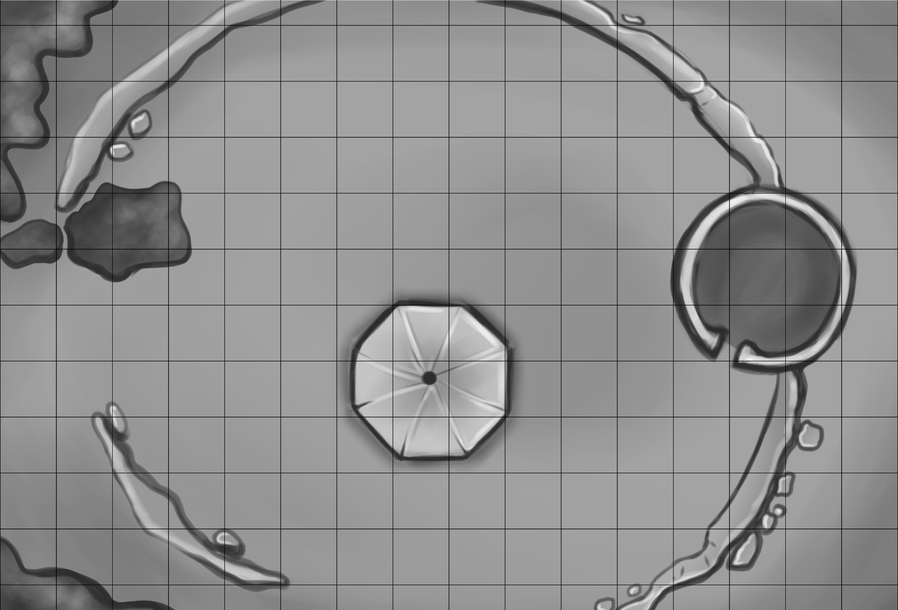

# חורבות טירת דארקפיר

מאת **אונו טסלר (Onno Tasler)**  
הרפתקה לקבוצת דמויות מתחילות

::: {.callout-note title="למנחת המשחק"}
זהו פרק למנחה, והוא כולל את סודות ההרפתקה. הקטעים המוזחים מיועדים להקראה לשחקנים או לתיאור במילים שלך. המרחקים הומרו למטרים, כמקובל בתרגום חוקי המשחק באתר.
:::

## רקע

טירת דארקפיר ניצבה בלב יער אשוחים עבות, ומכאן שמה, שפירושו "אשוח אפל". היא הייתה ביתם של אדוני דארקפיר. האחרון בשושלת, סר רג'ינלד מדארקפיר, לא דבק במעלות האבירות של אבותיו, אלא נכנע למידות רעות, ובראשן תאוות בצע. הוא פנה לשוד והטיל את חיתתו על הדוכסות כולה. במשך זמן רב היה הדוכס טרוד בפשיטות של דמויי־אדם, אך לבסוף כינס את הווסאלים שלו וצר על טירת דארקפיר. כוחותיו הסתערו עליה והעלו אותה באש, אך לא מצאו זכר לסר רג'ינלד או לאוצרותיו.

זמן קצר לאחר המצור ניסו תושבי הסביבה לקחת מאבני הטירה לבניית בתיהם, אך נמלטו בבהלה כשראו רוח רפאים משוטטת בה. הטירה הלכה והתפוררה. עד היום לא נמצאו האביר ואוצרו, אך השמועות על שניהם, החבויים בטירה הרדופה, עדיין נפוצות.

## מתקרבים לחורבות

> סוף־סוף, לאחר שעות של הליכה ביער אפל מלא עצים מפותלים, מעידות על שורשים בוגדניים ומעבר בסבכי קוצים, כשבאוזניכם רק קללותיכם ורחש הרוח בעלים, אתם מגיעים לקרחת יער המקיפה גבעה. בראש הגבעה ניצב מגדל שהזמן פורר אותו, העשן השחיר אותו והקיסוס כיסה אותו בירוק. ברור שהוא נטוש: קומתו העליונה הרוסה וחשופה לפגעי מזג האוויר. למרבה הפלא, נראה שאף ציפור לא בנתה קן בראשו, והוא נותר שומם ועזוב.
>
> כשאתם מתקרבים למגדל, אתם מבחינים בשרידי מה שהיה ככל הנראה טירת דארקפיר: חומות מתפוררות, מכוסות טחב וחזזיות. מעבר לחומה, מול המגדל, נערמת ערמת אשפה ועפר גדולה, ששרכים ושיחים כבר השתלטו על חלקה. כמעט במרכז המצודה לשעבר יש כתם קרקע שאין בו כל סימן לחיים.

## המגדל

### מחוץ למגדל

> המגדל, או מה שנותר ממנו, מתנשא לגובה שלוש קומות. הוא מכוסה קיסוס, שכמעט מסתיר את אבני הבנייה המקוריות. רק שתי הקומות התחתונות נותרו שלמות; הקיר המערבי של הקומה השלישית חסר. מדי פעם נושאת הרוח צחנה חריפה מהמגדל, וככל שאתם מתקרבים היא מתחזקת. הקרקע מסביב זרועה שברי בניין, שנפלו כנראה כשהקומות העליונות התמוטטו. עליכם להיזהר בכל צעד, פן תעקמו קרסול באחד הבורות הרבים. בקיר המגדל יש פרצה אחת, שאולי רחבה דיה לאדם בגודל ממוצע להידחק דרכה פנימה.

זה היה מגדל הטירה וקו ההגנה האחרון שלה. הקומות העליונות קרסו בחום העז של השרפה, אך הקומות התחתונות שרדו איכשהו. כיום שוכנים בקומה השנייה דארקלינג וחבורת עטלפים ענקיים המלווה אותו. הגללים שלהם הם מקור הצחנה, והם גם אלה שהבריחו את שאר הציפורים.

### בתוך המגדל

#### קומה ראשונה

> מלבד הצד המערבי, שדרכו נכנסתם, הרצפה נקייה משברי בניין, אך האבק שבכל מקום גורם לכם להתעטש. הצחנה חזקה עוד יותר. מעט האור החודר דרך הפתח מאיר את החלל בקושי, אך מאפשר בדיקה חטופה. אתם רואים גרם מדרגות לולייני שעדיין אפשר להשתמש בו, ליד הקיר הפרוץ, שולחן רקוב וכמה ערמות בגדים.

החדר נבזז ביסודיות במשך השנים, ואין בו דבר בעל עניין. עם זאת, קל למדי להגן עליו, וקשה להבחין בתוכו מבחוץ, ולכן הוא עשוי לשמש מקום מנוחה בטוח — אם כי לא נוח במיוחד, בשל הצחנה הקשה. נוסף על כך, כל מי שיעמוד על המשמר עלול לראות את רוח הרפאים.

אם הגיבורים בודקים את הרצפה, הם יכולים למצוא אבן רופפת מעט מצפון למרכז החדר. מתחתיה מתגלה ידית ברזל. הידית שייכת לדלת סתרים ברצפה, הסוגרת על מעבר סודי למרתף היין. הדלת לא הייתה בשימוש זמן רב, וחיילי הדוכס מעולם לא גילו אותה. משום כך היא תקועה ויש לפתוח אותה בכוח.

#### קומה שנייה

> ככל שאתם עולים, הצחנה מתחזקת. כשאתם מגיעים לבסוף לקומה השנייה, היא כבר מעוררת בחילה. החדר חשוך לחלוטין, אך אתם שומעים קול חלוש מאוד, כאילו רגליים זעירות מהלכות במרחק.

זוהי מאורת הדארקלינג (Darkling). כאן הוא ישן ביום, ומכאן הוא יוצא לציד בכל לילה ולכאן הוא שב בסיומו. הדארקלינג הוא עטלף ענק ששונה באמצעות כישוף אפל. חבורת עטלפים ענקיים מלווה אותו תמיד, והוא ישן ביניהם. אם מישהו או משהו יפריע לשנתם, פעולתו הראשונה תהיה צרחה מהממת. אם האויב נראה חזק מדי, הוא יימלט ויתכנן מארב בהמשך.

לא לדארקלינג ולא לעטלפים הענקיים יש אוצר, אך פרט מפוחלץ ושמור היטב של דארקלינג שווה 15 מטבעות כסף לאספנים ולמלומדים מסוימים. יש גם מעט ביקוש לדארקלינגים חיים לצורכי מחקר או לתצוגה בגן חיות. המעוניינים עשויים לשלם עד 300 מטבעות זהב, בהתאם למצבו של היצור.

| נתון | דארקלינג | 6 עטלפים ענקיים |
|---|---|---|
| דירוג שריון | 14 | 14 |
| קוביות פגיעה | 2 | 2 |
| מספר התקפות | 1 נשיכה או 1 צרחה | 1 נשיכה |
| נזק | 1d4 וניקוז נקודת פגיעה אחת לסיבוב, או הימום | 1d4 |
| תנועה | 3 מ'; מעוף 18 מ' | 3 מ'; מעוף 18 מ' (3 מ') |
| גלגול הצלה | גנב: 2 | לוחם: 2 |
| מורל | 8 | 8 |
| נק"נ | 100 | 75 לכל אחד |
| נקודות פגיעה | 13 | 6, 8, 5, 2, 5, 5 |

**צרחה מהממת:** צרחת הדארקלינג נמצאת מעט מתחת לטווח השמיעה האנושי. היא מהממת את הקורבן, שמאבד את הכרתו למשך 1d4+1 סיבובים. גלגול הצלה מוצלח נגד נשיפת דרקון מונע זאת. אפשר לכוון את הצרחה למטרה אחת בלבד בכל סיבוב, בטווח של עד 9 מ'. בכל סיבוב הדארקלינג יכול לנשוך או לצרוח, אך לא לעשות את שניהם.

#### קומה שלישית

> כשאתם מתקרבים לקומה השלישית, משב רוח מיילל דרך חור משונן בקיר. הקיסוס המכסה את המגדל נשאב בחלקו פנימה, ונופל בחזרה כשהמשב שוכך. הקיר המערבי התמוטט כמעט כולו וגרר עמו גם את התקרה. אפשר לראות הרחק מערבה, אך מלבד יערות וגבעות, דבר אינו מושך את העין.

## בית התפילה המקולל

> כמעט במרכז הטירה יש שטח בצורת מתומן כמעט מושלם שאין בו כל סימן לחיים: אפילו הצמח הקטן ביותר אינו צומח בו, ולא נראית בו שום מחילה. בדיוק במרכזו מונחת אבן גדולה. נראה שפעם עוצבה ביד אומן, אך מאז נשחקה ברוח ובגשם, ורובה מכוסה טחב וחזזיות. בתוך כל הירוק הזה מושך את עיניכם כתם כהה. באופן מוזר, גם עליו אין כל סימן לחיים, ממש כמו בקרקע שסביב האבן.

כאן עמד בעבר בית התפילה של טירת דארקפיר. רג'ינלד לא היה אדוק כאבותיו. כשכוהן בא לעצור את הברון השודד, רג'ינלד רק צחק עליו. עם זאת, הוא חשש שהכוהן מרגל. הוא הרשה לו להתפלל בבית התפילה הישן, אך רצח אותו בשעת תפילתו. מאז המקום מקולל, ורוחו של הכוהן שנרצח משוטטת בו בלילות ותוקפת כל מי שהיא פוגשת בתוכו.

אם הרוח מובסת בקרב, היא פשוט שבה ומתגשמת בלילה הבא. כדי לשחרר את נשמת הכוהן, אדם, או בן־תמותה תבוני אחר, חייב להתפלל יום שלם ולילה שלם לעילוי נשמתו ליד המזבח המחולל שבמרכז המקום. במשך היום הסכנה היחידה היא יצורים בעלי כוונות רעות שעלולים להזדמן לשם. בלילה על המתפלל להישאר במקומו למרות הרוח. למרבה המזל, היא אינה תוקפת את מי שמתפלל ליד המזבח, אך עצם נוכחותה מסב למתפלל נזק השקול לשלוש התקפות מוצלחות שלה.

אם הדמות שורדת, הרוח תנסה להשתלט על גופה עם שחר באמצעות [בקבוק קסם](allSpells.qmd#בקבוק-קסם). אם הניסיון מצליח, הדמות נרפאת לחלוטין מכל הנזק שספגה בזמן התפילה, וגם אחד מערכי התכונות שלה עולה בנקודה אחת. גלגלי 1d6:

| תוצאה | תכונה |
|:---:|---|
| 1 | כוח |
| 2 | זריזות |
| 3 | חוסן |
| 4 | תבונה |
| 5 | חוכמה |
| 6 | כריזמה |

::: {.callout-note title="הערת הכנה למנחה"}
במקור אין פסקת נתונים נפרדת לרוח. נתוני [רוח](monstersAll.qmd#רוח) מופיעים בתיאורי המפלצות. מומלץ לקרוא אותם ואת תיאור בקבוק קסם לפני המשחק; תנאי שחרור הנשמה והתגמול שלעיל הם התנאים המיוחדים להרפתקה זו.
:::

## ערמת האשפה

> מעבר לחומה, מול המגדל, יש ערמה גדולה של אשפה ועפר, ששרכים ושיחים כבר השתלטו על חלקה. בשולי הערמה, סמוך לשרידי החומה, צומח שיח גדול. מבין העלים הירוקים נשמע ציוץ של ציפור קטנה. היופי הזה נראה מעט לא שייך לחורבות השוממות שסביבו.

מאחורי הצמחייה מסתתרת הכניסה למבנה המגורים הישן, שאיכשהו שרד את השרפה ואת קריסת החומה עליו. אם ההרפתקנים מחפשים מתחת לצמחייה, הם רואים את תחתיתה של דלת רקובה כמעט לגמרי, וכן דרך המובילה אל תוך ערמת האשפה. בבדיקת האזנה מוצלחת הם שומעים תנועה בפנים — קולות השודדים הנעים במבנה.

## מבנה המגורים הישן

> בפנים חשוך. הצמחייה חוסמת את מעט האור שהיה יכול לחדור דרך הדלת. האוויר עומד, כמעט אין רוח, וריח של עובש ואבק ממלא את המקום. הרצפה נראית נקייה למדי; רק מדי פעם רגלכם נתקלת באבן או בפיסת אשפה.

בחיפוש יסודי ימצאו ההרפתקנים דלת ברצפה המובילה למרתף המזון, והרבה גרוטאות. חבורה קטנה של שודדים מסתתרת ליד הקיר המערבי, מאחורי שברי בניין ומתחתם.

שודדי הדרכים מצאו כאן מקלט לאחר שהמיליציה המקומית הביסה את כנופייתם. אלה הניצולים המעטים: רעבים, עייפים ופצועים, ואינם מעוניינים להילחם. לכן, אם הדמויות מתקרבות, הם מנסים להסתתר ולברוח בהזדמנות הראשונה. אם ההרפתקנים נראים בכל זאת כטרף קל, השודדים ינסו לארוב להם, אך יימלטו במהירות אם הקרב יתפתח לרעתם.

אם הדמויות מציעות להם להיכנע, השודדים יעשו זאת: אין להם עניין להיטבח בידי יריבים חמושים היטב. אם יציעו להם מזון ומחסה, הם יחברו להרפתקנים, אך יידרש זמן עד שיהיה אפשר לבטוח בהם לחלוטין.

לשודדי הדרכים יש מעט רכוש: נשק קל, מטבעות ספורים ושריון בלוי. הרשויות מחפשות אחריהם, והם יודעים זאת. על כל שודד שייתפס חי ויובא למשפט ישולם פרס של 10 מטבעות זהב. לא ישולם פרס על שודדים מתים.

| נתון | 5 שודדי דרכים |
|---|---|
| דירוג שריון | 13 |
| דרגה | אדם רגיל |
| מספר התקפות | 1 |
| נזק | 1d6 |
| תנועה | 9 מ' |
| גלגול הצלה | אדם רגיל |
| מורל | 6 |
| נק"נ | 10 לכל אחד |
| נקודות פגיעה | 4, 2, 3, 3, 2 |

לכל שודד יש 1d8 מטבעות נחושת ו־1d8 מטבעות כסף. כל אחד חמוש בנשק קל: גרזן יד, אלה או חנית.

## מתחת לאדמה

### מרתף המזון

> המדרגות נחצבו בסלע האם. האוויר והקירות קרירים ולחים, וריח אופייני של מחסנים תת־קרקעיים עולה באפכם. בפנים יש אשפה וגרוטאות, שרידי מדפים ומזון רקוב. מעבר צר חסום בדלת חלודה.

זה היה מחסן הטירה, אך כל מזון שלא נבזז כבר נרקב. אין בחדר דבר בעל עניין. את הדלת החלודה אפשר לפתוח רק בכוח; היא מובילה למרתף היין.

### מרתף היין

> גם המרתף הזה נבזז, ממש כמו מרתף המזון. רק שרידים רקובים ושבורים של חביות יין מזכירים למה שימש פעם. מלבד זאת הוא דומה למרתף המזון.

**אוצר:** איכשהו שרדה עד היום חבית יין קטנה, והיא עדיין חבויה מתחת לערמת אשפה בפינה הצפון־מזרחית. זהו יין משובח, ששוויו 2d6×10 מטבעות זהב.

**דלת סודית:** לחבית היין השלישית, בספירה מצפון, יש דופן קצה כפולה. בין שתי הדפנות יש די מקום לאדם בוגר. הדופן האחורית נפתחת כלפי חוץ ומובילה למעבר סודי.

### המעבר הסודי

> המעבר חצוב בגסות באבן, והאוויר בו גרוע אפילו מזה שבמרתף. עדיין אפשר לנשום, גם אם התחושה לא נעימה. אינכם שומעים דבר מלבד צעדיכם, ואינכם חשים בתנועת אוויר מלבד נשימותיכם.

המעבר מחבר את מרתף היין לקומה הראשונה של המגדל.

**מלכודת:** מלכודת במדרגות העולות אל המגדל נועדה למנוע ממתנקשים להיכנס בדרך זו. דריכה על המדרגה השנייה מלמטה גורמת למלכודת לירות קליע מתחת למדרגה השמינית. הקליע גורם נזק כמו קליע של רובה קשת כבד. נותר בה קליע אחד בלבד. בבחינה מקרוב של המדרגות אפשר להבחין בבירור שהמדרגה הממולכדת שחוקה הרבה פחות מהאחרות.

**דלת סודית:** כשליש הדרך מהמגדל אל המרתף, בצד ימין, קבוע לוח פליז מכוסה ירוקת. לאחר שמנקים אותו אפשר לקרוא את הכתובת:

> "רק מי שיש בו ניצוץ ימצא את האוצר."

אם יוצרים ניצוץ על הלוח בדרך כלשהי, דלת סודית נפתחת ומאפשרת כניסה לחדר האוצר.

### חדר האוצר

> כשאתם נכנסים למערה טבעית קטנה, נדמה לכם שאתם מריחים את הסלעים המחוספסים עצמם. במעבר דרך הדלת אתם חשים משב קל ליד אוזניכם, אך התחושה נעלמת כשאתם בפנים.
>
> הקרקע מחוספסת ולא אחידה, אך אין בה מקום מסוכן באמת, אלא אם מועדים אל הפרצה שמשמאל. החדר ריק למדי, מלבד תיבה ענקית במרכזו.

**תיבת האוצר:** התיבה נעולה במנעול פשוט בלבד, ולא יהיה קשה לפתוח אותה בכוח. היא אכן מלאה מטבעות — מטבעות נחושת. 4,320 מהם, ליתר דיוק.

נראה שמישהו, או משהו, כבר בזז את חדר האוצר. הרי לא ייתכן שזה כל עושרו האגדי של הברון השודד! מי שיחפש עקבות ימצא חריצים המובילים אל הפרצה, כאילו דבר־מה כבד נגרר לשם. מעבר לפרצה יורד פיר אל המעמקים...

החלק הבא נתון בידייך, המנחה. צרי מבוך משלך, או שלבי מבוך מתוך הרפתקה אחרת של בייסיק פנטזי. בהצלחה ובהנאה!

## מפת החורבות

{#fig-darkfir-map fig-alt="מפת חורבות טירת דארקפיר, עם המגדל מימין ובית התפילה במרכז."}

זוהי מפת פני השטח המופיעה במקור. לא מצורפת במקור מפה נפרדת של המרתפים והמעברים התת־קרקעיים, ולא צוין קנה מידה למשבצות.

## מקור, תרגום ורישיון

המקור: *Ruin of Darkfir Castle*, מאת Onno Tasler, בתוך *Adventure Anthology One*, מהדורה ראשונה, שחרור 21, עמ' 25–28 (עמ' 27–30 בקובץ PDF). זכויות יוצרים © 2008 Onno Tasler.

זהו תרגום עברי עם התאמות להצגה באתר: המרחקים הומרו לפי 10 רגל = 3 מטרים, הנתונים אורגנו בטבלאות, ורמז ה־“sparkling personality” עובד ל־"מי שיש בו ניצוץ" כדי לשמר את הפתרון. הערות ההכנה למנחה נוספו לעיבוד זה. השם דארקלינג תועתק משום שאין לו עדיין ערך במילון המפלצות של האתר.

טקסט ההרפתקה ותרגומו מזוהים כאן כתוכן משחק פתוח לפי OGL v1.0a, בנפרד מרישיון CC-BY-SA של יתר האתר. המפה מובאת מהמקור; לפי הודעת המקור, איורים אינם תוכן משחק פתוח וזכויותיהם נשארות בידי בעלי הזכויות. קרדיט המפות הכללי באנתולוגיה: J. D. Neal, Dennis Bamberger ומחברי ההרפתקאות; למפה זו לא ניתן קרדיט נפרד.

::: {.callout-note collapse="true" title="הודעת המקור ונוסח הרישיון המלא (באנגלית)"}
::: {dir="ltr" lang="en" style="text-align: left;"}

:::
:::
