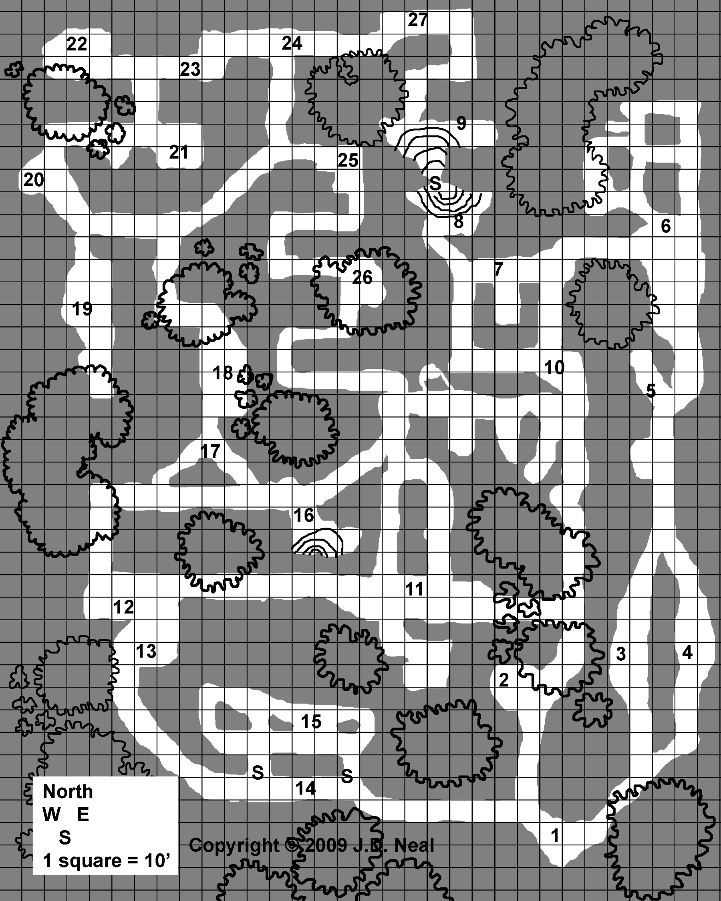

# Insect Valhalla

By **J. D. Neal**  
An adventure for 4 to 8 characters of levels 3 to 6

::: {.callout-note title="For the Game Master"}
This chapter contains adventure secrets. Blockquoted passages can be read aloud or paraphrased. Area numbers match the [map](#insect-valhalla-map).

The source refers to the Basic Fantasy Field Guide, Volume 1 for giant praying mantises, giant mosquitoes, guard ferns, and giant trapdoor spiders. The encounter statistics supplied in this adventure are preserved here; review creature descriptions, especially poison, blood drain, and special attacks, before play. This preparation note is an addition to the web edition.
:::

## Setting

This warren of caves is a mixture of roughly hewed mines and natural, water-worn chutes and tubes. It has never been the home of a humanoid tribe, although miners have traveled to it on occasion. The stonework is mostly soft lime (white or yellowish) and some granite, amid hard packed earth, roots and rock.

There are no “ceilings” for most of the tunnels – they are open, letting in light and water. Plant life and small life forms thrive in the rich loam that has spilled down (or been washed down by rain fall) from the upper surfaces. Plants thrive in the surrounding area, growing down into the tunnels and casting seeds onto the floor.

The inhabitants of this maze are a "warring" collection of giant insects, arachnids, worms and such creatures. They haven't been disturbed in a long time and have settled into a domestic life, often as not never leaving the area they have staked out, preying off each other and anything that passes by.

There aren't any doors and many of the areas are open enough to spill in light, so unless the players decide to go through it at night they will have less to deal with in terms of lighting (although deep shadows would make carrying light wise). While the crevices would (in real life) be winding and crooked, they were kept fairly straight to make it easier to map and describe.

The tunnels could be explored by walking outside, but (a) many of the monsters in it can certainly come crawling or flying out at fresh meat, and (b) during the growth season the crevices will be lined by plants and vines that make it difficult to see down into them. If party tries to skirt along the rim, the GM chances of being surprised should be increased. Many insects rely less on eyesight than they do chemical senses or vibrations to detect potential prey and intruders. Mucking around in the brush and trees outside the tunnels is an open invitation to ambush.

## Wandering Monsters

Roll: 1 on 1d6 every 3 turns (30 minutes)

| Roll | Encounter | Statistics |
|:---:|---|---|
| 1 | 1d6 Giant Ants | [As in #6](#room-6) |
| 2 | 1d3 Giant Crab Spiders | [As in #3](#room-3) |
| 3 | 1d6 Giant Shrews | [As in #11](#room-11) |
| 4 | 1d6 Giant Bees | [As in #21](#room-21) |
| 5 | 1d6 Cave Locusts | [As in #23](#room-23) |
| 6 | 2d6 Giant Centipedes | [As in #10](#room-10) |

## Area Key

### 1. Insect Graveyard {#room-1}

> This rough, crudely hewed room is full of insect skeletons and bits and pieces of body parts – legs, wings, etc.

These are the dried, empty corpses of beetles, spiders, and ants scattered in odd heaps here and there. Most are old and brittle. A few are fresher; one or two are moist to touch. As insects from other areas die, they are sometimes drug here to be eaten or disposed of.

### 2. Tree Of Woe {#room-2}

> A great tree has driven its massive roots down into the wide opening here.

A devilish pair of black widow spiders has claimed this nook as their territory. They remain hidden in the darkness of the tangled roots of the tree overhead, motionless and nearly invisible, hunting mainly by noting movement. Anyone moving into the nook has a high chance of becoming entangled in the nearly invisible webs that they have strung across the front. If they detect prey, the spiders come scuttling quickly down, causing any daylight from above to be blotted out and perhaps disorienting prey.

Slumped against the lower roots is the mummified, skeletal figure of a human kept together by webs and dried tissues. It is wearing a silver holy symbol, a magical Mace +1 attached by a thong around one wrist, and a backpack full of ordinary gear including decayed food, and a small pouch with 3 gems worth 100 gp each and coins totaling 15 gp.

| Statistic | 2 Giant Black Widow Spiders |
|---|---|
| AC | 14 |
| HD | 3\* |
| #At | 1 bite |
| Dam | 2d6 + poison |
| Mv | 20' Web 40' |
| Sv | F3 |
| Ml | 8 |
| XP | 175 ea. |
| HP | 16, 17 |

### 3. Spiders Galore {#room-3}

> Plants are thick here, with leaf covered vines and shrubs growing down into the crevice. The husks of dead insects are scattered here and there on the floor.

This rough hallway is the lair of a number of spiders fighting an unplanned war against the other insects. They are holding their ground, catching, killing and eating ants and beetles that come prowling around. The presence of carcasses on the floor will make it obvious who is here. Anyone who takes the time to investigate before entering might see something vague moving about now and then, although the spiders tend to be well camouflaged and strike from ambush. Someone patient enough may even witness a kill.

| Statistic | 6 Giant Crab Spiders |
|---|---|
| AC | 13 |
| HD | 2\* |
| #At | 1 bite |
| Dam | 1d8 + poison |
| Mv | 40' |
| Sv | F2 |
| Ml | 7 |
| XP | 100 ea. |
| HP | 13, 8, 5, 8, 4, 7 |

### 4. Wood Eating Beetles {#room-4}

> The floor of this area is thick with old leaves and rich earth. The smell of freshly turned over soil comes to the nose, as well as the smell of raw wood.

A collection of giant bombardier beetles are thriving in the mixture of leaf foliage and crumbled wood on the floor here. If attacked (or someone gets too close) they attack.

| Statistic | 8 Giant Bombardier Beetles |
|---|---|
| AC | 16 |
| HD | 2\* |
| #At | 1 bite + special |
| Dam | 1d6 + special |
| Mv | 40' |
| Sv | F2 |
| Ml | 8 |
| XP | 100 ea. |
| HP | 15, 12, 12, 8, 5, 8, 4, 6 |

### 5. Hunting Tiger Beetles {#room-5}

> Plant growth is lush here, especially along the rim. A long opening in the ceiling will shed bright light into this area during the day, especially at noon.

At the opposite end of this tunnel lurks three tiger beetles, careful and quiet. They will attack any movement in an attempt to secure prey, lunging out with a good chance of surprise, unless the player characters have some method of illuminating it from a distance to reveal them.

Several humanoid bones lie among the litter in this nest, as well as scraps of armor and clothing. A pouch with 300 gp has spilled onto the ground, alongside a rusted short sword and dagger (how rusted they are is up to the Game Master).

| Statistic | 3 Giant Tiger Beetles |
|---|---|
| AC | 17 |
| HD | 3+1 |
| #At | 1 bite |
| Dam | 2d6 |
| Mv | 60' (10') |
| Sv | F3 |
| Ml | 9 |
| XP | 145 ea. |
| HP | 21, 15, 14 |

### 6. Ants {#room-6}

> Ahead of you are twin openings in the north face of the crevice. The openings are rounded, cleared of roots and brush, some of which has been snipped off close to the root. There are no large rocks and something has evened out the walls and floors.

Scurrying in constant activity around these tunnels are giant ants. They are so busy keeping the tunnels clean that they will usually be seen outright.

| Statistic | 5 Giant Ants |
|---|---|
| AC | 17 |
| HD | 4 |
| #At | 1 |
| Dam | 2d6 |
| Mv | 60' (10') |
| Sv | F4 |
| Ml | 7 on first sighting, 12 after engaged |
| XP | 240 ea. |
| HP | 27, 23, 22, 22, 19 |

### 7. Grassy Death {#room-7}

> Thin, young trees dot this relatively open area, which is grown up with tall grasses and cane.

This is home to two giant praying mantises, which stalk prey by blending in with the vegetation. They have a high chance of surprising unwary characters (1-4 on 1d6); a lower chance of surprising those who might be looking for one.

| Statistic | 2 Giant Praying Mantises |
|---|---|
| AC | 16 |
| HD | 5 |
| #At | 1 bite |
| Dam | 1d12 bite |
| Mv | 40' Fly 120' |
| Sv | F5 |
| Ml | 8 |
| XP | 360 ea. |
| HP | 28, 22 |

More detailed information about giant praying mantises can be found in the Basic Fantasy Field Guide Volume 1.

### 8. Pool {#room-8}

> The north side of this alcove has a pool of water in it, clear, clean and cool. It lies placid, perhaps the run off of rain water or something that is fed by a gentle underground seep. There is a scattering of cane about, but overhanging ledges keep the area dark much of the time.

There might be an occasional insect here drinking, but few inhabit this area. The pool disappears under a shelf, opening out into the "secret" chamber to the north. Award the party a pocket award of (for example) 50 to 100 experience points for finding it and swimming to the other side.

### 9. Mosquitoes {#room-9}

> You see a pool of clear, clean and cool water filling much of this chamber. It is placid, perhaps a cistern formed by the run-off of rain water or fed by a gentle underground seep. The roof is open in this alcove and skinny but tall canes stretch thirty feet high around the rim. An annoying, buzzing whine can be heard, growing more intense second by second.

Here we have giant mosquitoes, which ravage the animals in the outlying area at night. They will come buzzing in to attack warm blooded prey any time of the day. There are a total of 20 + 2d6 of them, although rarely will more than 1d6+1 discover each adventurer at any time.

| Statistic | 22 to 32 Giant Mosquitoes |
|---|---|
| AC | 11 |
| HD | 1d4 HP\* |
| #At | 1 bite |
| Dam | 1d3 bite + 1d3/round blood drain |
| Mv | 50' |
| Sv | F1 |
| Ml | 9 |
| XP | 13 ea. |
| HP | 3, 1, 3, 3, 2, 3, 1, 3, 2, 4, 1, 1, 2, 3, 2, 1, 3, 4, 2, 1, 3, 1, 4, 2, 4, 4, 2, 3, 3, 2, 3, 2 |

More detailed information about giant mosquitoes can be found in the Basic Fantasy Field Guide Volume 1.

### 10. Centipedes {#room-10}

> Now and then something scuttles in the dry leaves carpeting this grassy, overgrown area.

The leaf litter and muck in this area is infested by giant centipedes. Roll to determine how many are encountered each minute of exploration. 1d6: 1-3 = 1, 4-5 = 2, 6 = 3. There is a maximum of 1d6+6 (7 – 12).

| Statistic | 7 to 12 Giant Centipedes |
|---|---|
| AC | 11 |
| HD | 1d4 HP\* |
| #At | 1 bite |
| Dam | poison |
| Mv | 40' |
| Sv | NM |
| Ml | 7 |
| XP | 13 ea. |
| HP | 2, 4, 2, 3, 4, 1, 2, 2, 3, 3, 1, 1 |

### 11. Giant Shrews {#room-11}

> This tunnel is fairly open, but overgrown along the rim. Large ferns and bushes are growing thick along the floor. A frantic squeaking like overgrown mice can be heard from amid the weeds.

Attracted by worms and insects, the giant shrews here are voracious and strike at any form of food they detect. Two silver-headed hand axes lie among rubbish on the ground.

| Statistic | 12 Giant Shrews |
|---|---|
| AC | 16 |
| HD | 1\* |
| #At | 2 bites |
| Dam | 1d6/1d6 |
| Mv | 60' |
| Sv | F2 |
| Ml | 10 |
| XP | 37 ea. |
| HP | 8, 7, 1, 4, 6, 3, 4, 6, 3, 5, 6, 4 |

### 12. Guard Fern {#room-12}

> Large ferns and brush grow thick along the floor here.

This area is defended by a guard fern.

| Statistic | Guard Fern |
|---|---|
| AC | 14 |
| HD | 6\* |
| #At | 3 thorn, acid, leaves |
| Dam | 1d4 thorn, 3d8 acid, 1d8 leaves |
| Mv | 0' (immobile) |
| Sv | F6 |
| Ml | 12 |
| XP | 555 |
| HP | 27 |

More detailed information about guard ferns can be found in the Basic Fantasy Field Guide Volume 1.

### 13. Skeletons {#room-13}

> You can tell that this channel was once much more narrower but has collapsed into a heap of rock and earth some time ago. Mixed in with the rubble are grasses and shrubs, growing up amid white, bone-like sticks and rounded rocks.

The sticks are bones and the rocks are skulls. Here lie the remnants of a human mining party killed by a cave-in, uncovered by weathering and insects. There are about six skeletons, 3 or 4 of which are suitable for being animated. Included among the bones are 180 cp, 13 sp, 13 gp, and 5 pp.

### 14. Spider Fox Holes {#room-14}

> You see a long tunnel open to the sky and grown over with grass on the floor and long vines along the walls.

Hidden in the north wall of the tunnel are two trapdoor spiders. They have made extremely good covers for their burrows, and rely mostly on sound and vibrations to detect prey. Consider the covers to be well-made secret doors. An aggressive physical search will reveal the coverings (they are soft while the walls and floors are hard). A probing search will also cause the spider within to attack. If they are not discovered beforehand, roll 1d6 for each person passing by an opening; on a 5 or 6 a spider has noted them and decides to attack.

| Statistic | 2 Giant Trapdoor Spiders |
|---|---|
| AC | 15 |
| HD | 4\* |
| #At | 1 bite |
| Dam | 1d8 bite + poison or wrestling |
| Mv | 50' |
| Sv | F4 |
| Ml | 8 |
| XP | 280 ea. |
| HP | 18, 15 |

More detailed information about giant trapdoor spiders can be found in the Basic Fantasy Field Guide Volume 1.

### 15. Litter Box {#room-15}

> A collection of many different insect corpses have been gathered in this area, punctured and drained of internal fluids and organs.

Buried under the bodies will be ten pounds of gold nuggets (at 10 coins per pound, they can be valued at 10 gp per pound) and two rough gems, whose uncut values are 200 gp each, but will approach 500 gp each once cut.

### 16. Waterfall {#room-16}

> The constant splatter of water announces this pool of water. A stream gushes out of a small hole up top and splatters down into the pool.

The pool is shallow and fresh. The hole up top and is too small for anyone to get into. It slowly drains into the porous rock below.

### 17. Worm Beds {#room-17}

> Both branches of this Y-intersection are thick with loam and earth. Something moves through the leaves now and then with a snake-like slither.

These areas are occupied by entirely inoffensive earthworms of quiet large size: a foot or two long, sometimes three or four. They live their blind life enriching the soil and providing food for moles and insects and such. Curious players might find 5d6 x 5 pounds of worms in each place.

### 18. Hissing Attack {#room-18}

> The walls are gown over with tall, narrow trees and vines. Winding down from the roof is a large snake!

Once the hungry inhabitant is dealt with, two crushed and mostly digested ancient corpses of dwarves can be found with a careful search, hidden among brush and leaves. A Potion of Healing and a Potion of Gaseous Form can be found in a smallish wooden casket underneath one. A mostly-digested leather bag contains 3 gems worth 100 gp each, 12 platinum pieces, and 230 gp.

| Statistic | Python Snake |
|---|---|
| AC | 14 |
| HD | 5\* |
| #At | 1 bite + constrict |
| Dam | 1d4 + 2d4 |
| Mv | 30' |
| Sv | F5 |
| Ml | 8 |
| XP | 590 |
| HP | 22 |

### 19. Gem Bed {#room-19}

> This narrow tube leads to a wet tunnel that ends in an area which seems to have been cut by humanoid hands. A broken, rusted iron pick and a very old, rotten leather sock-like shoe are visible amid spilled rocks and clumps of earth. The tunnel walls narrow sharply overhead, almost obscuring any light. Moisture drips down now and then and the floor is muddy and squishy. Sometimes you sink ankle deep in a random mud hole.

Here is what attracted occasional miners: encrusted into the soft matrix of the walls are gem stones. With a few hours of work the characters can recover the following uncut gems (cut values in parenthesis):

| Number | Uncut Value | Cut Value |
|:---:|---|---|
| 3d8 | 10 gp | 25 gp |
| 2d8 | 100 gp | 200 gp |
| 1d8 | 250 gp | 500 gp |

### 20. Blister Attack {#room-20}

> Trees and brush are thick overhead, creating a dark morass of shadows amid roots, vines, and ferns.

Three giant bombardier beetles lurk in the shadows, preying on whatever passes. Among the litter of their kills is a torn leather necklace with 10 small gems worth 50 gp each lashed to it.

| Statistic | 3 Giant Bombardier Beetles |
|---|---|
| AC | 16 |
| HD | 2\* |
| #At | 1 bite + special |
| Dam | 1d6 + special |
| Mv | 40' |
| Sv | F2 |
| Ml | 8 |
| XP | 100 ea. |
| HP | 13, 11, 5 |

### 21. Giant Bee Nest {#room-21}

> The opening to this cubicle is fairly open, with random trees and brush providing some shade. Nestled amid tree roots against the south wall is a curious, extremely large lump of gray wood.

A hive of giant bees has built its nest here – a massive structure of beeswax and paper. In general, the party will encounter them in waves of 1d6 or 1d8, unless the PCs do something to irritate the entire nest. Usually 1d6 or 1d8 will be inside the nest itself at any time and as such safe (or at least with a bonus to saves) from various area attack spells. The hive contains 2d6 x 10 gallons of honey which might be priced at 20 to 40 gp per gallon (about 5 to 10 gp per pound).

| Statistic | 15 Giant Bees |
|---|---|
| AC | 13 |
| HD | 1d4 HP\* |
| #At | 1 sting |
| Dam | 1d4 + poison |
| Mv | 10' Fly 50' |
| Sv | F1 |
| Ml | 9 |
| XP | 13 ea. |
| HP | 2, 3, 3, 1, 2, 4, 1, 1, 1, 4, 2, 4, 2, 2, 4 |

### 22. Ant Annoyance {#room-22}

> The floor of this passage is cluttered by leaf litter and the remains of old trees.

If the party enters this alcove, they will be swarmed by ants that are much larger than normal ants but are in no way giant ants. They make up two swarms of insects that attack in close combat.

| Statistic | 2 Insect Swarms |
|---|---|
| AC | 13 |
| HD | 4\* |
| #At | 1 swarm |
| Dam | 1d3 (double against no armor) |
| Mv | 10' |
| Sv | N/A |
| Ml | 11 |
| XP | 280 ea. |
| HP | 14, 13 |

Getting rid of them will allow a search of the area, revealing five uncut gems worth 50 gp each (100 gp if properly cut).

### 23. Cave Locust Minefield {#room-23}

> Vines, brush, and ferns are scattered along this hall. Leaf litter and rotten wood covers the floor. An occasional grinding noise is heard and the pop of something stepping on dry leaves.

Chewing on leaves and browse are giant cave locusts. They bite, jump, shriek, spit goo and so on per the rule book. There is a 1 in 1d6 chance that anyone passing through stealthily will spook them and cause them to react.

| Statistic | 7 Giant Cave Locusts |
|---|---|
| AC | 16 |
| HD | 2\*\* |
| #At | 1 bite or 1 bump or 1 spit |
| Dam | 1d2 or 1d4\* or special |
| Mv | 20' Fly 60' (15') |
| Sv | F2 |
| Ml | 5 |
| XP | 125 ea. |
| HP | 8, 11, 12, 7, 8, 10, 8 |

### 24. Guard Fern {#room-24}

> Vines, brush, and ferns are scattered along this hall. The ferns are especially thick near the intersection.

This collection of fern-like plants has developed a series of defenses against animals that might try to eat it.

| Statistic | Guard Fern |
|---|---|
| AC | 14 |
| HD | 6\* |
| #At | 3 thorn, acid, leaves |
| Dam | 1d4 thorn, 3d8 acid, 1d8 leaves |
| Mv | 0' (immobile) |
| Sv | F6 |
| Ml | 12 |
| XP | 555 |
| HP | 27 |

More detailed information about guard ferns can be found in the Basic Fantasy Field Guide Volume 1.

### 25. Fruits And Berries {#room-25}

> There are no ferns here and the vines are laden with red and green berries. Several small bushes covered by purple berries can also be seen. A fig tree is towering overhead and nearby you see a small pear tree.

Several of the plants here produce perfectly edible (and harmless) fruits and berries during the growing season. Around 1 week of rations for one person can be gathered each week during the growing season.

The Game Master must decide when the growing season is.

### 26. Giant Ants {#room-26}

> Overhanging plant growth along the rim of this hall makes the tunnel dark. The tunnel seems to have been neatly cleaned of roots, rocks, and other obstructions, perhaps with even more diligence than human miners would put into the chore.

A nest of giant ants has this corridor staked out and are renovating it. Piled back inside the nest are small rocks including eight uncut gemstones worth 50 gp (100 gp cut).

| Statistic | 5 Giant Ants |
|---|---|
| AC | 17 |
| HD | 4 |
| #At | 1 |
| Dam | 2d6 |
| Mv | 60' (10') |
| Sv | F4 |
| Ml | 7 on first sighting, 12 after engaged |
| XP | 240 ea. |
| HP | 23, 18, 16, 18, 14 |

### 27. Leg Breakers {#room-27}

> The floor of this passage is carpeted in leaves, roots, brush, and a long dead, immature pecan tree resting on its side.

A number of one-foot and two-foot wide holes are hidden under the clutter. If the players take care they can discover them and mark them or even fill them with large rocks or some such contrivance. If they aren't careful, there's a 1 in 6 chance of putting a leg through one and taking damage (1d6 points). Once they are revealed, anyone being careful can move through them safely, but someone running through the area has to make a random 1d6 roll versus Dexterity (or as the GM desires) or they will step into one.

## Insect Valhalla Map

{#fig-insect-map fig-alt="Original Insect Valhalla map, with north at the top and a scale of 10 feet per square."}

North is at the top. Each square represents 10 feet (3 meters in the Hebrew edition). Map copyright © 2009 J. D. Neal, as credited on the map itself.

## Source and License

*Insect Valhalla*, by J. D. Neal, in *Adventure Anthology One*, first edition, release 21, printed pages 64–70 (PDF pages 66–72). Copyright © 2009–2012 J. D. Neal.

This web edition preserves encounter numbers, hit points, and XP, reorganizes statistics into tables, and replaces printed HP boxes with numeric lists. It adds internal references and preparation notes. The Hebrew translation converts distances at 10 feet = 3 meters, uses approximately 0.45 kg per pound and 3.8 liters per gallon, and preserves the original honey prices by volume and weight as separate estimates. The unusual 1d6 roll versus Dexterity in area 27 is retained as written.

The adventure text and its Hebrew translation are identified as Open Game Content under OGL v1.0a, separately from the site's CC-BY-SA license. The original map is reproduced here; the source excludes artwork from Open Game Content and retains its copyright holders' rights.

::: {.callout-note collapse="true" title="Original source notice and complete license"}

:::
