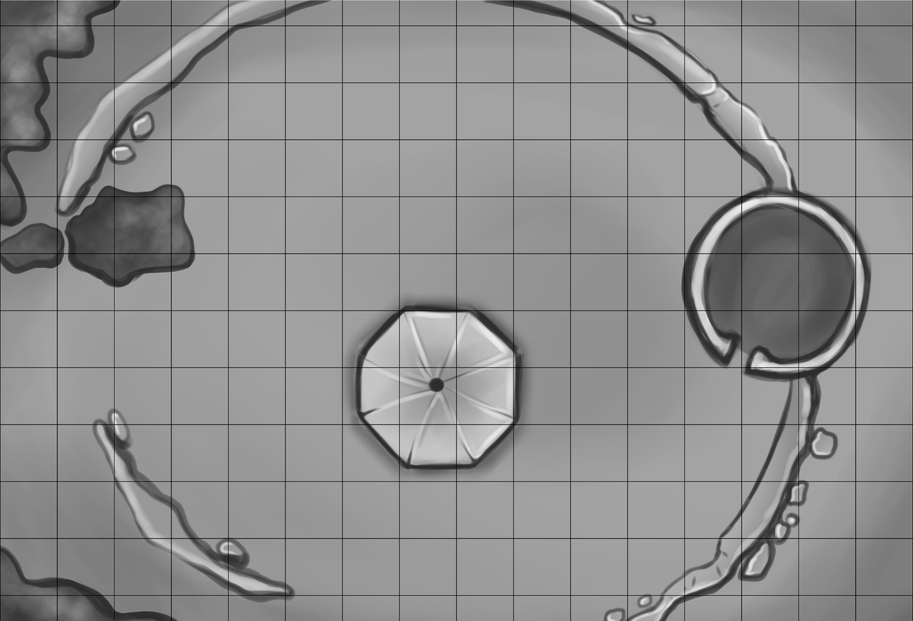

# Ruin of Darkfir Castle

By **Onno Tasler**  
An adventure for a group of beginning characters

::: {.callout-note title="For the Game Master"}
This chapter contains adventure secrets. Blockquoted passages can be read aloud or paraphrased for the players. Statistics and distances below follow the original English adventure.
:::

## Prelude

Set amidst a deep fir wood (hence its name), Darkfir Castle was home to the Sires of Darkfir. The last member of this family, Sir Reginald of Darkfir, did not adhere to the knightly virtues of his forefathers, but fell to vice, greed being the strongest of them. He turned to robbery and became the bane of the whole duchy. For a long time, the Duke was occupied by demi-human raiders, but finally he called his vassals and laid siege to Darkfir Castle, storming it and burning it to the ground. Yet, no trace was found of either Sir Reginald or his treasures.

Soon after the siege, locals tried to take stones for their homes, but fled in panic as they saw a ghost haunting the castle, which quickly fell to ruin. Up to now, treasure and knight remain lost — but rumors about both hidden in the haunted castle are still far spread.

## Approaching the Ruin

> Finally, after several hours of marching through a dark forest full of gnarled trees, stumbling over treacherous roots and passing through thorny bushes, hearing nothing but your curses and the wind in the leaves, you come to a clearing around a hill. Up the hill, you can see a tower, crumbled from time, black from smoke and green from ivy. It is clearly abandoned, as the topmost level is shattered and open to the elements. Strangely, no bird seem to have built his loft atop the tower and thus it remains barren and deserted.
>
> As you draw closer to the tower, you see the remains of what most likely was once Darkfir Castle: crumbled walls, overgrown by mosses and lichens. On the other side of the wall, opposite to the tower, is a big pile of garbage and dirt, which has partly been conquered by ferns and bushes. Almost in the middle of the former keep is a spot bare of life.

## The Tower

### Outside the Tower

> The tower — or what remains of it — stands three levels tall and is overgrown by ivy beneath which you can hardly spot the original stonework. Only the lower two levels are still complete; the west wall of the third level is missing. Occasionally, the wind carries a sharp stench from the tower; the closer you walk, the stronger this scent becomes. The ground around the tower is littered by debris, which probably fell down when the upper levels collapsed, and forces you to watch your step, lest you break your ankle in one of the many holes. There is one gap in the tower’s wall, which might be wide enough for an average man to squeeze himself inside.

This was once the castle’s tower and last line of defense. The upper levels collapsed under the intense heat when the castle was burned, but the lower levels somehow survived. Today, the second level is inhabited by a darkling and his giant bat companions. Their guano causes the stench and they are also responsible for driving off all other birds.

### Inside the Tower

#### First Level

> Except for the western side, where you entered the tower, the floor is free of debris but the omnipresent dust makes you sneeze. The stench became even stronger. The little light falling through the entrance illuminates the inside poorly but allows a cursory search. You can see a still usable spiral staircase next to the broken wall, a rotten table and some heaps of garment.

This room has been carefully plundered over the years and there is nothing of interest to be found inside, but the room can be defended quite well and its interior is not spotted easily from the outside and thus would probably make a safe resting place — though due to the overwhelming stench, not a very comfortable one. Also, any watch would be in danger of seeing the ghost.

If the heroes examine the floor, they can find a lose stone a bit north of the room’s center. If removed, an iron grip can be seen. This grip is part of a concealed trap door which shuts off a secret passage into the wine cellar. It has not been used for a long time (and never been found by the dukes troops), therefore it is stuck and needs to be forced open.

#### Second Level

> The higher you get, the stronger the stench becomes. As you finally enter the second level of the tower it becomes nauseating. The room is pitch-dark, but you hear a very faint sound, as if tiny feet were walking in the distance.

This is the darkling’s lair, where he sleeps during daytime and where he starts and ends his hunt each night. The darkling is a giant bat which was altered by foul sorcery. He is always accompanied by a group of giant bats and sleeps among them. Should someone or something disturb their sleep, he will use his stunning scream as first action. If the enemy seems too strong, he will flee and plot some ambush later.

Neither the darkling nor the giant bats carry any treasure, but a well preserved darkling trophy is worth 15 silver pieces to some collectors and scholars. There is also a small interest in living darklings for research or as part of a zoo; those interested might pay up to 300 gp, depending on the darkling’s status.

| Statistic | Darkling | 6 Giant Bats |
|---|---|---|
| AC | 14 | 14 |
| HD | 2 | 2 |
| #At | 1 bite or 1 scream | 1 bite |
| Dam | 1d4 + 1/round blood drain or Stun | 1d4 |
| Mv | 10'; Fly 60' | 10'; Fly 60' (10') |
| Sv | T2 | F2 |
| Ml | 8 | 8 |
| XP | 100 | 75 ea. |
| HP | 13 | 6, 8, 5, 2, 5, 5 |

**Stunning Scream:** The darkling's scream is just below the range humans can hear, and causes the victim to be stunned (knocked unconscious) for 1d4+1 rounds; a successful save vs. Dragon Breath is allowed to resist. The darkling's scream may only be directed at one target per round, up to 30' away. A darkling may either bite or scream in any given round, but may not do both.

#### Third Level

> When approaching the third level, a gust of wind howls through a jagged hole in the wall. The ivy covering the tower is partly sucked inside and falls back once the squall subsides. The west wall has nearly completely collapsed and took the ceiling down, too. You can see far westwards, but except for woods and hills, nothing particular catches your eye.

## Cursed Chapel

> Forming almost a perfect octagon, a spot in the castle’s center is devoid of life, not even the slightest plant grows there and no animal’s burrow can be seen. Exactly in its center lies a large stone, which once probably was formed by a craftsmen but meanwhile suffered from wind and weather and is mostly covered by mosses and lichens. Within all this green, a dark stain, curiously as devoid of life as everything directly around the stone, draws your attention.

This is the former chapel of Darkfir Castle. Reginald was not nearly as pious as his forefathers and thus, when a priest came to stop the robber baron, he only laughed at him. But as he was afraid the priest might be a spy, he allowed him to pray inside the old chapel, but slew him during his prayer. Since, the chapel is cursed and the murdered priest’s ghost roams it at night and will attack anybody it meets inside.

If killed in combat, he will simply reform the following night. To release his spirit, a human (or other sentient mortal being) has to pray a whole day and a whole night for the ghosts eternal soul at the desecrated altar in the middle of the spot. During daytime, this includes only danger from beings with evil intentions coming along, but during night, he has to remain there despite the ghost. Luckily, the ghost won’t attack anybody praying at the altar, but its mere presence is sufficient to harm the praying adventurer as strongly as three successful attacks would.

Should the character survive, the ghost will try to [magic jar](allSpells.qmd#magic-jar) him at dawn, should this succeed, the character will not only be completely healed from all damaged suffered while praying, but also gain one additional attribute point (roll 1d6):

| Roll | Attribute |
|:---:|---|
| 1 | STR |
| 2 | DEX |
| 3 | CON |
| 4 | INT |
| 5 | WIS |
| 6 | CHA |

::: {.callout-note title="GM preparation note"}
The original adventure does not supply a separate ghost stat block. See the [Ghost](monstersAll.qmd#ghost) entry and read Magic Jar before play; the release conditions and reward above are specific to this adventure. This preparation note is an addition to the web edition.
:::

## Pile of Garbage

> On the other side of the wall, opposite to the tower, is a big pile of garbage and dirt, which has partly been conquered by ferns and bushes. There grows a big bush at the corner of the dirt, adjacent to the stump of the former wall. You hear the twittering of a small bird from somewhere within the green leaves. This beauty seems somehow out of place in this otherwise rather barren ruin.

Hidden behind the tree lies to entrance to the former residential building, which somehow got over the fire and the wall collapsing onto it. If the adventurers search under the tree, they will see a the lower end of an almost rotten door, including a way leading into the pile of garbage. If they succeed a listen check, they will hear some movement inside (the sounds of the bandits moving around).

## Former Residential Building

> It is dark inside, the tree keeping out the little light the door might allow to pass. The air is stale, hardly any wind enters this place and you smell mold and dust. The floor seems quite clean, only seldom your foot hits stones or garbage.

When searching carefully, the adventurers will find a trap door leading down into the larder cellar and a lot of junk. A small band of bandits hides at the western wall behind and under some rubble.

A small group of highwaymen took refuge here after their gang was defeated by the local militia. They are few survivors, hungry, tired, and wounded and have no interest to fight, therefore they will try to hide if the characters approach and flee as soon as possible. Should the adventurers somehow promise an easy target the highwaymen will try to ambush them, but will flee quickly if the fight turns against them.

They will surrender if the character offers them the chance, as they have no interest in being slaughtered by well-armed adversaries. If offered food and shelter, they will ally themselves with the adventurers but it will take some time before they become fully trustworthy.

The highwaymen have few possessions: a light weapon, few coins and ragged armor. They are wanted by the authorities and know it; a bounty of 10 gp will be paid for each one if caught alive and brought to justice. The bounty will not be paid for dead highwaymen, however.

| Statistic | 5 Highwaymen |
|---|---|
| AC | 13 |
| LV | NM |
| #At | 1 |
| Dam | 1d6 |
| Mv | 30' |
| Sv | NM |
| Ml | 6 |
| XP | 10 ea. |
| HP | 4, 2, 3, 3, 2 |

Each highwayman has 1d8 cp and 1d8 sp, and is armed with a light weapon, either a hand axe, a club, or a spear.

## Underground

### Larder Cellar

> The steps have been cut out of the bedrock, air and walls feel chill and moist and you notice the typical smell of underground storage rooms. Inside, you find trash and junk, the remains of shelves and rotten food. There is a small passage which is closed by a rusted door.

This is the castle’s former storage room, but what food wasn’t plundered has become rotten meanwhile. There is nothing of interest to be found in this room. The rusted door can be opened by force only and leads to the wine cellar.

### Wine Cellar

> This cellar was plundered as well as the larder cellar, only the rotten and broken remains of wine casks remind you of what this cellar’s use was. Otherwise, it is similar to the larder cellar.

**Treasure:** Somehow, a small cask of wine get over till today and still remains hidden under a pile of garbage in the north-eastern corner. This is excellent wine and worth (2d6×10) gold pieces.

**Secret Door:** The third wine cask when counted from north has a double walled end. Between the walls is enough space for an adult human. The rear wall can be swung outside, it then opens into a secret passage.

### Secret Passage

> The passage is roughly cut from stone, the air even worse than it had been in the cellar. Still, you can breathe even though it feels uncomfortable. Within the passage, you hear nothing except your own feet on the ground and there is no wind but your own breath.

This passage connects the wine cellar and the first level of the tower.

**Trap:** A trap on the stairs up to the tower should prevent would-be-assassins from entering this way. When stepping on the second step from the bottom, the trap shoots a bolt from under the eighth step, doing the same damage as a heavy crossbow bolt. There is just one bolt left. (When the characters take a close look at the stairs, it will be obvious that the trapped step is much less worn than the others.)

**Secret Door:** About one third the way from the tower to the cellar, a brass badge, covered by verdigris, can be found on the right side. If cleared, one can read the following inscription:

> “Only those with a sparkling personality will find the treasure.”

If one somehow creates a spark on the badge, a secret door opens and grants access to the treasury.

### Treasury

> As you enter a small, natural cavern you feel as if you could smell the rough stones themselves. You feel a slight current passing by your ears when you step through the door, but lose this feeling once you are inside.
>
> Though the ground is rough and uneven there are no truly dangerous parts, unless one stumbles into the breakthrough on the left. The room is quite empty, except for the huge chest in the middle of the room.

**Treasure Chest:** This chest is only secured with a simple lock, and would not be difficult to open by force. It is truly filled with coins — copper coins. 4,320 of them, to be exact.

It seems something or somebody else plundered the treasury already, for this simply cannot be all of the fabled robber baron’s riches! Someone searching for trails will find grooves leading towards the breakthrough, as if something heavy has been drawn this way. Behind the breakthrough, a shaft descends into the depths...

The next part is up to you, the GM. Create a dungeon of your own, or perhaps slip in one found in another Basic Fantasy module. Enjoy!

## Map of the Ruins

{#fig-darkfir-map fig-alt="Darkfir Castle ruins, with the tower on the right and the chapel near the center."}

This is the original surface map. The source supplies neither a separate underground map nor a scale for the grid.

## Source and License

*Ruin of Darkfir Castle*, by Onno Tasler, in *Adventure Anthology One*, first edition, release 21, printed pages 25–28 (PDF pages 27–30). Copyright © 2008 Onno Tasler.

This web edition preserves the English adventure text, reorganizes statistics into tables, replaces printed HP boxes with numeric lists, and adds read-aloud formatting and clearly labeled preparation notes. The Hebrew edition also converts distances at 10 feet = 3 meters and adapts the wordplay clue.

The adventure text and its Hebrew translation are identified as Open Game Content under OGL v1.0a, separately from the site's CC-BY-SA license. The map is reproduced from the source; the source excludes artwork from Open Game Content and retains its copyright holders' rights. The anthology's general map credits name J. D. Neal, Dennis Bamberger, and the authors; it does not give a separate credit for this map.

::: {.callout-note collapse="true" title="Original source notice and complete license"}

:::
